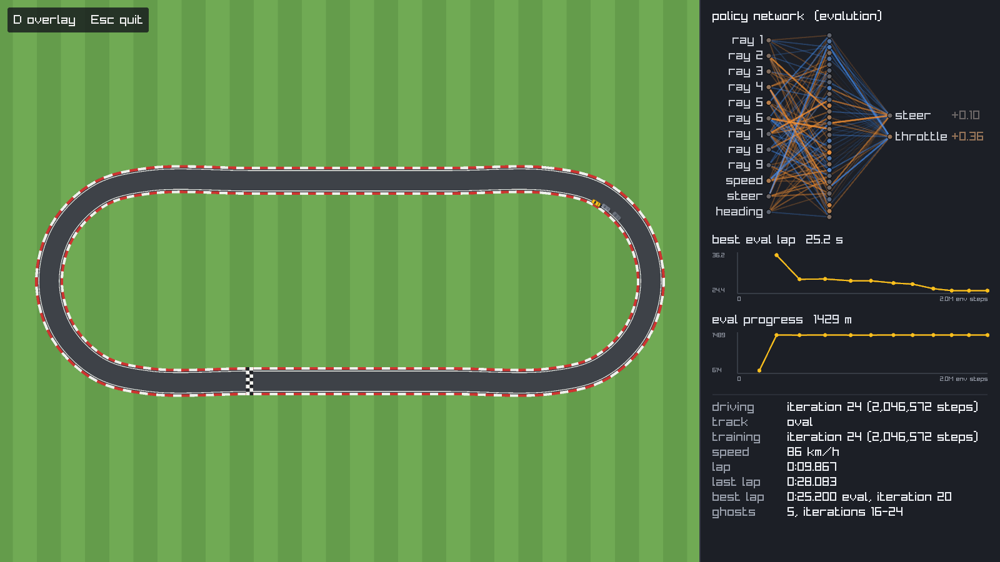
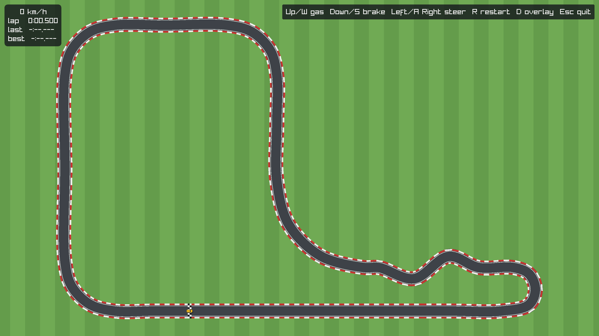

<div align="center">

# RL Racer

**Watch cars learn to race, and read every line that teaches them.**

[Quick start](#quick-start) · [Lessons](#lessons) · [Project layout](#project-layout)



</div>

A top-down 2D racing game in Python where cars start out crashing into walls and learn, lap by
lap, to drive clean and fast. Every learning method is written from scratch and kept readable,
and a lesson per stage explains the code with experiments you can run.

<p align="center">
  
  
  
  
  
  
  
</p>

- **Drive it yourself:** keyboard controls, lap timer, and a debug overlay that shows the walls,
  the centerline and the car's sensor rays.
- **A fast headless simulator:** hundreds of cars stepped together in numpy, with a Gymnasium
  interface on top.
- **Four learners from scratch:** neuroevolution (numpy), REINFORCE, A2C and PPO (PyTorch), each
  a separate file you can diff against the previous one.
- **An answer key:** Stable-Baselines3 PPO trained on the same simulator with the same settings.
- **A live viewer:** a separate window that follows a training run, with ghost cars of earlier
  best laps and the policy network drawn as it drives.

<p align="center"></p>

## Quick start

Needs [uv](https://docs.astral.sh/uv/) and a desktop for the game windows (developed on Linux).

```sh
uv sync                                    # Python 3.12, CPU PyTorch, everything else
uv run racer drive --track oval            # drive yourself; D toggles the overlay
uv run racer train evolution --set track=oval --set env_steps_budget=500000
uv run racer watch runs/evolution-<timestamp>-s0   # the directory train printed
```

That training run took 46 s on a Ryzen 7 7700X and lapped the oval in 28.45 s
([lesson 00](docs/lessons/00-overview.md#experiments)). Run the tests with `uv run pytest -q`.

## Lessons

Start at [00](docs/lessons/00-overview.md): it maps every module, shows how data flows from the
simulator to the viewer, and lists every command.

| lesson | topic |
|---|---|
| [00 · Overview](docs/lessons/00-overview.md) | project map, data flow, commands, tests |
| [01 · Track and geometry](docs/lessons/01-track-and-geometry.md) | spline, arc-length sampling, windowed projection, ray math |
| [02 · Car physics](docs/lessons/02-car-physics.md) | kinematic bicycle, grip limit, the braking problem |
| [03 · Sensors and the environment](docs/lessons/03-sensors-and-env.md) | observation, reward, terminated vs truncated, batching |
| [04 · Neural nets and neuroevolution](docs/lessons/04-neural-nets-and-evolution.md) | the MLP forward pass, a population of networks, selection and mutation with no gradients |
| [05 · REINFORCE](docs/lessons/05-reinforce.md) | the policy gradient derived, reward-to-go, why plain REINFORCE is noisy |
| [06 · A2C](docs/lessons/06-a2c.md) | a critic as baseline, n-step bootstrapping, the truncation fix |
| [07 · PPO vs Stable-Baselines3](docs/lessons/07-ppo.md) | trust regions, the clipped objective, GAE derived, our PPO checked against SB3's |
| [08 · Fastest lap](docs/lessons/08-fastest-lap.md) | reward shaping, the fixed-horizon time-cost trap, why a bigger time cost made evolution and PPO slower |
| 09 · Generalization to random tracks | coming |
| 10 · Results | coming |

## Project layout

| path | what is there |
|---|---|
| [`racer/`](racer) | the simulator (`track`, `car`, `sim`, `geometry`), Gymnasium wrapper, run logging, `drive` and `watch` |
| [`racer/algos/`](racer/algos) | one file per learning method: `evolution`, `reinforce`, `a2c`, `ppo`, `sb3_ppo` |
| [`racer/render/`](racer/render) | raylib drawing: camera, track, cars, overlay, network panel, curves |
| [`configs/`](configs) | `env.toml` for physics, sensors and reward; one TOML per method; step budgets |
| [`tracks/`](tracks) | `oval.json` and `twisty.json`: control points, width, start line |
| [`tests/`](tests) | pytest suite; the tests double as documentation of key behaviours |
| [`docs/lessons/`](docs/lessons) | the lessons, plus the measurement scripts they quote |
| `runs/` | training output (git-ignored): config, metrics, checkpoints, ghost laps |
