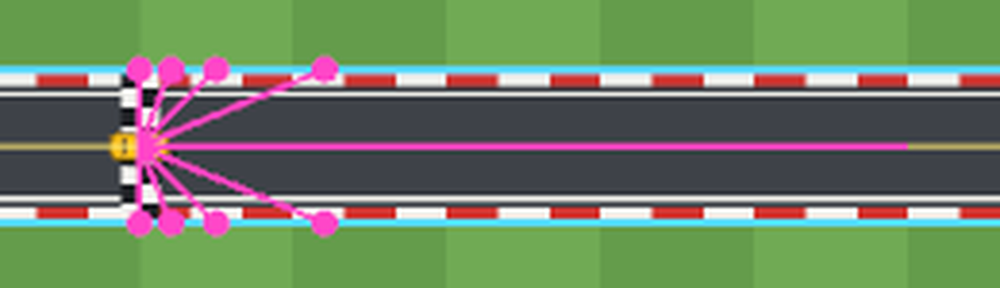
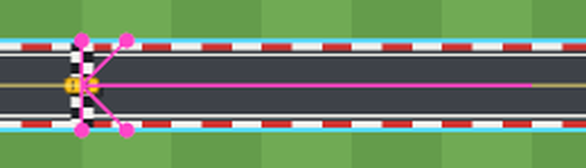

# 01 · Track and geometry

Everything in the simulator stands on the track. The walls decide when a car crashes and what
its distance sensors read. The centerline decides how much progress a car made, which is the
main reward and the lap counter. This lesson covers how a handful of control points in a JSON
file become those things, and the two pieces of 2D geometry that run every physics step: "where
does this ray hit a wall?" and "does this edge cross a wall?"

Files: [`racer/track.py`](../../racer/track.py), [`racer/geometry.py`](../../racer/geometry.py),
[`tests/test_track.py`](../../tests/test_track.py), [`tests/test_geometry.py`](../../tests/test_geometry.py).

## The track file

A track file lists a few control points in driving order, the road width and which control
point the start line sits on. [`tracks/oval.json`](../../tracks/oval.json) has 20 points and a
width of 14 m; [`tracks/twisty.json`](../../tracks/twisty.json) has 33 points and a width of
12 m. Points go counter-clockwise, so cars drive counter-clockwise and the left wall is the
inside of most corners.

Nothing else is stored. Walls, sample spacing, lengths and tangents are all derived, so a new
track is just a new list of points (that is what [`racer gen-track`](../../racer/trackgen.py#L160-L171) writes).

## From points to a smooth loop: centripetal Catmull-Rom

[`catmull_rom_closed`](../../racer/track.py#L27-L62) draws a smooth closed curve that passes
through every control point. A Catmull-Rom spline builds each span between points `p1` and `p2`
from four points `p0, p1, p2, p3`, so the curve's direction at `p1` is set by its neighbours and
consecutive spans join without a kink.

Each span is parameterized by "knots" `t0 < t1 < t2 < t3`, one per point. The choice of knot
spacing is the one design decision here ([lines 42-46](../../racer/track.py#L42-L46)):

- **uniform**: every step is 1. Simple, but when a short span sits next to a long one the curve
  overshoots and can form a small loop or a cusp.
- **chordal**: each step is the distance between the points (exponent 1).
- **centripetal** (used here): each step is the *square root* of the distance (exponent 0.5).
  It has a proven guarantee (Yuksel, Schaefer and Keyser, 2011): a centripetal Catmull-Rom never
  forms a cusp or a self-intersection inside a span, however unevenly the points are spaced.

The track files have uneven spacing on purpose: twisty's control points are 75 m apart on the
main straight and 12 m apart in its tightest corners. A long span next to a short one is the
situation where uniform knots overshoot, and a loop in the centerline would make the walls cross
themselves. Centripetal knots rule that out without anyone having to check each track file.

[Lines 48-54](../../racer/track.py#L48-L54) evaluate the span with the Barry-Goldman pyramid:
blend neighbouring points linearly, then blend the blends, then blend again. Three rounds of
linear interpolation give a cubic. It looks long but each line is one lerp.
[`test_catmull_rom_passes_through_control_points`](../../tests/test_track.py#L28-L33) pins the
property that matters: the curve really goes through the points.

## Arc-length resampling

The spline parameter `t` is not distance. Evaluating 200 evenly spaced `t` values per span
gives points that bunch up on short spans and spread out on long ones. The simulator wants
samples evenly spaced in meters, because several things count in samples and assume a sample is
about 2 m:

- the projection search window, `PROJECT_HALF = 10` samples ([sim.py#L34-L39](../../racer/sim.py#L34-L39));
- the crash-check window, `CRASH_HALF = 6` samples (same lines);
- the sensor window, `ceil(ray_range / spacing) + 2` samples ([sim.py#L269-L271](../../racer/sim.py#L269-L271)).

So [lines 57-62](../../racer/track.py#L57-L62) measure the cumulative length along the dense
points and use `np.interp` to place `n_samples` points at equal arc-length steps.
[`build_track`](../../racer/track.py#L163-L189) does this twice: a first coarse pass to measure
the total length, which sets the sample count `M = round(length / spacing)`, then the real pass.
The default spacing is 2.0 m, so the oval gets 357 samples and twisty 563 (measured in
Experiment 1 below).

## Tangents, normals and walls

[Lines 180-183](../../racer/track.py#L180-L183) take the tangent at sample `i` from its two
neighbours (`center[i+1] - center[i-1]`, a central difference, smoother than a one-sided
difference) and rotate it +90 degrees to get the normal, which points to the driver's left.
The walls are the centerline pushed half a road width along the normal
([lines 185-189](../../racer/track.py#L185-L189)):

```
left  = center + normal * width / 2
right = center - normal * width / 2
```

Wall segment `i` runs from sample `i` to sample `i + 1`, so each wall is a closed polyline of
`M` segments. One thing can go wrong: in a corner whose radius is smaller than `width / 2`, the
inner wall folds over itself. The shipped tracks avoid that by construction, and generated
tracks are rejected unless every corner radius is at least `width / 2 + 3 m`
([`track_is_valid`](../../racer/trackgen.py#L97-L110)).

[`wall_window`](../../racer/track.py#L84-L97) returns only the wall segments near a car
(samples `idx - half .. idx + half` of both walls). Every sensor and crash check uses it: a
car cannot touch a wall 100 m away, so there is no point testing it.

## Projection: where is the car along the track?

Progress reward, lap counting and wrong-way detection all need one number per car: its arc
length `s` along the centerline. [`Track.project`](../../racer/track.py#L99-L137) computes it in
two steps.

1. **Nearest sample, searched in a window** ([lines 117-121](../../racer/track.py#L117-L121)).
   Only samples within `hint ± half` are candidates, where `hint` is the car's index from the
   previous physics step.
2. **Project onto the neighbouring segments** ([lines 123-136](../../racer/track.py#L123-L136)).
   The car's position is projected onto the segment before and the segment after that sample;
   the closer one wins and `s = cum_len[start] + frac * segment_length`. Using the segment
   instead of the sample's own `s` makes progress continuous instead of jumping in 2 m steps
   ([`test_project_is_continuous_between_samples`](../../tests/test_track.py#L51-L56)).

### Why the search is windowed

A global search ("nearest sample anywhere on the track") breaks where two parts of the track
pass close to each other. Picture a hairpin: two straights side by side.

```
   far straight   <-------------------------------   centerline at y = 14
                  ===============================    its right wall, y = 8
                         (2 m of grass)
                  ===============================    near straight's left wall, y = 6
   near straight  ------------------------------->   centerline at y = 0   car driving here
```

Take the point `y = 8`: past the near road's left wall (y = 6) and across the grass, on the far
road's edge. It is 8 m from the near centerline but only 6 m from the far one. A global search
would say the car is on the far straight, 100 to 180 m away along the lap depending on where
along the straight it is. The simulator turns a change in `s` into progress with a wrap rule
([sim.py#L200-L201](../../racer/sim.py#L200-L201)): any step is read as the shorter way round the
loop, so that crossing `s = 0` is a small step forward. On this 283.8 m track half a lap is
141.9 m, which gives two different failures:

- a jump of less than half a lap is paid as progress: +10 reward in one step at `x = 80`,
  more than a lap bonus, for nothing. A policy can learn to hunt for that;
- a jump of more than half a lap reads as driving backwards: −10 reward, and the episode
  ends by the wrong-way rule (more than 15 m backwards), although the car did nothing wrong.

[`test_projection_search_is_windowed`](../../tests/test_track.py#L106-L123) builds
exactly this track, checks that the windowed search stays on the near straight, and also checks
that a global search really does jump (so the test cannot pass by accident).
[`test_projection_does_not_jump_hairpin`](../../tests/test_track.py#L89-L103) drives a car down
the inside of the same track and asserts no step ever jumps.

The window is safe because a car cannot outrun it. At the 50 m/s speed cap a car moves 0.83 m
per physics step, and the window reaches 10 samples (about 20 m) either way
([sim.py#L34-L36](../../racer/sim.py#L34-L36)).

When does the jump actually happen? A car `d` meters left of its own centerline, with the other
section's centerline `gap` meters away, is closer to the other one when `d > gap / 2`. A car on
the asphalt has `d < width / 2`, so a global search only fails when sections come closer than
one road width, or for a point off its own road, like the `y = 8` point on the far road's edge.
The shipped
and generated tracks keep sections further apart than that, so on them a car on the road is
always nearest its own stretch. The window turns that from "true for these track files" into "true
for any track file", and it is also far cheaper: 21 candidates instead of 563 on twisty, measured
at 254 µs against 5,063 µs per call for 256 cars (Experiment 3).

### A caveat: progress off the centerline

Projecting onto a polyline (straight segments) instead of the smooth curve has a side effect
that the docstring documents ([lines 111-115](../../racer/track.py#L111-L115)). In a corner
the two segments at a sample meet at a small angle, about `spacing / R` for corner radius `R`.

- A car on the **inside** of the corner, `d` meters from the centerline, has a foot on the
  earlier segment slightly before the sample and a foot on the later segment slightly after it.
  When the car crosses the line that bisects the angle, the closer segment switches and `s`
  jumps forward by about `d * spacing / R`.
- A car on the **outside** has both feet beyond the segments' ends; both clip to the sample, so
  `s` stays put for a short stretch (a plateau) and then catches up.

The total over a stretch is exact, because every jump is paid for by slower progress around it.
So summed progress, lap counting and episode returns are correct; only the per-step progress is
a little uneven off the centerline. Experiment 1 measures how uneven.

## Ray-segment intersection

Every decision, each car casts `n_rays` rays (9 by default) and reads the distance to the first
wall each one hits. [`ray_distances`](../../racer/geometry.py#L38-L63) does this for all cars,
rays and nearby wall segments in one numpy expression. The derivation is in the module
docstring ([lines 8-16](../../racer/geometry.py#L8-L16)); here it is in full.

A ray starts at `o` and points along the unit vector `d`; points on it are `o + t d` with
`t >= 0`, and because `d` has length 1, `t` is the distance in meters. A wall segment runs from
`a` to `b`; with `s = b - a`, its points are `a + u s` with `0 <= u <= 1`. They meet where

```
o + t d = a + u s        which rearranges to        t d - u s = a - o
```

That is two equations (x and y) in two unknowns. The 2D cross product
`cross(p, q) = p.x * q.y - p.y * q.x` solves it neatly because `cross(q, q) = 0` and
`cross(p, q) = -cross(q, p)`.

Cross both sides with `s` on the right. The `u` term vanishes:

```
t cross(d, s) - u cross(s, s) = cross(a - o, s)
t = cross(a - o, s) / cross(d, s)
```

Cross both sides with `d` on the right. Now the `t` term vanishes:

```
t cross(d, d) - u cross(s, d) = cross(a - o, d)
u = cross(a - o, d) / -cross(s, d) = cross(a - o, d) / cross(d, s)
```

The hit is real when `t >= 0` (in front of the car, not behind it) and `0 <= u <= 1` (on the
segment, not on the infinite line through it). That is
[line 61](../../racer/geometry.py#L61). The distance is the smallest `t` over all segments,
capped at `ray_range` (60 m), which also stands for "nothing hit".

The denominator `cross(d, s) = |d| |s| sin(angle)` is zero when the ray and the wall are
parallel. Then there is no single intersection, so those pairs are masked as "no hit"
(`PARALLEL_EPS`, [lines 55-56](../../racer/geometry.py#L55-L56)) and the division is guarded so
numpy never divides by zero ([`_safe_divide`](../../racer/geometry.py#L30-L35)). This matters
more than it looks: a single NaN or inf in an observation spreads through the network's
weights and silently ruins a training run.
[`test_parallel_and_collinear_rays_are_finite`](../../tests/test_geometry.py#L41-L50) pins it,
with warnings turned into errors.

The shapes do the batching ([lines 50-53](../../racer/geometry.py#L50-L53)): origins become
`(N,1,1,2)`, ray directions `(N,R,1,2)`, wall segments `(N,1,K,2)`, and numpy broadcasting
produces every car-ray-segment combination as an `(N,R,K)` array. With 256 cars, 9 rays and the
130 wall segments in twisty's sensor window (`2 walls × (2 × 32 + 1)` samples at 2 m spacing),
that is about 300,000 intersection tests per decision with no Python loop.

## Crossing test: how a crash is detected

A crash is "any edge of the car's rectangle crosses a wall segment"
([sim.py#L216-L218](../../racer/sim.py#L216-L218)). [`any_crossing`](../../racer/geometry.py#L66-L87)
uses the same algebra with segments on both sides: edge `p + t r` with `0 <= t <= 1`, wall
`q + u s` with `0 <= u <= 1`:

```
t = cross(q - p, s) / cross(r, s)        u = cross(q - p, r) / cross(r, s)
```

and the pair crosses when both parameters land in `[0, 1]`
([line 86](../../racer/geometry.py#L86)). Both intervals are closed, so touching counts
([`test_touching_endpoints_count_as_crossing`](../../tests/test_geometry.py#L75-L78)).

Why edges and not "distance from the centerline > width / 2"? Because the car is a 4.5 m by 2 m
rectangle that can sit at an angle. A centerline-distance test would let a car whose nose is
already over the wall carry on as long as its center is inside. Edge crossing uses the real
shape and the real walls, exactly as the overlay draws them.

The check runs every physics substep, not once per decision. A car moves at most 0.83 m per
substep, much less than its own width, so it cannot jump clean over a wall between two checks.

## What to look for in the viewer

Run `uv run racer drive --overlay` (or press `D` in drive or watch):

- **cyan lines** are the two wall polylines, the exact segments the crash check and the sensors
  use. They sit on the outer edge of the red and white kerbs: the kerbs are drivable.
- **the yellow line** is the sampled centerline that progress is measured along.
- **magenta rays** fan out from the car, with a dot where each one hits a wall. A ray with no dot
  is at full range (60 m) and hit nothing. If a ray ever ended short of a wall, the sensor code
  would be wrong; the overlay draws the distances straight from `BatchSim.last_rays`, the same
  numbers the observation is built from ([overlay.py#L58-L69](../../racer/render/overlay.py#L58-L69)).
- **the progress panel** shows meters from the start line and the lap count.

## Experiments

### 1. Sample spacing: 2 m vs 8 m

**Change.** `build_track` takes a `spacing` argument (default 2.0). The script
[`docs/lessons/scripts/projection_error.py`](scripts/projection_error.py) builds both shipped
tracks at 2 m and at 8 m and compares each with a 0.25 m reference that stands in for the true
spline. It reports the largest gap between the sampled centerline and the true curve, the
largest error in progress `s`, the largest error in the progress gained over one physics substep
for a car 4 m left of the centerline, and simulator throughput with 256 cars.

**Predict.** The gap between a chord and its arc is about `spacing² / (8R)`. How much bigger
should it be at 8 m than at 2 m? Which track suffers more, the oval (corners about 50 m radius)
or twisty (tightest corner about 12 m)? And does coarser sampling make the simulator faster or
slower, and why?

**Run.**

```sh
uv run python docs/lessons/scripts/projection_error.py
```

<details><summary>What we got</summary>

Output of `docs/lessons/scripts/projection_error.py`, run 2026-11-23 on the dev machine
(Ryzen 7 7700X). All lengths in meters.

```
track   spacing samples   length  min R chord gap s err d=0 s err d=4 step err d=4 car-steps/s
oval        2.0     357   713.64   38.9     0.014     0.005     0.166        0.135      25,598
oval        8.0      89   713.34   40.1     0.213     0.088     0.582        0.714      54,908
oval        ref    2855   713.66   38.9
twisty      2.0     563  1126.42   12.0     0.051     0.030     0.393        0.488      23,968
twisty      8.0     141  1125.24   13.1     0.630     0.432     1.629        2.052      48,850
twisty      ref    4506  1126.51   11.9
```

- The chord gap grew 15× on the oval (0.014 → 0.213 m) and 12× on twisty (0.051 → 0.630 m),
  close to the 16× that `spacing²` predicts. At 8 m, twisty's walls are off by over half a meter
  in its tightest corner: a car could crash into a wall that is not where it is drawn on the
  real curve, or squeeze through where it should not.
- For a car 4 m off the centerline, the progress gained in one substep is off by up to 0.49 m on
  twisty at 2 m spacing and 2.05 m at 8 m spacing. A full substep at top speed is only 0.83 m, so
  at 8 m the per-step progress reward is mostly noise in tight corners. That is the off-centerline
  caveat above, `d × spacing / R`, scaled by 4 when the spacing is.
- Coarser is about twice as fast (25.6k → 54.9k car-steps/s on the oval). Not because of
  projection, which always searches 21 samples, but because the sensor window covers
  `ray_range / spacing + 2` samples each way: every ray tests 130 wall segments on twisty at
  2 m spacing (134 on the oval), and 42 at 8 m.
- `min R` changes too (38.9 → 40.1 m on the oval, 12.0 → 13.1 m on twisty): coarse sampling
  softens the tightest corners. The oval's control points sit on 50 m circles, but the spline
  through them wobbles; its tightest point is 38.9 m.

2 m keeps every error well under the car's own size at half the speed of 8 m. That trade is why
2.0 is the default.

</details>

### 2. Ray count in the overlay

**Change.** In [`configs/env.toml`](../../configs/env.toml) set `n_rays = 5` (default 9).
`racer drive` reads that file, so the overlay shows the new fan.

**Predict.** The spread stays 180 degrees. What angle separates neighbouring rays with 5 rays,
and with 9? Which rays will hit the walls on a straight, and which will reach 60 m?

**Run.**

```sh
uv run racer drive --overlay
```

Then put `n_rays = 9` back. (The screenshots below were taken with
`racer drive --overlay --screenshot PATH`, which renders 30 frames, saves a PNG and exits.)

<details><summary>What we got</summary>

Screenshots from `uv run racer drive --overlay --screenshot ...` on twisty, car at rest on the
start line, cropped around the car and enlarged 4×. Files:
[`docs/img/overlay-9-rays.png`](../img/overlay-9-rays.png),
[`docs/img/overlay-5-rays.png`](../img/overlay-5-rays.png).

9 rays (default), 22.5 degrees apart:



5 rays, 45 degrees apart:



In both, the rays pointing straight sideways hit the walls 6 m away (half of twisty's 12 m width),
and the forward ray runs the full 60 m with no dot. The 9-ray fan has three rays per side between
"sideways" and "straight ahead"; the 5-ray fan has one. A corner that starts 30 m ahead shows up
first in those diagonal rays, so fewer rays means coarser warning of a turn. Lesson 04 trains
with 5 rays to see whether that matters.

</details>

### 3. What would a global search do?

**Change.** Nothing in the simulator. The script
[`docs/lessons/scripts/hairpin_jump.py`](scripts/hairpin_jump.py) builds the hairpin from the
tests and projects points along the near straight twice: with the window (as `BatchSim` does)
and with `half = M // 2`, which makes every sample a candidate. It then passes the global answer
through the simulator's own progress rule (the wrapped `ds` of
[sim.py#L200-L201](../../racer/sim.py#L200-L201)), as if the car had been at the windowed `s` one
substep earlier, and says what the simulator would do with it. It also times both searches for
256 cars on twisty.

**Predict.** For a point on the centerline (`y = 0`), near the left wall (`y = 5`) and on the
far road's edge (`y = 8`): where does the global search jump? After the simulator wraps the step
to the shorter way round a 283.8 m loop, which jumps become a reward and which become a
wrong-way ending? How much slower is searching 563 samples instead of 21?

**Run.**

```sh
uv run python docs/lessons/scripts/hairpin_jump.py
```

<details><summary>What we got</summary>

Output of `docs/lessons/scripts/hairpin_jump.py`, re-run 2026-11-23 after it was changed to apply
the simulator's wrap:

```
hairpin track: length 283.8 m (half a lap 141.9 m), 142 samples, spacing 2.00 m
    x    y  windowed s  global s   sim ds  reward  outcome
   40    0        40.0      40.0     +0.0    +0.0  no jump
   60    0        60.0      60.0     +0.0    +0.0  no jump
   80    0        80.0      80.0     +0.0    +0.0  no jump
   40    5        40.0      40.0     +0.0    +0.0  no jump
   60    5        60.0      60.0     +0.0    +0.0  no jump
   80    5        80.0      80.0     +0.0    +0.0  no jump
   40    8        40.0     221.9   -101.9   -10.2  fake wrong-way ending (> 15 m backwards)
   60    8        60.0     201.9   -141.9   -14.2  fake wrong-way ending (> 15 m backwards)
   80    8        80.0     181.9   +101.9   +10.2  fake progress reward

project() for 256 cars on twisty (563 samples):
  windowed (half = 10, 21 candidates):      254 us per call
  global (half = 281, 563 candidates):     5063 us per call
```

On the road (`y = 0` and `y = 5`) both searches agree: here the gap between the straights'
centerlines (14 m) is more than one road width (12 m), so a car on the asphalt is always
nearest its own straight. At `y = 8`, on the far road's edge, the global search jumps 100 to 180 m
along the lap, and what that does depends on the wrap:

- at `x = 80` the jump (101.9 m) is less than half a lap, so the simulator pays it as progress:
  +10.2 reward in one step, more than a whole lap bonus (10);
- at `x = 40` the jump (181.9 m) is more than half a lap, so it reads as 101.9 m *backwards*:
  −10.2 reward and a wrong-way ending;
- at `x = 60` the jump is exactly half a lap (141.9 m), the edge case: the wrap rule happens to
  read it as backwards.

So a global search would hand out either a free reward or a punishment for nothing, depending on
where the car is. The windowed search never jumps, whatever the track. It is also about 20×
cheaper (254 µs against 5,063 µs; the first run of the script measured 231 against 5,287), and
projection runs every physics substep for every car.

</details>

## Tests worth reading

| test | what it pins |
|---|---|
| [`test_projection_search_is_windowed`](../../tests/test_track.py#L106-L123) | the window stops a jump that a global search makes |
| [`test_projection_does_not_jump_hairpin`](../../tests/test_track.py#L89-L103) | driving the inside of a hairpin never jumps progress |
| [`test_project_wraps_across_start_line`](../../tests/test_track.py#L59-L65) | crossing `s = 0` is a small step, not `-length` |
| [`test_parallel_and_collinear_rays_are_finite`](../../tests/test_geometry.py#L41-L50) | no NaN or inf from parallel rays |
| [`test_ray_passing_beside_segment_end_misses`](../../tests/test_geometry.py#L29-L32) | the `0 <= u <= 1` check |
| [`test_lines_intersect_but_p_stops_short`](../../tests/test_geometry.py#L92-L96) | the `0 <= t <= 1` check for crossings |

Next: [02 · Car physics](02-car-physics.md).
