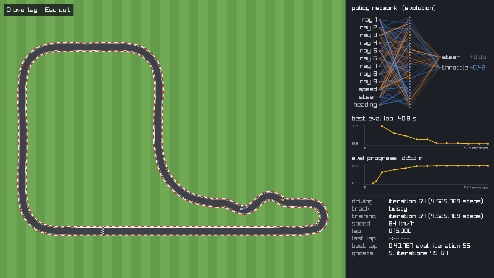

# 04 · Neural nets and neuroevolution

Lessons 01-03 built a world. From here on, something learns to drive in it. A *policy* is a
function from the 12-number observation to the 2-number action `[steer, throttle]`. This lesson
makes that function a small neural network and trains it the simplest way there is: keep a
population of networks, let every one drive, keep the best, and make noisy copies of them.
There are no gradients and no loss function, only "which car got further?". It is the baseline
every later method has to beat.

Files: [`racer/nets_np.py`](../../racer/nets_np.py), [`racer/algos/evolution.py`](../../racer/algos/evolution.py),
[`configs/evolution.toml`](../../configs/evolution.toml), [`configs/budgets.md`](../../configs/budgets.md),
[`racer/evaluate.py`](../../racer/evaluate.py), [`racer/runlog.py`](../../racer/runlog.py),
[`racer/watch.py`](../../racer/watch.py), [`tests/test_nets_np.py`](../../tests/test_nets_np.py),
[`tests/test_evolution.py`](../../tests/test_evolution.py).

## The network: a multilayer perceptron

The network is a *multilayer perceptron* (MLP): a chain of layers, each one a matrix multiply,
a bias add and a squashing function. Its layer sizes are set at
[evolution.py#L119](../../racer/algos/evolution.py#L119):

```python
sizes = (obs_dim(env_cfg), *cfg.hidden, 2)   # (12, 32, 2) with the defaults
```

12 inputs (9 rays, speed, steer angle, heading error; lesson 03), one hidden layer of 32 units
(`hidden = [32]` in [`configs/evolution.toml`](../../configs/evolution.toml#L6)), 2 outputs.

One forward pass, for one observation `x` written as a row vector:

```
x          (1, 12)
W1         (12, 32)      b1  (32,)
z1 = x W1 + b1           (1, 32)     pre-activation of the hidden layer
h  = tanh(z1)            (1, 32)     the hidden layer
W2         (32, 2)       b2  (2,)
z2 = h W2 + b2           (1, 2)
y  = tanh(z2)            (1, 2)      = [steer, throttle]
```

Written for a single hidden unit `j`, the first layer is `h_j = tanh(Σ_i x_i · W1[i, j] + b1[j])`:
a weighted vote over the 12 inputs, plus an offset, squashed. Unit `j` "fires" (goes towards +1)
when the inputs it weighs positively are large and the ones it weighs negatively are small. Each
output is the same thing one level up: a weighted vote over the 32 hidden units. That is all a
network is. [`forward_population`](../../racer/nets_np.py#L55-L66) is these two lines in a loop,
and [`test_forward_matches_manual_single`](../../tests/test_nets_np.py#L21-L29) checks it against
`tanh(tanh(x @ w1 + b1) @ w2 + b2)` written out by hand.

**Why tanh, and why a hidden layer at all?** `tanh(z) = (e^z - e^-z) / (e^z + e^-z)` is close to
`z` near zero and flattens out to ±1 for large `|z|`. Without it, the two layers would collapse
into one: `(x W1 + b1) W2 + b2 = x (W1 W2) + (b1 W2 + b2)`, a single linear map, and the whole
network would be `tanh(x W + b)`. In that network each input pushes each action in one fixed
direction, whatever the other inputs say: if a weight makes speed lower the throttle, more speed
lowers it on an empty straight just as before a hairpin. Good driving needs inputs that matter
only in combination: speed should cut the throttle when the forward ray is short, and not when it
is long. The hidden layer makes that possible. Each hidden unit is a soft switch that turns on in
some region of the input space, and the output layer combines the switches, so the effect of one
input can depend on all the others. More hidden units, more switches.

**Why tanh on the outputs too.** Every action is a number in [-1, 1] (lesson 02), and tanh's
range is exactly (-1, 1). So the output *is* the action: `y[0]` is the steering command,
`y[1]` the throttle (negative brakes), with no scaling or clipping step in between. The policy is
also deterministic: the same observation always gives the same action. The gradient methods in
lessons 05-07 need random actions to learn; evolution does not, because its randomness lives in
the weights instead (below).

**Counting parameters.** Layer 1 has `12 × 32` weights and 32 biases, layer 2 has `32 × 2` and
2: `384 + 32 + 64 + 2 = 482` numbers ([`genome_size`](../../racer/nets_np.py#L21-L23)). That is the
whole driver.

**Starting weights.** [`init_population`](../../racer/nets_np.py#L26-L39) draws every weight
from a normal distribution with standard deviation `sqrt(2 / (n_in + n_out))` (Xavier scaling):
0.213 for the 12 × 32 layer, 0.243 for the 32 × 2 layer. Biases start at zero. With inputs of
about unit size (lesson 03 scales them), that keeps `z` small enough that the tanh units are in
their sensitive middle range. With much larger weights the units would sit at ±1 like on/off
switches, where a small change to a weight changes nothing at all, and mutation would have nothing
smooth to work with.

### A forward pass by hand

[`docs/lessons/scripts/forward_pass.py`](scripts/forward_pass.py) loads the trained network
of a run, gives it the start-line observation on twisty from lesson 03, and computes each layer
step by step:

```
uv run python docs/lessons/scripts/forward_pass.py runs/evolution-20261123-200006-s0

evolution-20261123-200006-s0: checkpoint from generation 64, layer sizes (12, 32, 2)
genome: 482 numbers (genome_size says 482)
  W 12x32: genome[0:384]   b 32: genome[384:416]
  W 32x2: genome[416:480]   b 2: genome[480:482]

input x (1, 12): [0.1   0.108 0.141 0.261 1.    0.261 0.141 0.108 0.1   0.    0.    0.   ]
layer 1: z = h @ W + b  (1, 32); tanh(z)
  tanh z: min -0.935, max +0.914, 0 of 32 units saturated (|tanh| > 0.95)
layer 2: z = h @ W + b  (1, 2); tanh(z)
  z      = [-0.476  3.746]
  tanh z = [-0.443  0.999]   <- [steer, throttle]
forward_population gives [-0.443  0.999] (max difference 7.2e-16)

8 mutated copies, same observation: batched == loop over cars: True
  car 0: steer -0.634  throttle +1.000
  car 1: steer -0.789  throttle +0.998
  car 2: steer +0.425  throttle +0.996
  car 3: steer -0.764  throttle +0.999
  car 4: steer +0.076  throttle +0.991
  car 5: steer -0.870  throttle +0.994
  car 6: steer -0.355  throttle +1.000
  car 7: steer -0.791  throttle +0.998
```

The 12 inputs are the lesson 03 start-line observation (sideways rays 0.100, the forward ray 1.0,
the car at rest). The network is seed 0's final one
(generation 64 of the main run below). The hidden units spread between -0.94 and +0.91, none pinned at
±1, so all 32 still respond to their inputs. The throttle output's pre-activation is 3.75, deep in
tanh's flat region: `tanh(3.75) = 0.999`, full throttle off the line, as it should be. The steer
output is -0.44 (+1 is full left, lesson 02), a moderate turn to the right. That is the wheel
*command*; the steer-rate limit turns the wheel only gradually, and the car turns at all only once
it is moving. Hand computation and `forward_population` agree to within rounding (7.2e-16).

## The genome: a whole network as one flat vector

Evolution never looks *inside* a network. It needs to copy a driver and to make a slightly
different one. So each network is stored as one flat vector of 482 numbers, its *genome*. The
layout is in the [module docstring](../../racer/nets_np.py#L8-L11): for each layer, its weight
matrix flattened row by row, then its bias. For `(12, 32, 2)`:

| slice of the genome | what it is |
|---|---|
| `[0:384]` | `W1`, 12 × 32 |
| `[384:416]` | `b1`, 32 |
| `[416:480]` | `W2`, 32 × 2 |
| `[480:482]` | `b2`, 2 |

A population is a `(P, 482)` array, one row per car. [`unflatten`](../../racer/nets_np.py#L42-L52)
cuts it into per-layer views `W (P, n_in, n_out)` and `b (P, n_out)` with `reshape`, which copies
nothing: the views read the same memory as the genome. In return, the genetic operators become
one line each: copying a driver is copying a row, and mutating it is adding a noise vector to the
row.

## 128 networks in one call

Every car drives with *its own* network. A normal batched layer, where all rows share one weight
matrix, is `x @ W` with `x (P, in)` and `W (in, out)`. Here the weights carry a population axis
too, `W (P, in, out)`, and row `p` of `x` must meet only matrix `p`.
[Line 64](../../racer/nets_np.py#L64) does that with

```python
x = np.tanh(np.einsum("pi,pio->po", x, w) + b)
```

`einsum` reads its subscripts as loops: for every `p` and `o`, sum over `i` of
`x[p, i] · w[p, i, o]`. The index `p` appears in both inputs and in the output, so it is *not*
summed: it pairs car `p`'s observation with car `p`'s weights. The index `i` is missing from the
output, so it is summed over: that is the matrix-vector product. It computes the same thing as
`[x[p] @ w[p] for p in range(P)]`, without a Python loop. Lesson 03 showed why that matters: one
numpy call for 128 cars costs far less than 128 calls.

The last lines of the script check it: eight mutated copies of the network, all given the same
observation, produce eight different actions, and the batched call matches a loop over cars.
[`test_population_members_independent`](../../tests/test_nets_np.py#L32-L41) pins the same
property: changing genome 1 changes car 1's output and no other.

## Learning without gradients

Call the 482 numbers `θ`. Driving one episode with network `θ` and adding up the rewards gives
one number, the *fitness*

```
F(θ) = r_0 + r_1 + ... + r_{T-1}       (the episode return, undiscounted)
```

and the goal is a `θ` with large `F`. If `F` were a smooth formula in `θ`, the obvious tool would
be its gradient: move `θ` a little in the direction `∂F/∂θ`. But `F` is the output of a
simulation. A crash is an on/off event (one step the car is on the road, the next it is not, and
it loses 10 reward and every future step), laps are counted, and the path from a weight to the
return runs through 1,350 steps of geometry and wall tests. There is no useful derivative to take,
and the simulator was not written to provide one.

Evolution does not need one. It only ever *compares* fitness values: is this genome better than
that one? That makes `F` a *black box*: put a genome in, run an episode, read off a number.
This family of methods is called black-box or zeroth-order optimization (it uses values of `F`,
no first derivatives). The price is samples: every value of `F` costs a whole episode, and the
search learns nothing about *why* a genome scored well, only that it did. The gradient methods
in lessons 05-07 get around the non-differentiable simulator differently (by making the actions
random and differentiating their probabilities), and in exchange get a direction to move in from
every step of experience, not one number per episode.

One property of this setup makes the search easier than it could be: `F` is deterministic. Every
car starts on the same start line (`random_start = false`), and the network has no randomness, so
the same genome always earns exactly the same return in training (the evaluation episode can
differ, occasionally by a lot; see step 3 below). A surviving elite scores the same next
generation as this one, so the best fitness can never go down
([`test_elites_survive`](../../tests/test_evolution.py#L39-L43)). In lesson 09, where every
episode is a different random track, fitness becomes noisy and that guarantee goes away.

## One generation, line by line

[`train_evolution`](../../racer/algos/evolution.py#L114-L161) loops over generations until the
budget is spent. Each generation:

**1. Every car drives one episode.** [`run_generation`](../../racer/algos/evolution.py#L84-L98):

```python
obs = sim.reset()                       # all P cars on the start line
while sim.alive.any():
    env_steps += int(sim.alive.sum())   # only cars still driving count
    result = sim.step(forward_population(genomes, sizes, obs))
    fitness += result.reward
    obs = result.obs
```

The simulator is built with `auto_reset=False` ([line 120](../../racer/algos/evolution.py#L120)):
a car that crashes, times out or finishes its two laps freezes and earns 0 from then on, so
`fitness` ends up as each car's episode return. The generation ends when the last car stops.
`env_steps` counts only the cars still driving, so a crashed car frozen on the track costs
nothing in the budget ([`test_env_steps_excludes_frozen_cars`](../../tests/test_evolution.py#L72-L93)).
So a generation costs the sum of its 128 episode lengths, anywhere up to `128 × 1,350 = 172,800`
steps when every car drives the full 90 s, and that cost moves as the population changes. In seed
0's main run (per-generation differences of `env_steps` in its `metrics.csv`), generation 1 cost
111,124 steps. [`docs/lessons/scripts/first_generation.py`](scripts/first_generation.py) rebuilds
that generation and shows why: 78 of the 128 random networks drove the full 1,350 decisions, 66
of them moving less than 5 m. They brake from the start and sit on the line until the time limit,
using 95% of the generation's steps and scoring about -13.5 (1,350 decisions × 0.01 time cost, the
script prints -13.06 for the best of them). Selection removes them fast, and
by generation 7 a generation cost 17,767 steps, an average of 139 decisions (9 s) per car: most
cars now moved, and crashed early. As cars learned
to survive, the cost climbed back: from generation 15 to the end it stayed between 64,950 and
91,397 steps per generation.

**2. Selection and mutation.** [`next_generation`](../../racer/algos/evolution.py#L101-L108):

```python
elites   = genomes[np.argsort(fitness)[::-1][:n_elite]]           # the best 16, best first
parents  = elites[rng.integers(n_elite, size=pop - n_elite)]      # 112 picks, uniform, with repeats
children = parents + rng.normal(0.0, mutation_std, size=parents.shape)
return np.concatenate([elites, children])
```

- **Truncation selection.** Rank by fitness and keep the top `elite` (16 of 128, the top eighth).
  Everything below the cut is discarded, however close it came. Every survivor is equally likely
  to be a parent; rank among the 16 does not matter.
- **Elitism.** The survivors go into the next generation *unchanged*. Without that, a lucky
  driver could be lost to a bad mutation, and the best score could go backwards.
- **Gaussian mutation.** Each of the 112 children is a copy of a random elite with independent
  noise of standard deviation `mutation_std = 0.1` added to all 482 numbers. There is no
  crossover (mixing the genomes of two parents), which keeps the algorithm small. A common
  argument against crossover for networks: hidden unit 5 of one parent and unit 5 of another need
  not compute anything similar, so splicing them together tends to break both.

In the evolution-strategies literature this scheme is a (μ + λ) strategy with μ = 16 parents and
λ = 112 children: survivors and children compete together. Nothing in it knows anything about
driving; all the improvement comes from selection keeping what worked.

How big is a mutation of 0.1? The starting weights have a spread (standard deviation) of about
0.2, so early on every child moves every weight by about half of that spread, all at once.
Training grows the weights: in seed 0's final network the spread is 0.545 for `W1` and 0.628 for
`W2` (computed from its `latest.pt`), so late in training 0.1 is a smaller nudge, about a fifth of
the spread, but still applied to all 482 numbers at once. The forward-pass script above shows
the effect: eight mutants of one trained network, given the same observation, steer anywhere from
-0.87 to +0.43 (the parent: -0.44), while their throttle stays above 0.99. The throttle output sits
deep in tanh's flat region, so nudging its weights barely moves it; the steer output is in the
sensitive middle and swings. Most such children are worse than their parent, and that is expected:
a few better ones per generation are enough. Experiment 1 changes this number.

**3. Evaluate and checkpoint, every `eval_every` = 5 generations and on the last one**
([lines 143-157](../../racer/algos/evolution.py#L143-L157)). The best genome of the generation
drives one episode in [`evaluate`](../../racer/evaluate.py#L28-L61), its checkpoint is saved, and if
it completed a lap, so is its fastest lap as a ghost.

The evaluation drives the same genome from the same start line, so you might expect
`eval_return` to equal `best_fitness` on the same row. Usually the two are very close, but
not always. Training runs the network through `einsum` in `forward_population`; evaluation runs it
through `x @ w` in [`EvolutionPolicy.act`](../../racer/algos/evolution.py#L52-L62). The two add
the same products in a different order, so their actions can differ in the last few bits: on
the start-line observation, the 14 final networks of this lesson's runs give differences from 0
(three of them) up to 7.2e-16 (`forward_pass.py`'s "max difference", above, run on each).
Over a 1,350-decision episode that difference can grow: a car that just grazed a wall in one
episode just misses it in the other. An elite that survives a plateau is evaluated again every
fifth generation, so counting rows would count the same genome many times.
[`docs/lessons/scripts/eval_vs_fitness.py`](scripts/eval_vs_fitness.py) counts each genome once
per run directory (two evaluation rows of a run are the same genome when their checkpoints hold
identical weights) and keeps the largest difference per genome. Over the 14 runs in this lesson:

```
uv run python docs/lessons/scripts/eval_vs_fitness.py runs/evolution-20261123-20*
# the glob selects exactly this lesson's 14 runs: the three main runs (200006-200010) and the
# experiments' eleven (200843-200848, 201529-201533, 203500, 203501)

14 runs, 131 distinct evaluated genomes (counted per run)
  |training - evaluation| <= 0.005: 120
  |training - evaluation| <= 0.1:   128
  > 0.1:   0.63  evolution-20261123-201532-s1
  > 0.1:   1.77  evolution-20261123-201532-s1
  > 0.1:  11.98  evolution-20261123-200845-s0
```

So most genomes match closely (seed 0's final network: 232.74 in training, 232.68 in
evaluation), and the three that do not are all from experiment 1's two `mutation_std = 0.5`
runs. The worst is in
`runs/evolution-20261123-200845-s0`: from generation 12 on, its best genome earned 129.48 in
training and 141.45 in evaluation. Every number this lesson quotes for laps and lap
times comes from the evaluation columns.

## Why fitness is the episode return

The fitness is the plain sum of the environment's reward ([sim.py#L225-L226](../../racer/sim.py#L225-L226)),
nothing evolution-specific. Every other method in the project maximizes (a discounted version of)
the same reward. That is deliberate. Evolution could have used a hand-made fitness, say
`1000 × laps - lap time`, and might even learn faster with it. But then a comparison with PPO
would mix two things: a different algorithm *and* a different objective, and you could not tell
which made the difference. With the same reward, the same budget and the same evaluation, the only
thing left that differs is the learning method.

The other two pieces of that fairness:

- **The same budget, counted the same way.** `env_steps_budget = 4_500_000` in
  [`configs/evolution.toml`](../../configs/evolution.toml#L11), as for every method on twisty
  ([`configs/budgets.md`](../../configs/budgets.md)). It counts car-decisions, so 128 cars driving
  for 10 decisions cost 1,280, exactly as 1,280 decisions of PPO's 16 cars would. The budget is
  checked between generations, so a run overshoots by part of a generation.
- **The same evaluation.** [`evaluate`](../../racer/evaluate.py#L28-L61) drives one car from the
  start line with the policy's deterministic action until the episode ends, and reports return,
  progress, laps and the fastest lap. Every method's numbers in these lessons come from it.

## What a run writes

`racer train` creates a run directory ([runlog.py#L6-L10](../../racer/runlog.py#L6-L10)):

```
runs/evolution-<YYYYmmdd-HHMMSS>-s<seed>/
    config.json          method + env settings the run used
    metrics.csv          one row per generation
    checkpoints/         ckpt_00005.pt, ckpt_00010.pt, ... and latest.pt
    ghosts/              ghost_00005.npz, ...: the evaluation's fastest lap, when it lapped
```

The `metrics.csv` columns ([`METRIC_COLUMNS`](../../racer/runlog.py#L29-L30), plus evolution's
[`best_fitness`](../../racer/algos/evolution.py#L30)):

| column | for evolution |
|---|---|
| `iteration` | generation number |
| `env_steps` | car-decisions used so far, all generations together |
| `wall_time_s` | seconds since training started |
| `train_return_mean` | mean fitness of the whole population this generation. Mostly mutants, so it sits far below the best |
| `eval_return` | return of the deterministic evaluation of this generation's best genome (empty on rows without an evaluation) |
| `eval_progress_m` | meters that evaluation drove along the track |
| `eval_laps` | laps it completed (at most 2, `max_laps`) |
| `eval_best_lap_s` | its fastest lap, seconds (empty if it did not lap) |
| `best_fitness` | the best genome's return this generation; never decreases, thanks to elitism |

A checkpoint is a dict ([lines 149-152](../../racer/algos/evolution.py#L149-L152)): the method
name, generation and step count, `obs_dim`, the layer sizes, the 482 weights, and the env config
it was trained with. The viewer and
`evaluate` turn it back into a driver through [`EvolutionPolicy`](../../racer/algos/evolution.py#L45-L74),
which runs the same forward pass for a batch of observations with one network.

The console prints one line per generation (`best` and `mean` are `best_fitness` and
`train_return_mean`) and the evaluation on every fifth.

## Watching it learn

Start the viewer on a run while it trains (in a second terminal) or after it has finished:

```sh
uv run racer watch runs/evolution-<timestamp>-s0
```

The viewer only reads the run directory, so it never slows training down. Every 3 s it re-reads
`metrics.csv` and the ghosts, and checks whether `latest.pt` has changed. A new checkpoint waits
until the live car's episode ends ([watch.py#L231-L236](../../racer/watch.py#L231-L236)), so a lap
is never driven half by one network and half by another. On screen:

- **The live car** (yellow) is the newest checkpoint driving on the run's own track and
  environment settings.
- **The network panel** (top right) draws the 12 inputs on the left, the 32 hidden units, and the
  two outputs `steer` and `throttle`. Node colour is the activation (blue negative, orange
  positive, grey near zero); edges show the 90 strongest weights per layer, coloured by sign. Watch
  the steer output swing a corner before the car turns, and the throttle node go blue (braking)
  when the forward rays shorten at speed.
- **Two curves**: the evaluation's best lap and its progress, one point per evaluation.
- **Ghosts**: faded cars replaying the fastest evaluation laps of the last 5 checkpoints that
  lapped, older ones fainter. They run on the live car's lap clock: each ghost is shown where it
  was that many seconds into *its* lap, so you can see who is ahead.

One thing to know about the ghosts. A ghost is the *fastest* lap of its evaluation. When an
evaluation drives two laps, that is usually the second one, a flying lap that crosses the start
line at speed. The live car's first lap starts from standstill. So during lap 1 such ghosts pull
ahead even when they belong to older, slower networks; compare against them on the live car's
second lap, when both are flying.

On twisty this shows up once training is far along. While a network needs more than about 45 s
per lap, only one lap fits in the 90 s episode, so its ghost is a standing-start lap like the live
car's. Seed 0's evaluations fit two laps from generation 40 on (the main runs below), and from then
on the ghosts are flying laps. [`docs/lessons/scripts/ghost_gap.py`](scripts/ghost_gap.py) drives
seed 0's final network for one evaluation episode:

```
uv run python docs/lessons/scripts/ghost_gap.py runs/evolution-20261123-200006-s0

lap 1: 43.37 s  (standing start)
lap 2: 40.77 s  (flying)
15 s into lap 1: 349.9 m;  15 s into lap 2 (the ghost): 407.3 m;  ghost ahead by 57.4 m
```

The standing start costs 2.6 s, and 15 s into the live car's first lap the ghost of *the very same
network* is 57.4 m ahead. That is the screenshot below: `racer watch` on seed 0's finished run,
900 frames (15 s) into the live car's first lap. The live car (yellow) is braking into the
chicane (throttle -0.42 in the panel); the ghosts (faint grey) are ahead of it, further into the
chicane. On the live car's second lap they run together.



Two more things the screenshot shows. The status block says the car is driving the generation 64
checkpoint while the best evaluation lap is from generation 55: `best_fitness` stayed at 232.74
from generation 53 to the end, so generations 55, 60 and 64 saved the same elite genome (their
checkpoint weights are identical), and their three ghosts are the same 40.77 s lap drawn on top of
each other. Generations 45 and 50 likewise share one genome (`best_fitness` 232.55 from generation
44 to 52) and one 41.68 s lap. So the five ghosts show up as two cars, about 6 m apart. And the
best-lap curve flattens once the evaluation fits two laps: Results explains why.

## Results: three seeds on twisty

Three main runs with the defaults ([`configs/evolution.toml`](../../configs/evolution.toml):
twisty, population 128, elite 16, `mutation_std` 0.1, 4.5M env steps), seeds 0, 1 and 2, run at
the same time on the dev machine (Ryzen 7 7700X, 16 threads), 2026-11-23:

```sh
uv run racer train evolution --seed 0     # and --seed 1, --seed 2
uv run python docs/lessons/scripts/run_summary.py runs/evolution-20261123-200006-s0 \
    runs/evolution-20261123-200008-s1 runs/evolution-20261123-200010-s2
```

| seed | run directory | first lap (evaluation) | first 2-lap evaluation | final evaluation | best lap | generations, steps, wall time |
|---|---|---|---|---|---|---|
| 0 | `runs/evolution-20261123-200006-s0` | gen 15, 649,193 steps, 112 s | gen 40, 2,646,687 steps | 2 laps, return 232.68 | **40.77 s** (gen 55) | 64, 4,525,789, 476 s |
| 1 | `runs/evolution-20261123-200008-s1` | gen 10, 669,230 steps, 75 s | gen 45, 3,767,166 steps | 2 laps, return 232.46 | **41.67 s** (gen 55) | 55, 4,568,870, 417 s |
| 2 | `runs/evolution-20261123-200010-s2` | gen 5, 383,855 steps, 37 s | gen 30, 2,560,886 steps | 2 laps, return 232.81 | **40.78 s** (gen 50) | 54, 4,513,557, 408 s |

Every seed completes clean laps: all three final evaluations drive both laps without a crash.
"First lap" is the first *evaluation* that completed one, and evaluations run every 5
generations, so a seed may have been able to lap up to four generations earlier. The best lap is
the fastest evaluation lap of the run, which for all three is also the final evaluation's.
Things worth noticing:

- **The seeds take different routes, and seed 0 shows the trap every method faces.** Seed 2
  lapped at the first evaluation, at generation 5. Seed 0 spent its first 12 generations with a
  best return between 15.6 and 38.4. [`docs/lessons/scripts/replay_checkpoint.py`](scripts/replay_checkpoint.py)
  replays its checkpoints: at generation 5 the best network drove flat out down the 250 m start
  straight, reached 39.1 m/s and crashed in the first hairpin after 285 m and 11.6 s. That is
  lesson 02's braking problem as a fitness landscape. Full throttle is the best thing to do for the
  first 250 m, and getting round the hairpin needs hard braking at the right moment *and* the
  right steering, a combination one small mutation rarely produces; a car that only lifts off a
  little reaches the same crash later and pays more time cost. By generation 10 the best car was a different kind of
  driver: at most 13.0 m/s, 498 m in the full 90 s, no crash, return 36.3. At generation 13 a
  car finally got through the corners at a useful speed (best return 38.4 → 139.7; the generation
  15 evaluation lapped in 65.67 s), and seed 0 ended tied with seed 2 for the fastest lap
  (40.767 s against 40.783 s, one physics tick of 1/60 s apart). Seed-to-seed variation is
  large: the same settings took between 383,855 and 669,230 steps to a first lap. That is why
  one or two seeds are not enough to rank settings, and why lesson 10 aggregates over seeds.
- **Lap time drops fast, then flattens.** Seed 0's evaluation lap went 65.67 → 55.65 → 52.02 →
  46.97 s at generations 15, 20, 25, 30, then 41.70 s at 40 and only 40.77 s by the end (console
  lines of the run). Lesson 02's constant-speed controller managed 82.52 s on twisty; braking
  for corners is what evolution found beyond that (the screenshot above catches it braking,
  throttle -0.42, into the chicane).
- **Why it flattens: largely because the reward stops paying for speed.** Until a network fits
  two laps in 90 s, every extra meter is worth 0.1, and return rises steeply (seed 0: 148 → 219 between generations
  15 and 30). Once it fits both laps, the episode ends at the line, and going faster only saves
  time cost: 1 s faster is 15 fewer decisions, `15 × 0.01 = 0.15` return. All three seeds end
  between 232.46 and 232.81, though their best laps differ by 0.9 s. Truncation selection uses only
  the *ranking* of fitness, so even a 0.15 difference decides who survives, and lap times keep
  creeping down. But the signal is tiny, and lesson 08 changes the reward to see what a stronger
  speed incentive does.
- **Speed.** About 9.5-11k env steps per second over a whole run (4,525,789 steps in 476 s for
  seed 0), with three runs in parallel. [`configs/budgets.md`](../../configs/budgets.md) lists
  6.9k/s, measured over the first minute; seed 0 was at 6.4k/s at 59 s (generation 8). Early
  generations are slower per counted step because the simulator still computes physics for frozen
  cars ([sim.py#L192-L196](../../racer/sim.py#L192-L196) steps everyone, then keeps the old state
  for cars that are done), and early on most cars are done long before the generation ends.

## Experiments

All three experiments use twisty with a budget of **2,000,000 env steps** instead of 4.5M, so
each run takes 2-5 minutes (`--set env_steps_budget=2000000`). Every variant in an experiment
uses that same budget, so they are comparable to each other, and to the default settings run with
the same budget:

```sh
uv run racer train evolution --set env_steps_budget=2000000
```

Seed 0 with the defaults at 2M (`runs/evolution-20261123-200843-s0`) is step for step the first
32 generations of the seed 0 main run above (same seed, same run): first lap at generation 15
(649,193 steps), final evaluation 1 lap in **46.97 s**. Seed 1 with the defaults at 2M would
likewise be the first 25 generations of `runs/evolution-20261123-200008-s1`: first lap at
generation 10 (669,230 steps), 1 lap in **49.53 s** at generation 25 (2,046,167 steps).

Each experiment was run once with seed 0. Seed 0 turned out to sit right at the hairpin trap
described in Results, which made some variants look worse than they are, so every variant was
also run once with `--seed 1`. Two seeds are still very few; read the results as "what can
happen", not as averages.

### 1. Mutation size: `mutation_std` 0.02 vs 0.1 vs 0.5

**Change.** The standard deviation of the noise added to every weight of a child.

**Predict.** Tiny mutations make children nearly identical to their parents; huge ones make them
nearly random. Which reaches a lap first? Will `mean` (the population's average fitness) be higher
or lower than with 0.1, and why? Which one could get stuck?

**Run.**

```sh
uv run racer train evolution --set env_steps_budget=2000000 --set mutation_std=0.02
uv run racer train evolution --set env_steps_budget=2000000 --set mutation_std=0.5
uv run python docs/lessons/scripts/run_summary.py runs/evolution-<0.02 run> runs/evolution-<0.5 run>
```

<details><summary>What we got</summary>

Runs from 2026-11-23, twisty, 2M env steps, population 128, elite 16. Seed 0 variants ran five at
a time, seed 1 variants four at a time, so wall times are only a rough guide. "Mean" is
`train_return_mean` of the last generation.

| `mutation_std` | seed | run directory | first lap | final evaluation | last-generation mean |
|---|---|---|---|---|---|
| 0.02 | 0 | `runs/evolution-20261123-200844-s0` | never (107 generations) | 0 laps, 283.7 m, return 16.88 | 9.39 |
| 0.1 | 0 | `runs/evolution-20261123-200843-s0` | gen 15, 649,193 steps | 1 lap, 46.97 s | 61.55 |
| 0.5 | 0 | `runs/evolution-20261123-200845-s0` | gen 15, 1,226,435 steps | 1 lap, 70.95 s | -1.61 |
| 0.02 | 1 | `runs/evolution-20261123-201529-s1` | never (105 generations) | 0 laps, 286.1 m, return 16.97 | 9.29 |
| 0.1 | 1 | `runs/evolution-20261123-200008-s1` (to gen 25) | gen 10, 669,230 steps | 1 lap, 49.53 s | 65.19 |
| 0.5 | 1 | `runs/evolution-20261123-201532-s1` | gen 10, 782,872 steps | 1 lap, 48.78 s | 26.92 |

- **0.02 got stuck on both seeds.** Both ended where seed 0's main run was at generation 5:
  flat out down the start straight, crash in the first hairpin around 285 m (replayed with
  `replay_checkpoint.py`: seed 0's final network reached 46.1 m/s and crashed after 9.9 s,
  seed 1's 39.4 m/s after 10.9 s). Over 100+ generations seed 0's best return crept from 15.62 to
  16.92, and the replay shows how: by reaching the same crash *sooner*, which saves time cost
  (the main run's generation 5 car took 11.6 s). Evolution optimizes exactly the number it is
  given, including the details of how to crash. Children this close to their parents only search
  the immediate neighbourhood of the current best, and every small change to "full throttle,
  then crash" is no better. Getting out needs a different kind of driver (one that brakes, or
  drives slowly), and that is too far away for steps of 0.02. The population turned into near
  clones of one crasher: the last generation's mean, 9.4, is more than half of the best (16.9),
  so most children still drove their parent's line. (With 0.5, the mean was -1.61 against a best
  of 129.48.) And because those cars crash after about 10 s, generations
  were cheap (18,806 steps each on average), so seed 0 ran 107 of them and still went nowhere.
  This is *exploitation without exploration*.
- **0.5 moves in big jumps and long flats.** On seed 0 the best return sat at 24.90 from
  generation 4 to 11, jumped to 129.48 at generation 12 (a big mutation landing somewhere much
  better), then did not improve again for the remaining 14 generations (13-26). The last generation's mean was -1.61:
  almost every child crashes immediately, because noise of 0.5 on weights of around 0.2-1 rewrites
  the network instead of adjusting it. On seed 1 it did well, a 48.78 s lap against 49.53 s for
  0.1, but it got there the same way: the best return was 16.08 for generations 4-8, 142.45 for
  generations 9-17, 145.78 at generation 18, 185.62 at 19, and 209.84 for generations 20-29:
  five improvements in 29 generations. With 0.1 on seed 1 the best return improved 15 times in its first 25 generations,
  a mix of jumps and small steps (16.41 → 76.59 at generation 4, then 83.45 → 124.14 → 128.69 →
  145.47 → 157.36 → 166.47 → ...; all from `best_fitness` in the two runs' `metrics.csv`). Large mutations explore far, which can
  escape a trap, but they rarely produce a child that is a little better than its parent, and that
  is how a lap time gets polished. This is *exploration at the expense of exploitation*; it can
  pay off within a budget, as on seed 1, but it is a lottery.
- **0.1 was the most reliable of the three here**: it lapped on both seeds, was best on seed 0
  and within 0.75 s of 0.5 on seed 1. Its children are different enough to find a new kind of
  driver (seed 0 escaped the hairpin trap at generation 13) and close enough that many are small
  improvements. The best value depends on the network's weight scale, the population and the
  problem; there is no universal number.

</details>

### 2. Population: 32 vs 128

**Change.** 32 cars per generation instead of 128, with `elite = 4` so the same eighth of the
population survives. Shrinking the population that way changes two things at once, though: fewer
candidates per generation *and* fewer distinct parents (4 instead of 16). So run a second variant
that keeps 16 parents (`elite = 16`, half of 32 survive) to tell the two apart.

**Predict.** With the same step budget, 32 cars get about four times as many generations.
More rounds of selection, or more candidates per round: which matters more? Will it lap sooner,
in env steps? Does keeping 16 parents change the answer?

**Run.**

```sh
uv run racer train evolution --set env_steps_budget=2000000 --set population=32 --set elite=4
uv run racer train evolution --set env_steps_budget=2000000 --set population=32 --set elite=16
```

<details><summary>What we got</summary>

| population, elite | seed | run directory | generations | first lap | final evaluation |
|---|---|---|---|---|---|
| 32, 4 | 0 | `runs/evolution-20261123-200847-s0` | 510 | never | 0 laps, 288.1 m, return 17.12 |
| 32, 16 | 0 | `runs/evolution-20261123-203500-s0` | 510 | never | 0 laps, 282.7 m, return 16.89 |
| 128, 16 | 0 | `runs/evolution-20261123-200843-s0` | 32 | gen 15, 649,193 steps | 1 lap, 46.97 s |
| 32, 4 | 1 | `runs/evolution-20261123-201530-s1` | 80 | gen 30, 805,026 steps | 1 lap, 59.63 s |
| 32, 16 | 1 | `runs/evolution-20261123-203501-s1` | 140 | gen 90, 528,796 steps | 2 laps, 43.07 s |
| 128, 16 | 1 | `runs/evolution-20261123-200008-s1` (to gen 25) | 25 | gen 10, 669,230 steps | 1 lap, 49.53 s |

- **Seed 0: both small populations stayed in the hairpin trap.** With the same seed, both start
  from the same 32 random networks, and the best of them returned -2.94: not one earned a positive
  return. The elite-4 run then spent 510 generations polishing "flat out, crash at the hairpin"
  from 16.35 (generation 2) to 17.12 (its final network reached 42.4 m/s and crashed after 288 m,
  per `replay_checkpoint.py`); the elite-16 run ended the same way (50.0 m/s, crash after 282.7 m
  and 9.2 s). Population 128, starting from 128 random networks, got out at generation 13.
- **Seed 1: the parent count decided it.** With 4 parents, population 32 lapped later than
  population 128 (805,026 against 669,230 steps) and was slower at the end (59.63 s against
  49.53 s). With 16 parents it lapped *earlier* (528,796 steps), fitted two laps by generation 135
  (1,863,428 steps) and ended with a 43.07 s best lap, well ahead of population 128's 49.53 s at
  the same budget. It ran 140 generations to population 128's 25.
- "First lap" is only known to within one evaluation interval (5 generations), and that interval
  is much shorter for a small population: 111k-153k steps for population 32 / elite 4 on seed 1,
  and 41,854 steps before the elite-16 run's first lap, against 220k and 322k steps before the
  population-128 runs' first laps. That favours the small populations in the first-lap column.
  The final evaluations are not affected by it.

What this suggests, from two seeds: the poor elite-4 result came mostly from keeping only 4
parents, which fills the population with variations of one driver, rather than from having 32
cars. With 16 parents, many cheap generations used the budget better on seed 1. But on seed 0 no
32-car population got out of the hairpin trap that a population of 128 escaped, plausibly because
a bigger population holds more different kinds of driver at once (some fast crashers, some slow
survivors) for selection to choose from. More seeds would be needed to say which effect usually
wins; the trade-off has two ends (with a fixed budget, a population of thousands would get very
few generations).

</details>

### 3. Sensors: `n_rays` 5 vs 9

**Change.** Five rays instead of nine, still spread over 180°: they point at -90, -45, 0, +45
and +90 degrees, so the ±22.5° and ±67.5° rays are gone. That is an *environment* setting, so it
goes through `--env-set`. The network adapts on its own: its input layer becomes 5 + 3 = 8, and
the genome shrinks from 482 to 354 numbers (`8 × 32 + 32 + 32 × 2 + 2`).

**Predict.** Fewer inputs means fewer weights to search, which might help. But what does the car
lose? Think about where in a corner the ±22.5° rays matter.

**Run.**

```sh
uv run racer train evolution --set env_steps_budget=2000000 --env-set n_rays=5
```

<details><summary>What we got</summary>

| rays | seed | run directory | network | first lap | final evaluation |
|---|---|---|---|---|---|
| 5 | 0 | `runs/evolution-20261123-200848-s0` | (8, 32, 2), 354 weights | gen 35, 1,475,329 steps | 1 lap, 69.90 s |
| 9 | 0 | `runs/evolution-20261123-200843-s0` | (12, 32, 2), 482 weights | gen 15, 649,193 steps | 1 lap, 46.97 s |
| 5 | 1 | `runs/evolution-20261123-201533-s1` | (8, 32, 2), 354 weights | gen 55, 1,784,309 steps | 1 lap, 60.40 s |
| 9 | 1 | `runs/evolution-20261123-200008-s1` (to gen 25) | (12, 32, 2), 482 weights | gen 10, 669,230 steps | 1 lap, 49.53 s |

Five rays were worse on both seeds: the first lap came 2.3 to 2.7 times later in env steps, and at
the end of the budget the lap was 11-23 s slower. Both five-ray runs spent a long time on a
plateau (`replay_checkpoint.py` on their checkpoints): seed 1 in the hairpin trap, its best
evaluation crashing at 281-282 m from generation 5 to 30 (at generation 30 at the 50 m/s speed
cap, after 9.2 s); seed 0 as a cautious driver that covered 422.5 m in 90 s, top speed 17.5 m/s,
from generation 5 to 25. "First lap" is known only to within one evaluation interval: the
5-ray runs' last lapless evaluations came 370,879 and 445,474 steps before their first laps, so
they may have been able to lap that much earlier (after 1.10M and 1.34M steps at the soonest),
still well behind the 9-ray runs (649,193 and 669,230).

A smaller genome did not make the search easier, likely because what the network could know got
worse.
Lesson 03's start-line table shows why the missing rays matter: on the 12 m road, a ray at 45°
hits the side wall at 8.5 m, one at 22.5° at 15.7 m. The ±22.5° rays are the ones that look down
the road into a corner before the car reaches it. With five rays the car has the single forward
ray to tell that a corner is coming, and nothing that tells which way it bends until the 45° rays,
which on a straight see only about 8.5 m, pick it up. Braking early enough for twisty's
hairpins needs exactly that look-ahead (lesson 02). [`docs/img/overlay-5-rays.png`](../img/overlay-5-rays.png)
and [`docs/img/overlay-9-rays.png`](../img/overlay-9-rays.png) from lesson 01 show both fans.

</details>

## Tests worth reading

| test | what it pins |
|---|---|
| [`test_forward_matches_manual_single`](../../tests/test_nets_np.py#L21-L29) | the genome layout and forward pass match `tanh(tanh(x @ w1 + b1) @ w2 + b2)` written by hand |
| [`test_population_members_independent`](../../tests/test_nets_np.py#L32-L41) | each car's output depends only on its own genome |
| [`test_init_population_shape_and_zero_biases`](../../tests/test_nets_np.py#L14-L18) | biases start at zero, weights do not |
| [`test_next_generation_selection_and_mutation`](../../tests/test_evolution.py#L96-L110) | elites are copied exactly, best first; every child is mutated and close to some elite |
| [`test_elites_survive`](../../tests/test_evolution.py#L39-L43) | the best fitness never decreases |
| [`test_env_steps_excludes_frozen_cars`](../../tests/test_evolution.py#L72-L93) | the budget counts only cars still driving |
| [`test_same_seed_same_run`](../../tests/test_evolution.py#L46-L49) | the same seed gives the same run |

Next: [05 · REINFORCE: the policy gradient](05-reinforce.md).
