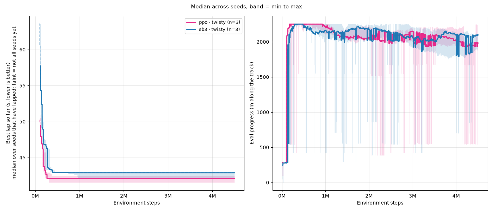
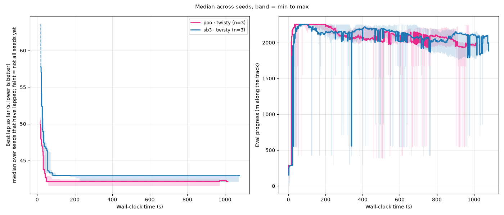
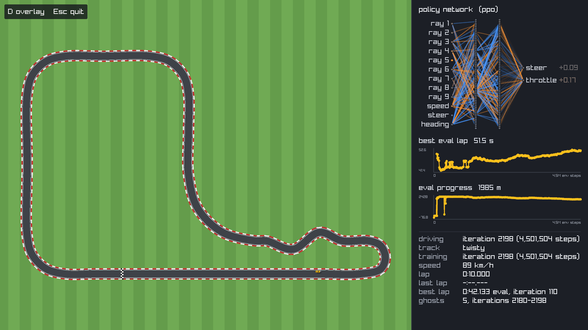

# 07 · PPO: reusing data safely, checked against Stable-Baselines3

A2C (lesson 06) learns fast and does not settle. It takes one gradient step per rollout,
throws the rollout away, and nothing bounds how far that step moves the policy: between 10% and
30% of its evaluations after the first lap did not lap, and twisty seed 2 drove both laps in every
evaluation from iteration 8610 to 8690 and crashed in every one after. PPO ("proximal policy
optimization", Schulman et al., 2017) keeps A2C's actor, critic, rollouts and truncation fix and
changes three things: it squeezes many gradient steps out of each rollout, it clips the
objective so those steps cannot carry the policy far from the one that collected the data, and
it estimates advantages with GAE, a tunable blend of A2C's n-step returns. This lesson derives
the pieces, reads the diff against `a2c.py`, and then does what the whole project was built
for: runs our from-scratch PPO next to Stable-Baselines3's PPO (SB3, a widely used and tested
implementation) on the same simulator with the same settings, as an answer key. Spoiler: they
match (both lap twisty on 3 of 3 seeds, best laps 41.53 s for ours and 42.12 s for SB3's), and
they share a habit worth a section of its own: after learning to lap, both end the run driving
slower than their own best checkpoints.

Files: [`racer/algos/ppo.py`](../../racer/algos/ppo.py), [`racer/algos/sb3_ppo.py`](../../racer/algos/sb3_ppo.py),
[`configs/ppo.toml`](../../configs/ppo.toml), [`configs/sb3.toml`](../../configs/sb3.toml),
[`configs/budgets.md`](../../configs/budgets.md), [`tests/test_ppo.py`](../../tests/test_ppo.py),
[`tests/test_sb3.py`](../../tests/test_sb3.py).

## Why a trust region

The policy gradient of lesson 05 is a *local* statement: `∇J(θ)` is the slope at the current
parameters, estimated from actions the current policy sampled. A step along it improves `J` only
if the step is small enough that the slope still describes the ground, and "small" is not about
the parameters (a tiny change in one weight can flip the throttle on a whole straight) but about
the *policy*: how different the new action distribution is from the one that produced the data.
A2C has no notion of that distance. Its step size is `lr` times whatever Adam makes of a
512-decision gradient, so one unlucky batch can move the mean driver from "brakes in time" to
"runs wide" (lesson 06's seed 2), and nothing undoes it except more equally unbounded steps.
The fix TRPO introduced (Schulman et al., 2015) is a *trust region*: maximize the improvement
the data predicts, subject to the new policy staying within a fixed KL divergence of the old one,
so the data stays a fair description of what the new policy will do. TRPO enforces the
constraint with second-order machinery (conjugate gradients, a line search). PPO gets most of the
benefit with a change to the loss function and plain Adam, which is why it is the default
policy-gradient method today.

## The surrogate objective: reusing old samples

To take more than one step per rollout we need an objective we can evaluate for a policy
`π_θ` *other* than the one, `π_old`, that collected the data. Importance sampling gives it: for
any function `f`,

```
E_{a ~ π_θ}[ f(a) ] = ∫ π_θ(a) f(a) da = ∫ π_old(a) · (π_θ(a) / π_old(a)) · f(a) da
                    = E_{a ~ π_old}[ r_θ(a) · f(a) ],      r_θ(a) = π_θ(a|s) / π_old(a|s)
```

Applied to the advantage this gives the *surrogate objective*

```
L(θ) = E_{s, a ~ π_old}[ r_θ(a|s) · A(s, a) ]
```

with `A` the advantages computed once, with the old policy and the old critic. Two facts make it
the right thing to climb:

- **At `θ = θ_old` its gradient is the policy gradient.** `∇r_θ = ∇π_θ / π_old`, and at
  `θ = θ_old` that is `∇π_θ / π_θ = ∇log π_θ`. So `∇L(θ_old) = E[∇log π_θ(a|s) · A]`, exactly
  lesson 06's actor gradient. The first minibatch step of every PPO update is an A2C-style step
  (on a minibatch, with normalized advantages; both below).
- **Away from `θ_old` it is only an approximation.** The importance weight corrects for the new
  policy choosing *actions* differently, but the states in the batch were still visited by the
  old policy. The true improvement `J(θ) - J(θ_old)` also depends on the states the new policy
  would visit, and `L` ignores that change. The approximation is good while `π_θ` stays close to
  `π_old` (TRPO's paper bounds the error by the KL divergence between them), and arbitrarily bad
  otherwise. Maximize `L` without a limit and the optimizer will happily push one sample's ratio
  to 50 because its advantage was positive.

## The clipped objective and what it does to the gradient

PPO's limit is built into the loss
([`clipped_surrogate`](../../racer/algos/ppo.py#L178-L189)):

```
L_clip(θ) = E[ min( r · A,  clip(r, 1-ε, 1+ε) · A ) ]          ε = clip = 0.2
```

```python
ratio = (logp_new - logp_old).exp()
return -torch.min(ratio * adv, ratio.clamp(1 - clip, 1 + clip) * adv).mean()
```

(The minus sign turns "maximize" into the "minimize" an optimizer does; the ratio is computed as
`exp(log π_new - log π_old)` because log-probabilities are what we store, and dividing two tiny
densities would underflow.) Take one sample and look at each case. Its contribution to the loss
gradient with respect to `log π_new` is `-r · A` whenever the unclipped term is the one `min`
picks, and 0 when the clipped term is picked and actually clipped (a constant has no gradient):

| advantage | ratio | `min` picks | gradient | meaning |
|---|---|---|---|---|
| `A > 0` | `r < 1+ε` | `r·A` (both equal inside `[1-ε, 1+ε]`) | `-r·A`: make `a` more likely | still room to move |
| `A > 0` | `r > 1+ε` | `(1+ε)·A`, a constant | **0** | already moved far enough, stop paying |
| `A < 0` | `r > 1-ε` | `r·A` | `-r·A`: make `a` less likely | still room to move |
| `A < 0` | `r < 1-ε` | `(1-ε)·A`, a constant | **0** | already moved far enough |

The `min` makes the objective *pessimistic*: it takes the lower of the clipped and the unclipped
estimate. If the ratio has moved past the boundary in the direction the advantage favours, the
clipped term is lower and flat, so that sample stops contributing: there is no reward for pushing
it further. If it moved the *wrong* way (a good action became less likely, `A > 0` and
`r < 1-ε`), the unclipped term is lower and its gradient still pulls it back. The two tests pin
exactly these numbers: [`test_clip_passes_gradient_inside_range`](../../tests/test_ppo.py#L45-L48)
(ratio 1, `A = 1`: gradient -1) and [`test_clip_blocks_large_ratio`](../../tests/test_ppo.py#L37-L42)
(ratio 2, `A = 1`, `ε = 0.2`: the loss is `-1.2` and the gradient exactly 0).

Two consequences worth knowing:

- **Clipping is per sample and only removes the incentive.** It does not stop a sample's ratio
  from moving: the weights are shared, so the gradients of the *other* samples in the minibatch
  can push a clipped sample's ratio further out. PPO does not enforce a trust region, it makes
  leaving it unprofitable. That is why it is worth measuring how far the policy actually moved
  (approx KL and clip fraction, below).
- **Many steps per rollout become safe-ish.** Each sample keeps contributing until its ratio
  leaves `[0.8, 1.2]`, so a rollout can feed dozens of gradient steps before most of its
  samples go silent.

## GAE: advantages as a weighted sum of TD errors

A2C's advantage was the n-step return minus the critic, with `n` running from 32 (first step of
a rollout) down to 1 (the last). Lesson 06 framed `n` as a bias-variance dial. GAE
(Schulman et al., 2016) turns that dial into a continuous one, and computes it with one
backward pass.

Start with the one-step *TD error* (temporal-difference error) at step `t`:

```
δ_t = r_t + γ V(s_{t+1}) - V(s_t)
```

It is a one-step advantage estimate: what happened in one step (`r_t + γV(s_{t+1})`) minus what
the critic expected (`V(s_t)`). Sum `k` of them with discounting, and the values in the middle
cancel in pairs (a telescoping sum):

```
Σ_{l=0}^{k-1} γ^l δ_{t+l}
  = Σ_{l=0}^{k-1} γ^l r_{t+l}  +  Σ_{l=0}^{k-1} γ^{l+1} V(s_{t+l+1})  -  Σ_{l=0}^{k-1} γ^l V(s_{t+l})
  = Σ_{l=0}^{k-1} γ^l r_{t+l}  +  γ^k V(s_{t+k})  -  V(s_t)                     (all middle V's cancel)
  = R_t^{(k)} - V(s_t)  =:  Â_t^{(k)}
```

So the k-step advantage of lesson 06 is the discounted sum of the first `k` TD errors. GAE does
not pick one `k`; it averages all of them with geometric weights `(1-λ) λ^{k-1}` (which sum to
1):

```
Â_t^{GAE(λ)} = (1-λ) Σ_{k=1}^{∞} λ^{k-1} Â_t^{(k)}
             = (1-λ) Σ_{k=1}^{∞} λ^{k-1} Σ_{l=0}^{k-1} γ^l δ_{t+l}
             = Σ_{l=0}^{∞} γ^l δ_{t+l} · (1-λ) Σ_{k=l+1}^{∞} λ^{k-1}        (swap the sums: δ_{t+l} appears for every k > l)
             = Σ_{l=0}^{∞} (γλ)^l δ_{t+l}                                   (the inner sum is λ^l / (1-λ))
```

An exponentially weighted sum of TD errors. The two ends of the dial:

- **`λ = 0`:** `Â_t = δ_t`, the one-step estimate. One reward of noise, but everything beyond
  that comes from the critic, so a wrong critic biases it fully.
- **`λ = 1`:** `Â_t = Σ γ^l δ_{t+l}`, which by the telescoping sum is the return to the end of
  the data minus `V(s_t)`: A2C's advantage. In a rollout the sum stops at the last step, where
  `δ` uses `V(s_T)` = `last_values`; so `λ = 1` is *exactly* `nstep_returns - values`, which
  [`test_gae_lam1_equals_nstep_minus_value`](../../tests/test_ppo.py#L28-L34) checks on random
  rewards, values and episode ends.

In between, a TD error `l` steps ahead counts `(γλ)^l`. With the default `λ = 0.95` and
`γ = 0.99`, `γλ = 0.9405`: a TD error 12 steps ahead counts half as much (`0.9405^12 = 0.48`), and
the weights sum to `1 / (1 - γλ) ≈ 17` steps, against up to 128 steps of real rewards for
`λ = 1`. Experiment 3 tries 0.9, 0.95 and 1.0.

In code ([`compute_gae`](../../racer/algos/ppo.py#L151-L173)) the infinite sum becomes a backward
recursion, `A_t = δ_t + γλ A_{t+1}`, with an episode end cutting both the bootstrap and the
chain exactly as A2C's `(1 - dones[t])` did:

```python
for t in reversed(range(len(rewards))):
    not_done = 1.0 - dones[t]
    delta = rewards[t] + gamma * next_value * not_done - values[t]
    running = delta + gamma * lam * not_done * running
    advantages[t] = running
    next_value = values[t]
```

[`test_gae_no_done`](../../tests/test_ppo.py#L15-L18) is small enough to do by hand: rewards 1,
`V = 0.5` everywhere, `γ = 0.9`, `λ = 0.8`. Every `δ = 1 + 0.9·0.5 - 0.5 = 0.95`, and from the
back, `A_2 = 0.95`, `A_1 = 0.95 + 0.72·0.95 = 1.634`, `A_0 = 0.95 + 0.72·1.634 = 2.12648`.

The critic's regression target is `advantages + values` (line 248), the *λ-return*: the same
blend of n-step returns, now as a value. Truncated steps get A2C's fix unchanged: `γ V(final_obs)`
is folded into their reward before GAE runs.

Is our GAE right? SB3 computes it in its `RolloutBuffer`, with a different convention for
episode ends (it stores "this step *starts* an episode" rather than "this step ended one").
[`docs/lessons/scripts/gae_vs_sb3.py`](scripts/gae_vs_sb3.py) feeds both the same random
128 × 16 rollout with 100 episode ends:

```
uv run python docs/lessons/scripts/gae_vs_sb3.py
lam 0.00: max |A_ours - A_sb3| = 3.28e-07, max |R_ours - R_sb3| = 3.46e-07  (128 x 16 steps, 100 episode ends, advantages up to 5.3)
lam 0.90: max |A_ours - A_sb3| = 2.01e-06, max |R_ours - R_sb3| = 2.12e-06  (128 x 16 steps, 100 episode ends, advantages up to 7.5)
lam 0.95: max |A_ours - A_sb3| = 3.38e-06, max |R_ours - R_sb3| = 3.74e-06  (128 x 16 steps, 100 episode ends, advantages up to 9.8)
lam 1.00: max |A_ours - A_sb3| = 5.84e-06, max |R_ours - R_sb3| = 6.55e-06  (128 x 16 steps, 100 episode ends, advantages up to 18.6)
```

The differences are float32 rounding (SB3 stores its buffer in float32, we compute in float64),
growing with the length of the sums: the two implementations compute the same thing.

## Minibatch epochs and advantage normalization

Each update collects `n_cars × n_steps = 16 × 128 = 2,048` decisions (A2C: 512), computes the
advantages and targets once, and then makes `epochs = 10` passes over them, each pass a fresh
random shuffle cut into minibatches of 256 ([lines 260-286](../../racer/algos/ppo.py#L260-L286)):
8 minibatches per pass, 80 Adam steps per rollout, each decision used in 10 of them. On the
4.5M budget that is 2,198 rollouts and 175,840 gradient steps, against A2C's 8,790. Shuffling
matters: consecutive decisions of one car are nearly the same state (lesson 06), and a random
minibatch mixes cars and times, so each step's gradient is closer to one from independent
samples.

Inside each minibatch the advantages are standardized ([line 271](../../racer/algos/ppo.py#L271-L272)):

```python
adv = (adv - adv.mean()) / (adv.std() + 1e-8)
```

Lesson 06 found A2C's advantages taking whatever scale the critic's errors had on that batch: near
zero when every car drove smoothly, size 10 and up when a crash landed in it. After
standardizing, every minibatch's advantages have mean 0 and std 1, so the size of the actor's step
no longer depends on the reward scale or on how surprised the critic happened to be. Subtracting
the mean is one more baseline (half of each minibatch is pushed up, half down); dividing by the
std is a per-minibatch learning-rate adjustment. (Strictly, the minibatch mean depends on the other
samples' actions, so the baseline argument of lesson 06 does not hold exactly; with 256 samples
the effect is negligible, and SB3 does the same.)

The critic is not normalized: its loss is the plain squared error to the λ-return, weighted by
`value_coef = 0.5`, with the same shared gradient clip at `max_grad_norm = 0.5` as A2C.

## Health signals: approx KL and clip fraction

Because clipping only removes incentives, two numbers logged every update say how far the policy
actually went ([lines 282-285](../../racer/algos/ppo.py#L282-L285)):

- **`approx_kl`** estimates `KL(π_old ‖ π_new) = E_{a ~ π_old}[log π_old(a) - log π_new(a)]
  = E[-log r]`. The obvious per-sample estimate `-log r` is unbiased but noisy, and negative for
  about half the samples. The code uses `(r - 1) - log r` instead. It has the same expectation,
  because `E_{a~π_old}[r] = ∫ π_new = 1` so the added `r - 1` averages to zero, and it is never
  negative (`log x ≤ x - 1`), so it is much less noisy. It is computed from the log-probs of the
  forward pass before each minibatch's step, so it measures where the previous steps of this
  update have taken the policy; the very first minibatch of an update always gives 0. Our CSV
  stores the mean over all 80 minibatch steps of the update. (SB3 logs the mean over the *last*
  epoch only, so if you compare KL with SB3's own logger, ours reads lower for the same policy
  movement. SB3's numbers do not reach our `metrics.csv` at all: its rows have no `value_loss`,
  `approx_kl` or `clip_frac` columns.)
- **`clip_frac`** is the share of samples whose ratio is outside `[1-ε, 1+ε]`, again averaged over
  the update's minibatch steps: how much of the data has stopped contributing.

Rules of thumb from the PPO literature: `approx_kl` around 0.01-0.02 and `clip_frac` around 0.1-0.2
are a healthy update. A KL that keeps growing means the steps are too large for the clip to
contain (lower `lr` or `epochs`; SB3 also offers `target_kl`, which stops the epochs early, set to
off here as in our code). A clip fraction near 0 means the clip never acts and PPO is behaving
like plain multi-epoch policy gradient.

## Reading the diff

As with A2C, the module's docstring says to read it as a diff:

```sh
diff racer/algos/a2c.py racer/algos/ppo.py
```

Renames aside (`A2CConfig` → `PPOConfig`, `"a2c"` → `"ppo"`), and leaving out the random-track
mode (`tracks = "random"`, the `trackgen` import and `N_HELDOUT`, which lesson 09 uses), these are
the hunks that carry the algorithm.

**Config: longer rollouts, a smaller learning rate, and the PPO knobs.**

```diff
<     n_steps: int = 32               # steps per car per rollout; one update uses n_cars * n_steps
---
>     n_steps: int = 128              # steps per car per rollout; one update uses n_cars * n_steps
<     lr: float = 7e-4                # Adam learning rate
---
>     lam: float = 0.95               # GAE: 0 = one-step advantage, 1 = full n-step return - V
>     clip: float = 0.2               # PPO clip range epsilon: ratio is kept near [1-eps, 1+eps]
>     epochs: int = 10                # passes over each rollout's data
>     minibatch: int = 256            # samples per gradient step
>     lr: float = 3e-4                # Adam learning rate
>     normalize_adv: bool = True      # standardize advantages within each minibatch
```

`lr` drops from 7e-4 to 3e-4 because there are now 80 steps per rollout instead of one. `lr`,
`epochs`, `γ`, `λ` and `clip` are the PPO paper's MuJoCo settings (also SB3's defaults); its
2,048-step rollout from one environment becomes 16 cars × 128 steps, and minibatches are 256
instead of 64. `eval_every` drops from 10 to 5 so that our PPO evaluates every 5 × 2,048 = 10,240
env steps, the cadence SB3 is given too (`eval_every_steps` in `configs/sb3.toml`).

**Collection: remember what the old policy thought.**

```diff
<             action = actor.dist(torch.as_tensor(obs, dtype=torch.float32)).sample().numpy()
---
>             obs_t = torch.as_tensor(obs, dtype=torch.float32)
>             dist = actor.dist(obs_t)
>             action_t = dist.sample()
>             logp = dist.log_prob(action_t).sum(-1).numpy()  # sum over steer and throttle
>             value = critic(obs_t).numpy()
>             action = action_t.numpy()
```

`logp` is `log π_old(a|s)`, the denominator of every ratio in the update; `value` is `V_old(s)`,
needed by GAE and by explained variance. A2C recomputed both from the stored observations in its
one loss evaluation, which gave the same numbers because nothing had changed yet. PPO changes the
networks 80 times per rollout, so the "old" values have to be frozen at collection time.

**Returns: GAE instead of n-step returns.**

```diff
<         returns = nstep_returns(rewards, dones, batch["last_values"], cfg.gamma)
---
>         advantages = compute_gae(rewards, batch["values"], dones, batch["last_values"],
>                                  cfg.gamma, cfg.lam)
>         returns = advantages + batch["values"]  # the critic's regression targets
```

and `nstep_returns` itself becomes `compute_gae` (shown above). The truncation bootstrap
(`add_truncation_bootstrap`) is untouched.

**Loss: the clipped surrogate replaces `-logp · A`.**

```diff
<     advantage = returns - values
<     policy_loss = -(logp * advantage.detach()).mean()
<     value_loss = (values - returns).pow(2).mean()
<     return policy_loss + value_coef * value_loss - entropy_coef * entropy.mean(), value_loss
---
>     ratio = (logp_new - logp_old).exp()
>     return -torch.min(ratio * adv, ratio.clamp(1 - clip, 1 + clip) * adv).mean()
```

The `.detach()` is gone because the advantages are now plain numbers computed once from the
frozen `values`, not a tensor connected to the critic.

**Update: one step becomes a loop of 80.**

```diff
<         # 4. UPDATE
<         optimizer.zero_grad()
<         loss.backward()
<         torch.nn.utils.clip_grad_norm_(params, cfg.max_grad_norm)
<         optimizer.step()
---
>         # 3. LOSS + 4. UPDATE: several epochs, each a fresh shuffle cut into minibatches.
>         value_losses, kls, clip_fracs = [], [], []
>         for _ in range(cfg.epochs):
>             order = torch.randperm(n_samples)
>             for lo in range(0, n_samples, cfg.minibatch):
>                 idx = order[lo:lo + cfg.minibatch]
>                 dist = actor.dist(batch_obs[idx])
>                 logp = dist.log_prob(batch_act[idx]).sum(-1)  # sum over steer and throttle
>                 entropy = dist.entropy().sum(-1)
>                 values = critic(batch_obs[idx])
>                 adv = batch_adv[idx]
>                 if cfg.normalize_adv and len(adv) > 1:
>                     adv = (adv - adv.mean()) / (adv.std() + 1e-8)
>                 policy_loss = clipped_surrogate(logp, batch_logp_old[idx], adv, cfg.clip)
>                 value_loss = (values - batch_returns[idx]).pow(2).mean()
>                 loss = policy_loss + cfg.value_coef * value_loss - cfg.entropy_coef * entropy.mean()
>
>                 optimizer.zero_grad()
>                 loss.backward()
>                 torch.nn.utils.clip_grad_norm_(params, cfg.max_grad_norm)
>                 optimizer.step()
```

Everything A2C did once now happens per minibatch: forward pass, loss, backward, clip, step. The
four lines at the end of the loop body are A2C's whole update, unchanged.

**Logging: explained variance from the frozen values, plus the two gauges.**

```diff
<         explained = (1.0 - float((batch_returns - values.detach()).var()) / var_ret
---
>         explained = (1.0 - float((batch_returns - batch_values).var()) / var_ret
```

`batch_values` is the critic's prediction at collection time, so explained variance still means
"how well did the critic predict these targets before training on them" (after 10 epochs on them
it would look better than it is). The new columns are `approx_kl` and `clip_frac`.

**What SB3 does differently, and how it is matched.** [`sb3_ppo.py`'s docstring](../../racer/algos/sb3_ppo.py#L10-L33)
has the full table. Every shared number is the same (`tests/test_sb3.py`'s
[`test_sb3_config_matches_ppo_toml`](../../tests/test_sb3.py#L40-L57) fails if the two TOML files
drift), and three of SB3's defaults are overridden because ours differ: `log_std_init = -0.5`
(SB3: 0), `ortho_init = False` (SB3 initializes weights orthogonally; we use torch's default) and
Adam `eps = 1e-8` (SB3: 1e-5). SB3 drives the same `BatchSim` of 16 cars through
[`BatchSimVecEnv`](../../racer/algos/sb3_ppo.py#L136-L213), which reports truncation as
`TimeLimit.truncated` so SB3 bootstraps it exactly as `add_truncation_bootstrap` does. What remains
different is code we did not write: SB3's rollout buffer, its minibatch sampler, its logging and
its Python overhead per step.

## Results: our PPO against SB3, three seeds each

Six main runs with the matched defaults ([`configs/ppo.toml`](../../configs/ppo.toml),
[`configs/sb3.toml`](../../configs/sb3.toml): 16 cars × 128 steps per rollout, 10 epochs of
minibatches of 256, `lr = 3e-4`, `γ = 0.99`, `λ = 0.95`, `ε = 0.2`, no entropy bonus,
`max_grad_norm = 0.5`, 4.5M env steps, an evaluation every 10,240 steps), seeds 0, 1, 2 on twisty,
all six at once on the dev machine (2 torch threads each, 16 hardware threads), 2026-11-23:

```sh
uv run racer train ppo --seed 0          # and --seed 1, 2
uv run racer train sb3 --seed 0          # and --seed 1, 2
uv run racer compare runs/ppo-20261123-220355-s0 runs/ppo-20261123-220356-s1 runs/ppo-20261123-220358-s2 \
    runs/sb3-20261123-220359-s0 runs/sb3-20261123-220400-s1 runs/sb3-20261123-220401-s2 --out results/ --name ppo_vs_sb3
uv run python docs/lessons/scripts/run_summary.py runs/ppo-20261123-220355-s0 ...
uv run python docs/lessons/scripts/eval_history.py runs/ppo-20261123-220355-s0 ... --short
uv run python docs/lessons/scripts/lap_counts.py runs/ppo-20261123-220355-s0 ...
```



`racer compare`'s table (appended to [`results/summary.md`](../../results/summary.md)):

| group | seeds | success | best lap s, median (range) | env steps to first lap | wall s to first lap |
|---|---|---|---|---|---|
| ppo · twisty | 3 | 3/3 | 42.13 (41.53–42.43) | 102,400 | 15.3 |
| sb3 · twisty | 3 | 3/3 | 42.92 (42.12–42.93) | 102,400 | 16.7 |

and per run ([`run_summary.py`](scripts/run_summary.py), [`eval_history.py`](scripts/eval_history.py),
[`lap_counts.py`](scripts/lap_counts.py); 440 evaluations per run):

| impl | seed | run directory | first lapping evaluation | evaluations that lapped (2 laps) | fastest lap (iteration) | final evaluation | wall time |
|---|---|---|---|---|---|---|---|
| ours | 0 | `runs/ppo-20261123-220355-s0` | 92,160 steps | 430 (70) | 42.13 s (110) | 1 lap, 51.53 s, 1,984 m | 1,016 s |
| ours | 1 | `runs/ppo-20261123-220356-s1` | 112,640 steps | 430 (70) | 42.43 s (270) | 1 lap, 52.65 s, 1,928 m | 1,007 s |
| ours | 2 | `runs/ppo-20261123-220358-s2` | 102,400 steps | 372 (22) | **41.53 s** (150) | 1 lap, 46.13 s, 2,242 m | 971 s |
| SB3 | 0 | `runs/sb3-20261123-220359-s0` | 81,920 steps | 408 (12) | 42.92 s (190) | 1 lap, 54.30 s, 1,884 m | 1,079 s |
| SB3 | 1 | `runs/sb3-20261123-220400-s1` | 102,400 steps | 414 (139) | **42.12 s** (470) | 1 lap, 49.27 s, 2,102 m | 1,072 s |
| SB3 | 2 | `runs/sb3-20261123-220401-s2` | 112,640 steps | 406 (19) | 42.93 s (185) | 1 lap, 48.83 s, 2,113 m | 1,078 s |

**The spec's bar, checked.** Our PPO must lap twisty on at least 2 of 3 seeds and its best lap must
be within 10% of SB3's best under the same budget:

- seeds that lapped: **3 of 3** (SB3: 3 of 3);
- best lap: ours **41.53 s** (seed 2), SB3's **42.12 s** (seed 1). Within 10% means at most
  1.10 × 42.12 = 46.33 s; ours is 41.53 / 42.12 = 0.986 of SB3's, i.e. 1.4% *faster*. The medians
  over seeds agree too (42.13 s against 42.92 s).

So the bar passes, with no fix needed. The two implementations are indistinguishable at this
sample size: first laps after 81,920-112,640 steps for both, fastest laps within 1.4 s of each other
on all six runs, and the same shape of curve (below). That is the answer key doing its job: if our
clipped loss, GAE, advantage normalization or truncation bootstrap had a bug, SB3 on the same
simulator with the same numbers would show it as a gap.

**Wall clock.** Ours took 971-1,016 s, SB3 1,072-1,079 s for the same 4,501,504 steps
(4.43-4.64k against 4.17-4.20k steps/s, all six sharing the machine). Both drive one `BatchSim`
of 16 cars, so the 5-11% difference is most likely SB3's own Python per step (its buffer,
callbacks, logger and the `VecEnv` info dicts); with six runs sharing the machine, it is not a
clean benchmark. The time plot (below) is the steps plot stretched by that factor.
(At its far right our median line jumps: seed 2 finished at 971 s, after which the "median" is of
the two seeds still running.)



**Against A2C (lesson 06).** PPO first lapped twisty after 81,920-112,640 steps; A2C needed
261,120-680,960. Count the evaluations from the first lap onwards that did *not* complete a lap:
A2C 228 of 829, 243 of 818 and 158 of 747; our PPO 2 of 432, 0 of 430 and 59 of 431; SB3 25 of
433, 17 of 431 and 24 of 430. On five of the six PPO runs the bounded update did what it was
designed to do: a policy that had learned to lap almost never lost it again. Our seed 2 is the
exception: 59 of its 431 evaluations after the first lap failed, 48 of them in the second half of
the run (22% of those evaluations, in A2C's 21-30% range).

A2C has the better *laps*, though. Lesson 06's twisty runs set fastest laps of 39.03-39.27 s,
2.3-2.5 s faster than the fastest PPO run here (41.53 s; all six span 41.53-42.93 s), and two of its three final evaluations drove
both laps (41.75 s and 41.50 s), which none of the six PPO finals did. Same environment, same
reward, same budget: so the reward does pay for laps that fast, and whatever slows PPO down
(next section) is in the optimization, not in what the reward asks for. (A word on training
returns: SB3's `train_return_mean` column is a rolling mean over its last 100 finished episodes,
ours is the mean of the episodes that ended in this rollout, so SB3's curve is smoother by
construction; they are not compared here.)

### But it gets slower

The "best lap so far" panel only ever goes down, and it hides what the progress panel shows: after
the first 0.5-1M steps, the evaluation progress of both implementations sinks from 2,254 m (two
full laps) on four of the six runs, our seeds 0 and 1 and SB3's seeds 0 and 1: the median
`eval_progress_m` over the last quarter of each run's evaluations is 2,029, 1,947, 1,811 and
2,142 m (from `metrics.csv`). The two seed-2 runs never held two laps for long (first-quarter
medians 2,178 and 2,151 m) and drift rather than sink, with last-quarter medians of
2,192 and 2,096 m; ours also crashed in about a quarter of its third-quarter evaluations. Every
one of the six final evaluations is "1 lap, no crash": the car is still
driving when the 90 s limit ends the episode, because its laps now take 46-54 s and two of them no
longer fit. [`lap_counts.py`](scripts/lap_counts.py) splits each run's 440 evaluations into
quarters (output condensed to one line per run; the script prints a header line per run):

```
uv run python docs/lessons/scripts/lap_counts.py runs/ppo-20261123-220355-s0 ...
                         evaluations with 0/1/2 laps, median best lap, per quarter
ppo-20261123-220355-s0:  Q1  10/ 29/ 70 lap 43.75 s | Q2   0/110/  0 lap 46.92 s | Q3   0/110/  0 lap 48.67 s | Q4   0/111/  0 lap 50.60 s
ppo-20261123-220356-s1:  Q1  10/ 29/ 70 lap 43.48 s | Q2   0/110/  0 lap 50.13 s | Q3   0/110/  0 lap 51.17 s | Q4   0/111/  0 lap 52.28 s
ppo-20261123-220358-s2:  Q1  16/ 72/ 21 lap 47.15 s | Q2   4/106/  0 lap 49.58 s | Q3  28/ 82/  0 lap 47.58 s | Q4  20/ 90/  1 lap 46.92 s
sb3-20261123-220359-s0:  Q1  22/ 75/ 12 lap 47.58 s | Q2   6/104/  0 lap 50.52 s | Q3   4/106/  0 lap 51.40 s | Q4   0/111/  0 lap 56.27 s
sb3-20261123-220400-s1:  Q1  11/ 23/ 75 lap 43.31 s | Q2   2/ 65/ 43 lap 46.13 s | Q3  13/ 76/ 21 lap 46.25 s | Q4   0/111/  0 lap 48.17 s
sb3-20261123-220401-s2:  Q1  13/ 77/ 19 lap 47.85 s | Q2  14/ 96/  0 lap 47.35 s | Q3   1/109/  0 lap 49.32 s | Q4   6/105/  0 lap 48.93 s
```

Both implementations do it. Measured against each run's own fastest checkpoint, every seed ends
slower (the table below); as a steady trend over the run it holds for four of the six. SB3 seed 1
holds on to two-lap evaluations longest, and the two seed-2 runs show no trend after their first
quarter: our seed 2's quarter medians are 47.15, 49.58, 47.58 and 46.92 s and its final evaluation
reached 2,242 m, SB3 seed 2's are 47.85, 47.35, 49.32 and 48.93 s. Since SB3 does the same as ours,
it is not a bug in our code: it is what PPO with these settings does on this task. What changed in the driver?
[`noisy_vs_mean_laps.py`](scripts/noisy_vs_mean_laps.py), which now takes `RUN@ITERATION` to load
any checkpoint, compares each run's fastest-lap checkpoint with its final one on the opening
straight (the deterministic driver):

| run | checkpoint | applied throttle before 215 m | speed at 150 m | top speed |
|---|---|---|---|---|
| ours s0 | 110 (fastest) / final | +0.62 / +0.39 | 33.4 / 24.7 m/s | 33.8 / 29.4 m/s |
| ours s1 | 270 / final | +0.63 / +0.37 | 33.9 / 23.9 m/s | 34.0 / 26.3 m/s |
| ours s2 | 150 / final | +0.65 / +0.50 | 34.3 / 28.9 m/s | 34.8 / 34.0 m/s |
| SB3 s0 | 190 / final | +0.58 / +0.30 | 31.9 / 21.6 m/s | 32.2 / 27.5 m/s |
| SB3 s1 | 470 / final | +0.61 / +0.46 | 33.1 / 27.5 m/s | 33.5 / 27.7 m/s |
| SB3 s2 | 185 / final | +0.59 / +0.45 | 32.2 / 26.9 m/s | 32.4 / 28.9 m/s |

The final drivers use less throttle on a straight that has nothing to brake for, and arrive at the
first hairpin 5-10 m/s slower. That is not a better policy by the training objective: our seed 0's
training return (noisy policy, our own per-rollout mean) was 229.2 on average over iterations
100-149 and 195.7 over iterations 2150-2199. The reward pays 0.1 per meter and charges 0.01 per
decision, so slower driving simply earns less. The optimizer drifted to a worse policy and stayed.

What the logs show alongside the drift (seed 0; `eval_history.py`, `metrics.csv`):

- **The exploration noise collapsed.** `log_std` went from -0.5 at the start to -0.92 (mean over
  iterations 100-149) and -3.80 at the end: a std of 0.02, against about 0.4 when the car was
  fastest. There is no entropy bonus (`entropy_coef = 0`, the SB3 default), so nothing resists
  the shrinking. This is not lesson 06's saturated mean: inside `[-1, 1]` a small `σ` still has a
  nonzero expected gradient (the score `(a - μ)/σ²` grows as `σ` shrinks; the estimate gets
  noisier, not zero). Two other things happen instead. A probe of ±0.02 throttle barely changes
  what the car does, so the advantages say little about which direction is better. And the clip
  limits how far each update can move the mean: a ratio of `1 ± ε` is reached by moving the mean
  roughly `ε·σ` in action units, 0.004 at `σ = 0.02` against 0.08 at `σ = 0.4`, so climbing back
  to more throttle on the straight would take many times as many updates.
- **The updates grew in policy terms.** `approx_kl`'s median over the last tenth of the run was
  0.053 (seed 0), 0.043 (seed 1), 0.025 (seed 2), against 0.028, 0.022, 0.021 over the whole run,
  and `clip_frac` rose to 0.39, 0.35 and 0.27, from whole-run medians of 0.281, 0.244 and 0.234
  that were already above the 0.1-0.2 rule of thumb. Moving a Gaussian's mean by `Δμ` changes a
  typical sample's log-probability by about `Δμ / σ` and the KL by `Δμ² / (2σ²)`, so the same
  nudge to the mean is a 400 times bigger KL at `σ = 0.02` than at `σ = 0.4`. The clip then
  silences a third of every batch.

These are correlations, not a proven cause. The usual remedies are a learning rate that decays to
zero over the run (the PPO paper's MuJoCo runs use a constant 3e-4 and anneal only for Atari, but
OpenAI's `baselines` PPO code anneals the learning rate linearly for MuJoCo too; SB3's default is constant, so both implementations here keep it constant), an entropy bonus, or stopping an update's epochs early
when the KL passes a target (SB3's `target_kl`). None is used here, so that the comparison with
SB3 stays on its defaults. Lesson 08 is about the fastest lap itself, and experiments 1 and 2 below
change how far each update may move.

### The unbounded mean, in PPO

The actor is lesson 06's: an unbounded Gaussian mean, clipped by the simulator. SB3's `MlpPolicy`
does the same (its `action_net` is a plain linear layer, and SB3 clips the action before stepping
the env), so this is a property of both. [`policy_means.py`](scripts/policy_means.py) (with
[`actor_of.py`](scripts/actor_of.py) to read SB3's actor) on the final checkpoints:

| run | start-line throttle mean | throttle mean > 1 (eval states / training-like states) | steer mean range on eval states | std (steer / throttle) |
|---|---|---|---|---|
| ours s0 | +3.73 | 7% / 12% | -1.95 .. +2.23 (22% outside [-1, 1]) | 0.019 / 0.025 |
| ours s1 | +3.08 | 8% / 13% | -1.31 .. +2.44 (15% outside) | 0.017 / 0.042 |
| ours s2 | +3.73 | 12% / 20% | -2.18 .. +2.96 (33% outside) | 0.031 / 0.057 |
| SB3 s0 | +1.65 | 3% / 6% | -3.50 .. +2.71 (19% outside) | 0.017 / 0.027 |
| SB3 s1 | +3.18 | 8% / 14% | -1.42 .. +2.73 (18% outside) | 0.026 / 0.035 |
| SB3 s2 | +2.65 | 8% / 13% | -1.87 .. +1.91 (38% outside) | 0.026 / 0.048 |

and our seed 0 over training:

```
uv run python docs/lessons/scripts/policy_means.py runs/ppo-20261123-220355-s0 110 500 1000 2000 latest

iteration       110    500   1000   2000   2198
throttle      +3.61  +6.58  +4.88  +3.79  +3.73      start-line mean
std           0.40   0.15   0.06   0.03   0.025     throttle
```

The problem is there, and smaller than in A2C: lesson 06's twisty runs ended with start-line throttle
means of +8.4 to +10.1 and throttle means above 1 on 34-47% of the evaluation's states, against +1.7
to +3.7 and 3-12% here. Two things differ. The start-line mean does not drift outwards for the whole
run, it peaks (+6.58 at iteration 500) and comes back, consistent with PPO's smaller, bounded
steps doing less random dragging of the shared weights. And with a std of 0.02-0.06, "saturated"
starts just above 1: a mean of 1.1 already has practically no sample below 1, so the zero-gradient
zone of lesson 06 covers almost every mean outside the range.

The noisy-versus-mean gap that lessons 05 and 06 traced to the asymmetric brake (a throttle sample
below the mean brakes harder than one above it accelerates) is gone by the end: with stds this
small, the final checkpoints' 32 noisy episodes drive like the mean (opening-straight speeds
within 0.2 m/s of the mean's on every run, from `noisy_vs_mean_laps.py`), and 189 of the 192 noisy
episodes complete exactly one lap, as the mean does (10 of the 192 crash or turn the wrong way
instead of reaching the time limit: 6 on our seed 2, 4 on SB3's seed 2).

## What to look for in the viewer

```sh
uv run racer watch runs/ppo-20261123-220355-s0
uv run racer watch runs/sb3-20261123-220359-s0          # SB3 runs open the same way
```



(Screenshot: `uv run racer watch runs/ppo-20261123-220355-s0 --screenshot docs/img/ppo.png --frames 600`,
600 frames, so 10.000 s into the live car's lap.) Unlike `racer compare`'s "best lap so far", the
viewer's **best eval lap** panel plots each evaluation's own best lap, so the slowdown is right
there: down to about 42 s early, then a slow climb to the final evaluation's 51.5 s. The **eval
progress** panel shows the same thing in meters, a long, slight slide from two full laps to the
final 1,985 m. The status block keeps the record separately: best lap 0:42.133, from the evaluation
at iteration 110. The live car is the final policy; in the screenshot it is doing 89 km/h
(24.7 m/s) ten seconds in, on a straight it could take far faster (the fastest checkpoint reached
33.4 m/s by 150 m, the table above). The ghosts are the newest five recorded laps (the status block
says iterations 2180-2198), all from the slow end of the run and driving at nearly the same pace
as the live car, so they sit on top of it; the run saved one ghost per lapping evaluation, 430 in
all, so a large `--ghosts` value also brings back the 42-44 s laps of iterations 100-300 to race
against. In the network panel the output values are small in the screenshot (steer +0.09,
throttle +0.17): the unclipped throttle mean is above 1 near the start line (+3.7 on it) and only
briefly elsewhere, on 7% of the final evaluation's decisions (the unbounded-mean table above), so
the throttle node shows full orange only for those moments.

## Experiments

All three experiments train our PPO on twisty with a budget of **1,500,000 env steps** instead of
4.5M (`--set env_steps_budget=1500000`), seeds 0 and 1, and compare against the defaults run with
the same budget (`runs/ppo-20261123-222234-s0`, `runs/ppo-20261123-222235-s1`; their first laps
and fastest laps came at exactly the iterations of the main runs', 45 and 110 for seed 0, 55 and
270 for seed 1). Runs took 298-347 s with six sharing the machine (the `epochs = 3` ones
260-267 s), 2026-11-23. Two seeds are few: read the results as "what can happen", not as a
ranking.

```sh
uv run racer train ppo --set env_steps_budget=1500000            # the defaults at this budget, --seed 0 and 1
uv run python docs/lessons/scripts/run_summary.py runs/ppo-<run>
uv run python docs/lessons/scripts/eval_history.py runs/ppo-<run> --short
uv run python docs/lessons/scripts/lap_counts.py runs/ppo-<run>
```

In the tables, "evaluations that lapped" counts the 147 evaluations that completed at least one lap,
and the number in brackets those that completed both (the rest of the lapping ones hit the 90 s
limit after one lap, the slowdown of the main runs). KL and clip fraction are medians over all 733
updates.

### 1. Clip range: `clip` 0.1 vs 0.2 vs 0.4

**Change.** `ε`, the half-width of the band `[1-ε, 1+ε]` inside which a sample's ratio still
earns gradient.

**Predict.** A narrower band silences samples sooner, so each update moves the policy less:
lower `approx_kl`, higher `clip_frac` (more samples hit the edge). A wider band allows bigger
moves. Which learns faster, and which is steadier?

**Run.**

```sh
uv run racer train ppo --set env_steps_budget=1500000 --set clip=0.1
uv run racer train ppo --set env_steps_budget=1500000 --set clip=0.4
```

<details><summary>What we got</summary>

| `clip` | seed | run directory | first lapping evaluation | evaluations that lapped (2 laps) | fastest lap | final evaluation | `approx_kl` | `clip_frac` |
|---|---|---|---|---|---|---|---|---|
| 0.1 | 0 | `runs/ppo-20261123-222236-s0` | 112,640 steps | 136 (0) | 46.68 s | 1 lap, 47.87 s | 0.0027 | 0.144 |
| 0.2 | 0 | `runs/ppo-20261123-222234-s0` | 92,160 steps | 137 (70) | 42.13 s | 1 lap, 47.22 s | 0.0109 | 0.141 |
| 0.4 | 0 | `runs/ppo-20261123-222239-s0` | 81,920 steps | 132 (3) | 43.47 s | 1 lap, 46.45 s | 0.0370 | 0.114 |
| 0.1 | 1 | `runs/ppo-20261123-222238-s1` | 122,880 steps | 128 (33) | 43.12 s | 1 lap, 47.95 s | 0.0029 | 0.149 |
| 0.2 | 1 | `runs/ppo-20261123-222235-s1` | 112,640 steps | 137 (70) | 42.43 s | 1 lap, 49.73 s | 0.0102 | 0.135 |
| 0.4 | 1 | `runs/ppo-20261123-222240-s1` | 61,440 steps | 81 (0) | 46.13 s | **0 laps**, crash at 530 m | 0.0365 | 0.113 |

- **The KL follows `ε` almost quadratically**: median 0.0027-0.0029 at 0.1, 0.010-0.011 at 0.2,
  0.037 at 0.4. A band twice as wide lets the ratios, and so the log-probabilities, move about
  twice as far, and KL grows with the square of the move. The clip fraction barely moves
  (0.11-0.15 for all three): whatever the band, about the same share of samples ends up at its edge,
  because the optimizer keeps pushing until they get there.
- **Wider was faster to the first lap** (61,440 and 81,920 steps at 0.4, 112,640 and 122,880 at
  0.1) **and less steady**: seed 1 at 0.4 lapped in only 81 of 147 evaluations, 36 of its last
  38 evaluations ended without a lap, and the final one crashed at 530 m. Its explained variance over the last tenth
  of the run was 0.93-0.97 (`eval_history.py`), a critic that fits the targets very well because
  the targets had become "crash soon": a high explained variance is not a healthy run, as lesson
  06's experiment 1 found.
- **The default produced the fast laps.** Both 0.2 runs drove 70 two-lap evaluations and the
  fastest laps (42.13 and 42.43 s); 0.1 and 0.4 managed 0-33 two-lap evaluations and 43.1-46.7 s.
  With two seeds, read that as "0.2 is a reasonable default here", not as a measured optimum.

</details>

### 2. Reuse: `epochs` 3 vs 10

**Change.** Passes over each rollout: 3 gives 24 Adam steps per rollout instead of 80.

**Predict.** Fewer passes means less movement per rollout and a smaller KL; the same 1.5M steps
buy 3.3 times fewer gradient steps. Does that cost more than it saves in wall time (each update
is cheaper)?

**Run.**

```sh
uv run racer train ppo --set env_steps_budget=1500000 --set epochs=3
```

<details><summary>What we got</summary>

| `epochs` | seed | run directory | Adam steps | wall time | first lapping evaluation | evaluations that lapped (2 laps) | fastest lap | final evaluation | `approx_kl` | `clip_frac` |
|---|---|---|---|---|---|---|---|---|---|---|
| 3 | 0 | `runs/ppo-20261123-222838-s0` | 17,592 | 267 s | 235,520 steps | 115 (98) | **40.93 s** | 1 lap, 46.17 s | 0.0050 | 0.061 |
| 10 | 0 | `runs/ppo-20261123-222234-s0` | 58,640 | 347 s | 92,160 steps | 137 (70) | 42.13 s | 1 lap, 47.22 s | 0.0109 | 0.141 |
| 3 | 1 | `runs/ppo-20261123-222839-s1` | 17,592 | 260 s | 286,720 steps | 114 (32) | 42.22 s | 1 lap, 47.12 s | 0.0053 | 0.063 |
| 10 | 1 | `runs/ppo-20261123-222235-s1` | 58,640 | 335 s | 112,640 steps | 137 (70) | 42.43 s | 1 lap, 49.73 s | 0.0102 | 0.135 |

- **Reuse buys sample efficiency.** Ten epochs reached the first lap in 2.5 times fewer env steps
  (92,160 and 112,640 against 235,520 and 286,720). Each rollout is worth more when it is used for
  80 steps instead of 24, which is the whole point of PPO against A2C.
- **It costs a bit of wall time, less than you might think.** 3 epochs took about 23% less wall
  time (260-267 s against 335-347 s) even though they did 70% fewer gradient steps, because collecting
  the rollouts (the simulator, and the actor and critic on every decision) is most of the time.
  In wall time the 10-epoch runs still reached their first lap first (13 and 16 s against 30 and
  34 s, `run_summary.py`).
- **Fewer epochs, smaller moves.** The KL halved (0.005 against 0.010-0.011) and the clip fraction
  fell from 0.14 to 0.06: with fewer passes, fewer samples reach the band's edge.
- **And seed 0 did not lose its two laps within 1.5M steps**: 33 of its last 38 evaluations
  still drove two laps (`lap_counts.py`), against 0 of 38 for the 10-epoch run, although its
  median lap still crept up a little (41.97, 43.52, 43.32 s in quarters 2-4), and it set the
  fastest lap of any run in this lesson, 40.93 s. Seed 1 slowed down as the defaults did. One seed
  in two is not a result, but it points the same way as the main runs' logs: smaller policy moves
  per update, less drift.

</details>

### 3. GAE: `lam` 0.9 vs 0.95 vs 1.0

**Change.** `λ`, the weight `(γλ)^l` of a TD error `l` steps ahead. 0.9 sums over about 9 steps
(`1 / (1 - 0.99 · 0.9)`), 0.95 over about 17, 1.0 over everything to the end of the 128-step
rollout, which is A2C's advantage.

**Predict.** Lower `λ` leans on the critic (less variance, more bias); `λ = 1` uses only real
rewards until the rollout's end. The critic's targets change with `λ` too (they are
`A + V`), so explained variance is not comparable between the settings, for the reason
lesson 06's experiment 1 found.

**Run.**

```sh
uv run racer train ppo --set env_steps_budget=1500000 --set lam=0.9
uv run racer train ppo --set env_steps_budget=1500000 --set lam=1.0
```

<details><summary>What we got</summary>

| `lam` | seed | run directory | first lapping evaluation | evaluations that lapped (2 laps) | fastest lap | final evaluation | explained variance (median) |
|---|---|---|---|---|---|---|---|
| 0.9 | 0 | `runs/ppo-20261123-222840-s0` | 81,920 steps | 127 (111) | 41.58 s | **2 laps**, 43.27 s | 0.70 |
| 0.95 | 0 | `runs/ppo-20261123-222234-s0` | 92,160 steps | 137 (70) | 42.13 s | 1 lap, 47.22 s | 0.58 |
| 1.0 | 0 | `runs/ppo-20261123-222843-s0` | 235,520 steps | 121 (0) | 45.90 s | 1 lap, 47.35 s | 0.30 |
| 0.9 | 1 | `runs/ppo-20261123-222842-s1` | 204,800 steps | 119 (0) | 47.97 s | 1 lap, 48.03 s | 0.69 |
| 0.95 | 1 | `runs/ppo-20261123-222235-s1` | 112,640 steps | 137 (70) | 42.43 s | 1 lap, 49.73 s | 0.63 |
| 1.0 | 1 | `runs/ppo-20261123-222844-s1` | 112,640 steps | 132 (110) | 41.08 s | 0 laps, crash at 386 m | 0.38 |

- **Explained variance falls as `λ` rises** (0.69-0.70, 0.58-0.63, 0.30-0.38), on both seeds. That
  is the targets, not the critic: with `λ = 0.9` a target leans on the critic's own estimate a
  few steps later, with `λ = 1` it holds up to 128 real rewards and all their noise. The same
  caveat as lesson 06's `n_steps` experiment: compare explained variance only between runs with
  the same `λ`.
- **Each extreme won once.** `λ = 0.9` gave seed 0 the steadiest run in the lesson (111 two-lap
  evaluations, still two laps at the end, 43.27 s) and seed 1 a slow one (no two-lap evaluation,
  first lap only at 204,800 steps). `λ = 1.0` did the reverse: seed 1 got faster all run (median best
  lap 46.98, 43.00, 42.03, 41.30 s by quarter) and then crashed in its very last evaluation, seed 0
  never drove two laps. The default sat in the middle on both seeds. Two seeds cannot separate
  the effect of `λ` from the luck of the seed here; what they do show is that `λ` is not a knob
  with one obviously right end.

</details>

## Tests worth reading

| test | what it pins |
|---|---|
| [`test_clip_passes_gradient_inside_range`](../../tests/test_ppo.py#L45-L48) | inside the band the surrogate's gradient is `-r·A` (ratio 1, `A = 1`: -1) |
| [`test_clip_blocks_large_ratio`](../../tests/test_ppo.py#L37-L42) | past `1+ε` with a positive advantage the loss is flat (`-1.2`) and the gradient exactly 0 |
| [`test_gae_no_done`](../../tests/test_ppo.py#L15-L18) | the GAE recursion by hand (`δ = 0.95`, `γλ = 0.72`: 2.12648, 1.634, 0.95) |
| [`test_gae_done_at_t1`](../../tests/test_ppo.py#L21-L25) | an episode end cuts both the bootstrap and the chain of later TD errors |
| [`test_gae_lam1_equals_nstep_minus_value`](../../tests/test_ppo.py#L28-L34) | `λ = 1` is exactly A2C's n-step return minus the value |
| [`test_ppo_smoke`](../../tests/test_ppo.py#L51-L62) | a tiny run logs `approx_kl`, `clip_frac`, `value_loss` and saves a loadable checkpoint |
| [`test_sb3_config_matches_ppo_toml`](../../tests/test_sb3.py#L40-L57) | every setting shared by `ppo.toml` and `sb3.toml` is the same number |
| [`test_vec_env_done_step_semantics`](../../tests/test_sb3.py#L129-L165) | SB3's vector env reports crashes and time limits the way SB3 expects, so it bootstraps truncation like we do |

Next: [08 · Fastest lap](08-fastest-lap.md): both PPOs learned to lap twisty in about 100,000 steps
and ended the run slower than their best checkpoints. Lesson 08 asks what the reward actually pays
for, raises the price of time, and finds out why that does not help.
