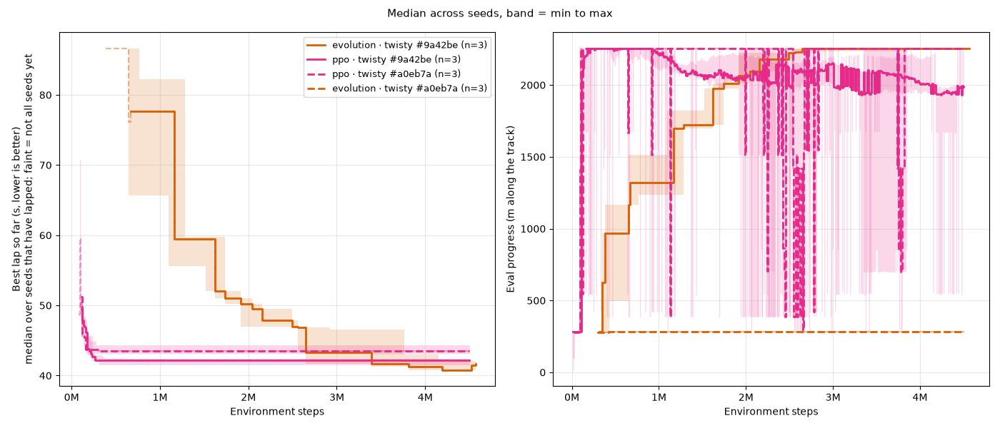
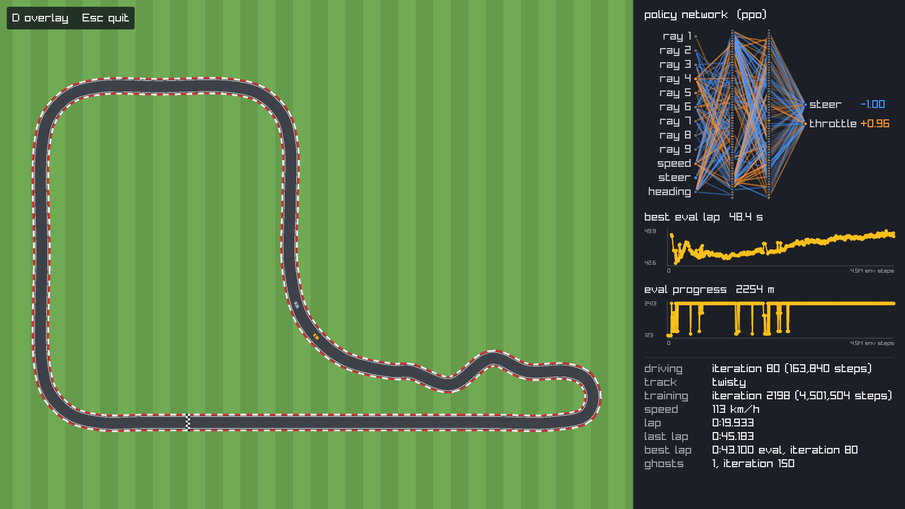

# 08 · Fastest lap: reward shaping, and what a time cost really buys

Lessons 04 and 07 left the same question from two sides. Evolution's lap time flattened at
40.77-41.67 s once two laps fit in the 90 s limit, because from there "1 s faster ≈ 0.15 return"
(lesson 04). Both PPOs learned 42 s laps and then drifted to 46-54 s, while A2C, on the same
reward, set 39.03 s (lesson 07). This lesson changes the reward to ask for speed,
[`configs/env_fastlap.toml`](../../configs/env_fastlap.toml), a five times larger time cost, and
measures what happens. Three things come out of it. The first version of that config did not do
what its comment said, and why it did not is the most useful idea here: a per-step cost only
prices time if the episode can end sooner. After the fix, the bigger time cost made evolution
worse and PPO no better: evolution never got past the first hairpin on any of three seeds (it had
lapped on all three with the default reward), and PPO's best laps came out slower (median 43.48 s
against 42.13 s, a gap inside the run-to-run spread we measured, so suggestive rather than
proven). A smaller increase, twice the default, did not help either. And the derivation of *why*
gives the lesson's main tool: write down what each learner actually maximizes, and ask which of
its choices a reward change reorders.

Files: [`configs/env_fastlap.toml`](../../configs/env_fastlap.toml), [`configs/env.toml`](../../configs/env.toml),
[`racer/sim.py`](../../racer/sim.py), [`racer/algos/evolution.py`](../../racer/algos/evolution.py),
[`racer/algos/ppo.py`](../../racer/algos/ppo.py), [`tests/test_config.py`](../../tests/test_config.py).

## Reward shaping

Every method in this project maximizes a number computed from the rewards, and only that
number. Evolution ranks genomes by the undiscounted episode return (lesson 04); A2C and PPO
maximize the discounted return, with the critic standing in for everything after a truncation
(lessons 06 and 07). Nothing else about what we "meant" reaches them. *Reward shaping* is
designing the reward terms so that maximizing that number is easy to learn and produces the
behaviour we want, and the two goals pull apart more often than you would expect.

The reward is four terms ([sim.py#L225-L226](../../racer/sim.py#L225-L226), lesson 03):

```
reward = progress_scale * progress - time_cost + lap_bonus * lapped - crash_penalty * crashed
         0.1 per meter                0.01/decision  10 per lap          10 per crash
```

One classic result tells you which terms can change what is optimal and which cannot.
*Potential-based shaping* (Ng, Harada and Russell, 1999): pick any function `Φ(s)` of the state
and add `F = γ Φ(s') - Φ(s)` to every step's reward. Summed over an episode, the added terms
telescope,

```
Σ_t γ^t F_t = Σ_t (γ^{t+1} Φ(s_{t+1}) - γ^t Φ(s_t)) = γ^T Φ(s_T) - Φ(s_0)
```

so every policy's return changes by the same `-Φ(s_0)` plus a term that depends only on where
the episode ends. If every episode ends in states with the same `Φ`, the ranking of policies is
untouched: such a term can make learning easier (it hands out credit early) but cannot change
what the best policy is.

Our progress term is exactly that form with `γ = 1` and `Φ = 0.1 · traveled`: each decision pays
`0.1 · (traveled' - traveled)`, and an episode's progress reward is `0.1 ·` the distance it ends at.
So whether progress pays for *speed* depends only on whether the distance an episode ends at
depends on speed. The time cost is the mirror image: it sums to `-time_cost ·` the number of
decisions, so it pays for speed only if the *length* of the episode depends on speed. Both come
down to the same question: what ends the episode?

## What ends the episode decides what the time cost pays for

The simulator ends an episode in four ways ([sim.py#L220-L223](../../racer/sim.py#L220-L223),
lesson 03): a crash or driving 15 m the wrong way (*terminated*), the time limit or the last lap
(*truncated*). Hold the car fixed, a driver lapping twisty (1,126.42 m) in exactly `T` seconds
at constant speed, and change only the rules. [`fastlap_arithmetic.py`](scripts/fastlap_arithmetic.py)
does it for a 41 s and a 45 s driver (15 decisions per second):

```
uv run python docs/lessons/scripts/fastlap_arithmetic.py
1. undiscounted episode return (evolution's fitness)
  env.toml          41 s laps: laps at  82.0 s, 2252.8 m, 2 laps  return  232.98
  env.toml          45 s laps: laps at  90.0 s, 2252.8 m, 2 laps  return  231.78
  env.toml          41 s driver earns +1.20 more

  old env_fastlap   41 s laps: time limit at  90.0 s, 2472.6 m, 2 laps  return  199.76
  old env_fastlap   45 s laps: time limit at  90.0 s, 2252.8 m, 2 laps  return  177.78
  old env_fastlap   41 s driver earns +21.98 more

  env_fastlap.toml  41 s laps: laps at  82.0 s, 2252.8 m, 2 laps  return  183.78
  env_fastlap.toml  45 s laps: laps at  90.0 s, 2252.8 m, 2 laps  return  177.78
  env_fastlap.toml  41 s driver earns +6.00 more
```

Read it term by term:

| config | what ends a clean episode | progress | time cost | 41 s driver's edge |
|---|---|---|---|---|
| `env.toml` (0.01 per decision, 2 laps, 90 s) | the line, at `2T` | 225.28 for both (same distance) | `0.15 · 2T`: 12.30 vs 13.50 | **+1.20**, all from the time cost |
| old `env_fastlap` (0.05, **3 laps**, 90 s) | the clock, at 90 s (3 laps need `3T`: 123 s at 41 s laps) | 247.26 vs 225.28 (more meters in 90 s) | `0.75 · 90` = 67.50 for **both** | **+21.98**, all from progress |
| fixed `env_fastlap.toml` (0.05, 2 laps, 120 s) | the line, at `2T` | 225.28 for both | `0.75 · 2T`: 61.50 vs 67.50 | **+6.00**, all from the time cost |

### The bug in the first fast-lap config

The plan's first `env_fastlap.toml` raised the time cost five times "so every second costs more"
and raised `max_laps` from 2 to 3. On twisty those two changes cancel. Three laps take at least
117 s even at the best lap any method has set (A2C's 39.03 s, lesson 06), so no car ever finishes
them in 90 s: every episode that does not crash ends at the time limit, after exactly 1,350 decisions,
and pays exactly `1,350 × 0.05 = 67.50` of time cost. A number that every surviving driver pays
in full cannot tell them apart. [`time_cost_returns.py`](scripts/time_cost_returns.py) confirms it on
real checkpoints, the two fastest evolution genomes of lesson 04 and the PPO checkpoint that set
42.13 s in lesson 07, each replayed under all three configs:

```
uv run python docs/lessons/scripts/time_cost_returns.py runs/evolution-20261123-200006-s0 \
    runs/evolution-20261123-200008-s1 runs/ppo-20261123-220355-s0@110
(first line, the track length, and blank lines left out)
runs/evolution-20261123-200006-s0  (evolution, iteration 64)
  default      2 laps       84.13 s   2253.0 m  laps [43.37, 40.77]  return  232.68 = progress  225.3 time -12.62 laps   20 crash   -0
  old fastlap  time limit   90.00 s   2474.4 m  laps [43.37, 40.77]  return  199.94 = progress  247.4 time -67.50 laps   20 crash   -0
  fastlap      2 laps       84.13 s   2253.0 m  laps [43.37, 40.77]  return  182.20 = progress  225.3 time -63.10 laps   20 crash   -0
runs/evolution-20261123-200008-s1  (evolution, iteration 55)
  default      2 laps       86.07 s   2253.7 m  laps [44.38, 41.67]  return  232.46 = progress  225.4 time -12.91 laps   20 crash   -0
  old fastlap  time limit   90.00 s   2400.9 m  laps [44.38, 41.67]  return  192.59 = progress  240.1 time -67.50 laps   20 crash   -0
  fastlap      2 laps       86.07 s   2253.7 m  laps [44.38, 41.67]  return  180.82 = progress  225.4 time -64.55 laps   20 crash   -0
runs/ppo-20261123-220355-s0@110  (ppo, iteration 110)
  default      2 laps       86.60 s   2253.5 m  laps [44.45, 42.13]  return  232.36 = progress  225.4 time -12.99 laps   20 crash   -0
  old fastlap  time limit   90.00 s   2367.0 m  laps [44.45, 42.13]  return  189.20 = progress  236.7 time -67.50 laps   20 crash   -0
  fastlap      2 laps       86.60 s   2253.5 m  laps [44.45, 42.13]  return  180.40 = progress  225.4 time -64.95 laps   20 crash   -0
```

Under "old fastlap" the time column reads -67.50 three times. The general rule:

> **A constant per-step penalty under a fixed horizon is reward-neutral.** If every episode
> lasts the same number of steps, `-c` per step is `-c · T_max` for everyone, a constant, and a
> constant changes no ranking and no gradient. Only *termination*, an episode that can end
> sooner, makes time matter.

Two honest footnotes to that rule, both visible above:

- **The old config still paid for speed, through progress.** With the clock ending every clean
  episode, progress is "meters in 90 s", and the 41 s driver's 220 extra meters are worth +21.98,
  more than the fixed config's +6.00. So the first config was not a no-op. It was a *different*
  speed incentive than the one its comment claimed (distance in a fixed time instead of time for a
  fixed distance), and its five-times time cost added nothing to it.
- **The time cost was not quite neutral: it made crashing cheaper.** A car that crashes at
  second `t` stops paying `0.75` a second for the remaining `90 - t`. A crash at 30 s saves
  45.0, almost five crash penalties. "Neutral" holds only among cars that survive.

The fix ([commit message and file comments](../../configs/env_fastlap.toml)) keeps `max_laps = 2`
and raises the limit to 120 s, so any driver lapping in 60 s or less finishes inside it and the
episode lasts `2T`. Then each second saved per lap is worth `2 × 0.75 = 1.5` (env.toml: 0.3).
[`test_env_fastlap_laps_finish_inside_time_limit`](../../tests/test_config.py) pins the condition
that makes this work (`max_laps × 60 s ≤ max_episode_s`), and
[`test_env_fastlap_differs_from_env_only_in_time_cost_and_time_limit`](../../tests/test_config.py)
pins that nothing else changed.

## Evolution ranks, so only orderings matter

Evolution never looks at fitness *values*, only at their order:
[`next_generation`](../../racer/algos/evolution.py#L101-L108) sorts and keeps the top 16.

```python
elites = genomes[np.argsort(fitness)[::-1][:n_elite]]  # best first
```

So multiply the time cost by five and ask which *orderings* change. Among genomes that finish
both laps, none: progress and lap bonuses are equal, and any positive time cost puts the faster
one first. `env.toml` already did that; "1 s faster ≈ 0.15" (lesson 04) was small but ranked
correctly, and rank is all selection uses. What a bigger time cost changes is how a finisher
compares with a car that does *not* finish, and that matters most early, when nobody finishes.
Lesson 04's seed 0 is the example: at generation 5 its best genome drove flat out and crashed in
the first hairpin, at generation 10 the best was a cautious crawler that never crashed, and from
there it learned to lap. Replayed under all three configs:

```
uv run python docs/lessons/scripts/time_cost_returns.py runs/evolution-20261123-200006-s0@5 runs/evolution-20261123-200006-s0@10
runs/evolution-20261123-200006-s0@5  (evolution, iteration 5)
  default      crash        11.58 s    285.0 m  laps [-]  return   16.76 = progress   28.5 time  -1.74 laps    0 crash  -10
  old fastlap  crash        11.58 s    285.0 m  laps [-]  return    9.80 = progress   28.5 time  -8.70 laps    0 crash  -10
  fastlap      crash        11.58 s    285.0 m  laps [-]  return    9.80 = progress   28.5 time  -8.70 laps    0 crash  -10
runs/evolution-20261123-200006-s0@10  (evolution, iteration 10)
  default      time limit   90.00 s    497.9 m  laps [-]  return   36.29 = progress   49.8 time -13.50 laps    0 crash   -0
  old fastlap  time limit   90.00 s    497.9 m  laps [-]  return  -17.71 = progress   49.8 time -67.50 laps    0 crash   -0
  fastlap      time limit  120.00 s    497.9 m  laps [-]  return  -40.21 = progress   49.8 time -90.00 laps    0 crash   -0
```

Under `env.toml` the crawler beats the crasher, 36.29 to 16.76: not crashing is worth more than
speed. Under the fast-lap reward the order flips, 9.80 to -40.21: the crawler's 120 s of driving
cost 90.00, nine crash penalties. The stepping stone lesson 04 relied on is gone. The general
version: at a time cost of `c` per decision, each further second of driving pays for itself only
above `15c / 0.1 = 150c` m/s average (7.5 m/s at 0.05). That is a per-second break-even, not yet a
reason to crash, because crashing costs a one-off 10: a slower car scores better by crashing only
when enough driving is still ahead for its per-second losses to add up to more than 10. The
crawler above averaged 4.15 m/s (497.9 m in 120 s), lost 0.34 per second, and over its 120 s
lost 40.21, four crash penalties; it would have been better off crashing after about 30 s. A
beginner is slower than 7.5 m/s and has a whole episode ahead of it. So the prediction for evolution is not "faster laps" but "trouble getting through the first hairpin at
all". The results below confirm it.

## PPO: discounting, bootstrapping, and a time cost that only prices endings

A2C, PPO and SB3 see the same reward through two lenses: a discount, and the truncation bootstrap.

**Discounting already favours speed, in one way weakly and in another strongly.** At `γ = 0.99`
per decision and 15 decisions per second, a reward one second away counts `0.99^15 = 0.860`, the
half-life is 4.6 s, and the effective horizon `1/(1-γ)` is 100 decisions, 6.67 s
(`fastlap_arithmetic.py`, part 2):

```
41 s laps (27.47 m/s): the first lap bonus, 41 s away, is worth 0.0207 at the start; driving on forever is worth 18.32 in progress (0.1 x v / 15 per decision, / (1 - gamma))
45 s laps (25.03 m/s): the first lap bonus, 45 s away, is worth 0.0113 at the start; driving on forever is worth 16.69 in progress (0.1 x v / 15 per decision, / (1 - gamma))
```

- *Weakly*, through the goal: the textbook argument "with `γ < 1`, reaching the goal sooner is
  worth more" is true and useless here. The lap bonus is 615 decisions away for the 41 s driver,
  `0.99^615 = 0.002`: arriving four seconds earlier adds 0.009 to the value at the start line.
- *Strongly*, through the dense progress term: every decision pays `0.1 · v / 15`, and the
  discounted sum of that is `0.667 · v`, so the critic's value is proportional to speed: 18.32
  against 16.69, a 9.8% edge for the 41 s driver. Under `env.toml` evolution's edge for the same
  driver was 1.20 in 232.98, 0.5%. For a discounted learner, progress is not a pure shaping term
  (the potential-based form needs `γΦ(s') - Φ(s)`, and we pay `Φ(s') - Φ(s)`): meters now are
  worth more than meters later, which is a direct incentive to go fast.

**Bootstrapping makes the race endless.** Both the time limit and the last lap are truncations,
and [`add_truncation_bootstrap`](../../racer/algos/ppo.py#L145-L148) adds `γ V(final_obs)` to the
last reward (lesson 06): as far as the critic is concerned, the car drives on. So `max_laps` and
`max_episode_s` do not enter PPO's objective at all; they only decide where cars respawn. The
only endings PPO's objective knows are crashes and wrong way. Now split the time cost out of a
discounted sum that ends with a termination at step `T`:

```
Σ_{t<T} γ^t (r_t - c) = Σ_{t<T} γ^t r_t  -  c (1 - γ^T)/(1 - γ)
                      = Σ_{t<T} γ^t r_t  -  c/(1 - γ)  +  γ^T · c/(1 - γ)
```

The middle term is the same for every policy. The last is a reward of `c/(1-γ)` paid at the
moment of termination, discounted like any reward at step `T`. So **for PPO a time cost is
exactly a bonus of `c/(1-γ)` on every crash and every wrong-way ending**, and nothing else: 1.0
for `env.toml`'s 0.01, 5.0 for the fast-lap 0.05. The fast-lap config, for PPO, is "crashes cost
5 instead of 10, and turning round earns 5 minus the 1.5 of lost progress". Whether ending beats
driving on depends on speed (part 3 of the script; lap bonuses, worth under 0.03 from 41 s away,
left out):

```
time cost x1  (c = 0.01): termination bonus   1.0; ending beats driving on below  0.0 m/s by crashing,  0.0 m/s by turning round
time cost x2  (c = 0.02): termination bonus   2.0; ending beats driving on below  0.0 m/s by crashing,  0.7 m/s by turning round
time cost x5  (c = 0.05): termination bonus   5.0; ending beats driving on below  0.0 m/s by crashing,  5.2 m/s by turning round
time cost x20 (c = 0.20): termination bonus  20.0; ending beats driving on below 15.0 m/s by crashing, 27.7 m/s by turning round
```

At ×5 a PPO car slower than 5.2 m/s would rather turn round, which only a beginner is; at ×20,
anything slower than a 41 s lap (27.5 m/s) would. That is the prediction for experiment 1.

## Results: the fast-lap reward against the default, three seeds each

Six main runs on the fixed `env_fastlap.toml`, PPO and evolution with their default settings
([`configs/ppo.toml`](../../configs/ppo.toml), [`configs/evolution.toml`](../../configs/evolution.toml)),
seeds 0, 1, 2 on twisty, the shared 4.5M env-step budget, all six at once on the dev machine
(later joined by the experiments below), 2026-11-23. The default-reward runs they are compared
with are lesson 04's evolution and lesson 07's PPO runs, same settings, same budget.

```sh
uv run racer train ppo --env-config configs/env_fastlap.toml --seed 0          # and --seed 1, 2
uv run racer train evolution --env-config configs/env_fastlap.toml --seed 0    # and --seed 1, 2
uv run racer compare runs/evolution-20261123-200006-s0 runs/evolution-20261123-200008-s1 runs/evolution-20261123-200010-s2 \
    runs/ppo-20261123-220355-s0 runs/ppo-20261123-220356-s1 runs/ppo-20261123-220358-s2 \
    runs/evolution-20261123-225704-s0 runs/evolution-20261123-225705-s1 runs/evolution-20261123-225707-s2 \
    runs/ppo-20261123-225701-s0 runs/ppo-20261123-225702-s1 runs/ppo-20261123-225703-s2 --out results/ --name fastlap
uv run python docs/lessons/scripts/run_summary.py runs/ppo-20261123-225701-s0 ...
uv run python docs/lessons/scripts/eval_history.py runs/ppo-20261123-225701-s0 ... --short
uv run python docs/lessons/scripts/lap_counts.py runs/ppo-20261123-225701-s0 ...
```

`racer compare` groups runs by method, track, a hash of the env config and a hash of the
method's settings (seed left out). The method settings are the same here, so the two rewards
are two groups per method: **`#9a42be` is `env.toml`, `#a0eb7a` is `env_fastlap.toml`** (solid
and dashed lines in the plots). Its table (appended to [`results/summary.md`](../../results/summary.md)):

| group | seeds | success | best lap s, median (range) | env steps to first lap | wall s to first lap |
|---|---|---|---|---|---|
| evolution · twisty #9a42be (default) | 3 | 3/3 | 40.78 (40.77–41.67) | 649,193 | 75.4 |
| evolution · twisty #a0eb7a (fast-lap) | 3 | 0/3 | – | – | – |
| ppo · twisty #9a42be (default) | 3 | 3/3 | 42.13 (41.53–42.43) | 102,400 | 15.3 |
| ppo · twisty #a0eb7a (fast-lap) | 3 | 3/3 | 43.48 (43.10–44.37) | 92,160 | 13.0 |

**Which "best lap".** `compare`'s best lap is, per seed, the fastest lap any evaluation of the
run ever drove (the running minimum of `eval_best_lap_s`), then the median over seeds. So a run
that slows down late still keeps its fast checkpoint's lap; the late slowdown has its own section
below. One more thing differs between the groups: evaluations use each run's own env config, and
the fast-lap one allows 120 s, so a slow late PPO driver completes both laps there and can record
a (faster, flying) second lap that a 90 s evaluation would have cut off. For the running best this
matters once: fast-lap seed 1's fastest checkpoint (iteration 135) needs 91.13 s for both laps,
so a 90 s evaluation would have recorded only its 46.72 s first lap, not the 44.37 s second
(`time_cost_returns.py`, below). That flatters the fast-lap group, so it does not change the
conclusion; every other run's fastest checkpoint drove both laps in under 90 s.



Per run (`run_summary.py`; lesson 07's table for the default PPO runs, lesson 04's for evolution):

| method | reward | seed | run directory | first lapping evaluation | fastest lap (iteration) | final evaluation |
|---|---|---|---|---|---|---|
| PPO | default | 0 | `runs/ppo-20261123-220355-s0` | 92,160 steps | 42.13 s (110) | 1 lap, 51.53 s |
| PPO | default | 1 | `runs/ppo-20261123-220356-s1` | 112,640 steps | 42.43 s (270) | 1 lap, 52.65 s |
| PPO | default | 2 | `runs/ppo-20261123-220358-s2` | 102,400 steps | **41.53 s** (150) | 1 lap, 46.13 s |
| PPO | fast-lap | 0 | `runs/ppo-20261123-225701-s0` | 102,400 steps | 43.48 s (150) | 2 laps, best 57.13 s |
| PPO | fast-lap | 1 | `runs/ppo-20261123-225702-s1` | 92,160 steps | 44.37 s (135) | 2 laps, best 48.45 s |
| PPO | fast-lap | 2 | `runs/ppo-20261123-225703-s2` | 81,920 steps | **43.10 s** (80) | 2 laps, best 48.35 s |
| evolution | default | 0 | `runs/evolution-20261123-200006-s0` | gen 15, 649,193 steps | **40.77 s** (55) | 2 laps, return 232.68 |
| evolution | default | 1 | `runs/evolution-20261123-200008-s1` | gen 10, 669,230 steps | 41.67 s (55) | 2 laps, return 232.46 |
| evolution | default | 2 | `runs/evolution-20261123-200010-s2` | gen 5, 383,855 steps | 40.78 s (50) | 2 laps, return 232.81 |
| evolution | fast-lap | 0 | `runs/evolution-20261123-225704-s0` | never (330 generations) | – | crash at 283.3 m, return 11.48 |
| evolution | fast-lap | 1 | `runs/evolution-20261123-225705-s1` | never (338 generations) | – | crash at 283.3 m, return 11.48 |
| evolution | fast-lap | 2 | `runs/evolution-20261123-225707-s2` | never (340 generations) | – | crash at 283.2 m, return 11.47 |

### Evolution: stuck at the first hairpin, on every seed

The fast-lap evolution runs are the flat dashed line at 283 m in the progress panel. All three
spent the whole 4.5M steps with a best genome that drives flat out down the start straight and
crashes in the first hairpin (best fitness between 11.2 and 11.5 from generation 10 to the end,
in the console logs), the same kind of driver as lesson 04's generation-5 genome, which was worth
9.80 under this reward (11.48 here, crashing at 283 m instead of 285 m). They ran 330-340 generations, five to six times more than the default runs' 54-64,
because a generation of crashers is short. Selection had plenty of chances, and still never kept a car that
got through. The arithmetic says why the *slow* survivors evolution actually produced lost: the
crawler above scored -40.21 against the crashers' 11.48. It does not say every survivor must
lose. A car that braked only for the hairpin and crashed at the next corner (about 500 m after
about 20 s) would score roughly 50 - 10 - 15 = 25, more than the crashers. That such a car never
appeared in 330-340 generations suggests the real barrier is how mutations act: in a 12-32-2
network a change that makes the car brake before the hairpin most likely also slows it on the
straight and everywhere else, which produces a crawler, not a selective braker. We did not test
this directly. Either way, the reward that asks for fast laps took away the reward for the
cautious drivers that came first under `env.toml`.

### PPO: laps, but slower and crashier

PPO lapped on all three seeds as fast as before (81,920-102,400 steps to the first lap), and set
fastest laps of 43.10-44.37 s against 41.53-42.43 s. With three seeds a side, complete separation
(all three fast-lap runs slower than all three default runs) would happen by chance one time in
20 if the reward made no difference, so this is suggestive, not proven; experiment 1 below gives
a sense of the run-to-run spread. Two things in the logs point the same way as the theory (a
crash now costs 5 instead of 10):

- **More evaluations failed to lap.** From each run's first lap on, evaluations that did not
  complete a lap (`eval_history.py`): 117 of 431, 34 of 432 and 24 of 433 for the fast-lap seeds,
  against 2 of 432, 0 of 430 and 59 of 431 with the default reward (lesson 07). Totals: 175 of
  1,296 against 61 of 1,293.
- **Replays classify those as crashes.** [`endings.py`](scripts/endings.py) replays every fourth
  checkpoint of all six runs under the *same* config (`env_fastlap.toml`, so both get 120 s) and
  classifies how each episode ended:

```
uv run python docs/lessons/scripts/endings.py runs/ppo-20261123-220355-s0 ... --every 4 --noisy 32 --env configs/env_fastlap.toml
endings per quarter of the run: crash / wrong way / time limit / finished, median lap s
ppo-20261123-220355-s0 (110 checkpoints under configs/env_fastlap.toml)
  Q1   2   0   0  26 44.79 | Q2   0   0   0  27 46.42 | Q3   0   0   0  27 47.47 | Q4   0   0   0  28 49.51
  final checkpoint, 32 sampled episodes: crash / wrong way / time limit / finished =   0   0   0  32; median lap 50.72 s; median episode 101.5 s
ppo-20261123-220356-s1 (110 checkpoints under configs/env_fastlap.toml)
  Q1   3   0   0  25 44.97 | Q2   0   0   0  27 49.20 | Q3   0   0   0  27 50.56 | Q4   0   0   0  28 51.40
  final checkpoint, 32 sampled episodes: crash / wrong way / time limit / finished =   0   0   0  32; median lap 51.95 s; median episode 104.0 s
ppo-20261123-220358-s2 (110 checkpoints under configs/env_fastlap.toml)
  Q1   5   0   0  23 46.15 | Q2   3   0   0  24 48.85 | Q3   9   0   0  18 46.72 | Q4  11   0   0  17 46.09
  final checkpoint, 32 sampled episodes: crash / wrong way / time limit / finished =   6   0   0  26; median lap 46.15 s; median episode 90.7 s
ppo-20261123-225701-s0 (110 checkpoints under configs/env_fastlap.toml)
  Q1   4   0   1  23 48.50 | Q2   5   0   0  22 54.26 | Q3  12   0   0  15 56.77 | Q4  12   0   0  16 57.00
  final checkpoint, 32 sampled episodes: crash / wrong way / time limit / finished =   0   0   0  32; median lap 58.10 s; median episode 116.0 s
ppo-20261123-225702-s1 (110 checkpoints under configs/env_fastlap.toml)
  Q1   6   0   1  21 47.29 | Q2   0   0   0  27 48.73 | Q3   5   0   0  22 50.33 | Q4   2   0   0  26 50.17
  final checkpoint, 32 sampled episodes: crash / wrong way / time limit / finished =   0   0   0  32; median lap 49.29 s; median episode 98.5 s
ppo-20261123-225703-s2 (110 checkpoints under configs/env_fastlap.toml)
  Q1   6   0   0  22 46.23 | Q2   4   0   0  23 46.00 | Q3   1   0   0  26 47.71 | Q4   0   0   0  28 49.41
  final checkpoint, 32 sampled episodes: crash / wrong way / time limit / finished =   0   0   0  32; median lap 49.67 s; median episode 98.9 s
```

(The first three runs are the default reward, the last three fast-lap; the output of the two
invocations is shown together.) Crashes in the replayed evaluations: 33 of 330 for the default
runs, 57 of 330 for the fast-lap runs, but seed by seed it is 2/3/28 against 33/13/11: the
default seed 2 crashed about as often as the worst fast-lap seed. The direction matches the
theory; the size is mostly seed. The "median lap" column mixes standing-start first laps and
flying second laps, so read it for its trend, not against `compare`'s best laps.

Where the slower laps lose time, from the fastest lap of each run (its ghost;
[`line_compare.py`](scripts/line_compare.py), seeds 2 and 0 of each reward):

```
uv run python docs/lessons/scripts/line_compare.py runs/ppo-20261123-220358-s2 runs/ppo-20261123-225703-s2 runs/ppo-20261123-220355-s0 runs/ppo-20261123-225701-s0
time per eighth of the lap (s), from the start line
runs/ppo-20261123-220358-s2 (iteration 150): lap 41.53 s, average 27.1 m/s, top 34.8 m/s, slowest 8.7 m/s at 283 m
    line: mean |offset| 1.98 m, more than 3 m off 4% of the lap, max |offset| 4.47 m
    sections:  4.11  4.90  7.22  4.87  5.25  5.25  4.54  5.39
runs/ppo-20261123-225703-s2 (iteration 80): lap 43.10 s, average 26.1 m/s, top 34.4 m/s, slowest 8.7 m/s at 284 m
    line: mean |offset| 2.52 m, more than 3 m off 46% of the lap, max |offset| 4.58 m
    sections:  4.43  5.09  7.46  4.82  5.43  5.45  4.83  5.60
runs/ppo-20261123-220355-s0 (iteration 110): lap 42.13 s, average 26.7 m/s, top 33.8 m/s, slowest 10.2 m/s at 283 m
    line: mean |offset| 1.49 m, more than 3 m off 2% of the lap, max |offset| 3.93 m
    sections:  4.21  4.92  7.19  5.20  5.29  5.26  4.65  5.41
runs/ppo-20261123-225701-s0 (iteration 150): lap 43.48 s, average 25.9 m/s, top 31.5 m/s, slowest 12.0 m/s at 289 m
    line: mean |offset| 1.43 m, more than 3 m off 2% of the lap, max |offset| 3.56 m
    sections:  4.43  5.16  7.71  5.18  5.30  5.30  4.92  5.39
```

No single corner explains the gap: the fast-lap laps lose a little in almost every eighth of the
track (seed 2: 0.32 s in the first, 0.24 in the third, 0.29 in the seventh). The racing line
changed on seed 2 (it spent 46% of its lap more than 3 m from the centerline, against 4%) and not
on seed 0 (2% for both), so "the time cost changes the line" is not a general finding here.
Everything slowest happens at the same place, the 283 m hairpin, where both rewards' drivers brake
to 8.7-12.0 m/s.

### Did PPO still slow down late?

Yes, on all three seeds, as with the default reward. The fast-lap evaluations allow two laps in
120 s, so the late, slow drivers keep completing both laps (the dashed progress lines stay at
2,254 m, while the default runs' sag to about 2,000 m because a 48 s driver no longer fits two laps
in 90 s; that difference is the evaluation's time limit, not the drivers). `lap_counts.py` on the
fast-lap runs:

```
ppo-20261123-225701-s0:  Q1  12/  1/ 96 lap 48.25 s | Q2  20/  4/ 86 lap 53.91 s | Q3  48/ 13/ 49 lap 56.42 s | Q4  46/  2/ 63 lap 56.43 s
ppo-20261123-225702-s1:  Q1  22/  6/ 81 lap 46.68 s | Q2   2/  1/107 lap 48.19 s | Q3  15/  8/ 87 lap 49.83 s | Q4   3/  4/104 lap 49.27 s
ppo-20261123-225703-s2:  Q1  15/  7/ 87 lap 44.92 s | Q2  14/  4/ 92 lap 45.08 s | Q3   2/  1/107 lap 47.19 s | Q4   0/  0/111 lap 48.33 s
```

(output condensed to one line per run, as in lesson 07.) To compare the final drivers like for
like, `time_cost_returns.py` replays the six final checkpoints under the same two configs: under
`env_fastlap.toml` the fast-lap finals drive their second laps in 57.13, 48.45 and 48.35 s, the
default finals in 49.90, 51.12 and 44.25 s. Every one ends slower than its own fastest lap,
by 4.1-13.7 s with the fast-lap reward and 2.7-8.7 s with the default. And the exploration noise collapsed the same way: final `log_std` -3.53, -3.55, -3.43 (a std of
about 0.03), against -3.84, -3.62, -3.17 for the default runs:

```sh
uv run python -c "from racer.runlog import RunDir; print([round(RunDir.open(r).read_metrics()[-1]['log_std_mean'], 2) for r in ['runs/ppo-20261123-225701-s0', 'runs/ppo-20261123-225702-s1', 'runs/ppo-20261123-225703-s2']])"
```

with `approx_kl` medians over the last tenth of 0.034, 0.032 and 0.043 and `clip_frac` 0.33, 0.31
and 0.36 (`eval_history.py`), the same growth lesson 07 found. That is what the theory says should
happen: for PPO the fast-lap reward changes only the price of a crash, and lesson 07's slowdown
was traced to the optimization (a collapsing std, growing policy moves), not to what the reward
pays for. A reward change cannot fix an optimizer problem. The remedies lesson 07 listed (a
decaying learning rate, an entropy bonus, `target_kl`) remain the ones to try.

## Reward hacking: what we looked for

*Reward hacking* is an agent maximizing the reward you wrote in a way you did not intend. With a
time cost there are three obvious exploits; each was checked.

- **Ending the episode early.** If driving on is worth less than ending, the agent ends. With the
  ×5 time cost, no: in 660 replayed PPO evaluations and 192 sampled episodes above, nothing ended
  early except crashes, which the theory says are 5 cheaper but still a loss for any car that
  moves at all (the ×5 row of the table above: 0.0 m/s). With ×20, yes, in both methods (experiment 1): PPO on both seeds and evolution on
  seed 0 learned to crash into the side of the road 1.27 s after the start.
- **Turning round.** The wrong-way rule ends an episode with no penalty, only the 1.5 of lost
  progress, so it is the cheapest exit. Zero wrong-way endings in the 660 replays and 192 sampled
  episodes above, and none among the experiments' final evaluations: the cars that wanted out
  crashed instead (the wall is a few meters away; turning round means driving 15 m backwards).
- **Cutting corners through the projection.** Progress is measured by projecting the car onto the
  centerline, and [`Track.project`](../../racer/track.py#L99-L137)'s docstring warns that on the
  inside of a curve `s` can jump by a little at each segment boundary. Could a car earn progress by
  hugging the inside? The jumps cancel: the totals over a stretch are exact, and every two-lap
  episode replayed in this lesson covered 2,253.0-2,254.5 m, 2 × 1,126.42 m plus the overshoot of
  the final decision. And the four ghost lines compared above stayed inside the walls (max
  |offset| 3.56-4.58 m against a wall at about 5 m for the car's center), because leaving the road
  is a crash.

The fast-lap failure of evolution is not reward hacking. Nothing was exploited: the reward
ordered a beginner's options so that the path to good driving went downhill first. That is the
more common way shaping goes wrong.

## Tuning the time cost: a second attempt

The plan allowed tuning `time_cost` if lap times did not improve, and they did not. The two
derivations say which direction is worth trying. For PPO any time cost is only a termination
bonus of `100c`: above ×5 it heads for the ×20 suicide of experiment 1, below it heads back to
`env.toml`. For evolution a larger cost blocks the beginner earlier. So the only candidate is
*down*: `time_cost = 0.02` (×2, each second saved per lap worth 0.6), the full 4.5M budget, three
seeds of each method, 2026-11-23 (three PPO and three evolution runs at once).

```sh
uv run racer train ppo --env-config configs/env_fastlap.toml --env-set time_cost=0.02 --seed 0          # and 1, 2
uv run racer train evolution --env-config configs/env_fastlap.toml --env-set time_cost=0.02 --seed 0    # and 1, 2
```

| method | `time_cost` | seed | run directory | first lapping evaluation | fastest lap (iteration) | final evaluation |
|---|---|---|---|---|---|---|
| PPO | 0.02 | 0 | `runs/ppo-20261123-232824-s0` | 71,680 steps | 42.48 s (750) | 2 laps, best 48.00 s |
| PPO | 0.02 | 1 | `runs/ppo-20261123-232825-s1` | 122,880 steps | 44.30 s (225) | 2 laps, best 51.98 s |
| PPO | 0.02 | 2 | `runs/ppo-20261123-232827-s2` | 92,160 steps | 43.23 s (165) | 2 laps, best 44.23 s |
| evolution | 0.02 | 0 | `runs/evolution-20261123-232215-s0` | never (419 generations) | – | crash at 283.5 m, return 15.61 |
| evolution | 0.02 | 1 | `runs/evolution-20261123-232217-s1` | gen 30, 1,364,450 steps | 43.07 s (55) | 2 laps, best 43.13 s |
| evolution | 0.02 | 2 | `runs/evolution-20261123-232218-s2` | gen 5, 476,465 steps | 42.07 s (48) | 2 laps, best 42.07 s |

- **PPO: median fastest lap 43.23 s**, between `env.toml`'s 42.13 s and ×5's 43.48 s, and inside
  the run-to-run spread of experiment 1. Evaluations that failed to lap after the first lap:
  28 of 434, 33 of 429 and 99 of 432 (`eval_history.py`). The late slowdown is there again
  (`lap_counts.py` quarter medians for seed 1: 45.90, 51.19, 51.07, 52.34 s).
- **Evolution: two of three seeds lapped**, at 43.07 and 42.07 s, slower than all three default
  runs (40.77-41.67 s); seed 0 stayed at the hairpin for all 4.5M steps. Seed 1 needed 1,364,450
  steps for its first lap, the same generation as in the 1.5M experiment: a hard climb, not bad luck.

So `env_fastlap.toml` keeps its ×5: it is the setting the lesson studies, and no value tried made
either method faster. The honest conclusion of this stage is that a bigger time cost is the wrong
lever here. For PPO, the speed incentive is already in the per-meter progress reward, and the slow
end of its runs is an optimization problem (lesson 07); the next things to try are the optimizer
fixes listed there. For evolution, a curriculum would sidestep the beginner's problem (learn to
lap under `env.toml`, then raise the time cost to rank the finishers harder), but rank selection
already ranks finishers by lap time under any positive time cost, so even that could only change
which risks the elite takes, not whether speed is rewarded. Neither is built in this project.

## What to look for in the viewer

The viewer replays a run's own ghosts. To race the two rewards against each other,
[`ghost_pair.py`](scripts/ghost_pair.py) builds a scratch run directory
(`runs/ghostcmp-ppo-s2`, git-ignored like every run) whose live car is the fast-lap seed 2
checkpoint that set 43.10 s, and whose only ghost is the default-reward seed 2 lap of 41.53 s:

```sh
uv run python docs/lessons/scripts/ghost_pair.py ppo-s2 runs/ppo-20261123-225703-s2@80 runs/ppo-20261123-220358-s2
uv run racer watch runs/ghostcmp-ppo-s2 --ghosts 1
```



(Screenshot: the same `watch` command with `--screenshot docs/img/fastlap.png --frames 3911`:
3,911 frames at 60 per second is 65.18 s, the live car's 45.18 s first lap plus 20 s of its
second, flying lap, which is the lap the ghost recorded.) The status block says what is on screen:
driving iteration 80, lap 0:19.933, last lap 0:45.183, best lap 0:43.100 (eval, iteration 80),
ghosts 1, iteration 150, speed 113 km/h. The live car is the yellow one on the long diagonal that
climbs from the chicane towards the top of the track; the ghost, the pale car just up the road from
it, is ahead. From the two ghost files, 20 s into their laps the default lap is at 530 m and the
fast-lap one at 504 m, 26 m apart, and the gap grows to 28 m by 30 s. In the network panel the
driver is at full steering lock (-1.00, the limit of the output) on nearly full throttle (+0.96)
through that long curve. The **best eval lap** panel is the fast-lap run's whole history (the
copied `metrics.csv`): lowest near the start (the 43.10 s of iteration 80), then a slow climb to
the final evaluation's 48.4 s: lesson 07's slowdown, under the new reward. The **eval progress** panel sits at 2,254 m (two full
laps), with drops, the crashed evaluations, scattered over the first half of the run.

## Experiments

All experiments train on twisty with **1,500,000 env steps** (`--set env_steps_budget=1500000`),
seeds 0 and 1, both PPO and evolution, starting from the fixed fast-lap config and changing one
thing with `--env-set`. 24 runs, six at a time with the main and tuning runs sharing the
machine, 2026-11-23; they took 265-534 s each (PPO) and 206-467 s (evolution), so a few went over
the 5-minute target because of the sharing. Two seeds are few: read these as "what can happen".

```sh
uv run racer train ppo --env-config configs/env_fastlap.toml --set env_steps_budget=1500000 --env-set time_cost=0.01 --seed 0
uv run racer train evolution --env-config configs/env_fastlap.toml --set env_steps_budget=1500000 --env-set time_cost=0.01 --seed 0
uv run python docs/lessons/scripts/run_summary.py runs/<run>
uv run python docs/lessons/scripts/lap_counts.py runs/<run>
```

### 1. Time cost: ×1 vs ×2 vs ×5 vs ×20

**Change.** `time_cost` 0.01, 0.02, 0.05 (the fast-lap value) and 0.20, with the fast-lap episode
rules (two laps, 120 s), so each second saved per lap is worth 0.3, 0.6, 1.5 and 6.0.

**Predict.** Using the two derivations above. Evolution: any of them ranks finishers by lap time,
so the question is whether it can get to finishing; ending at once beats driving on below 1.5,
3.0, 7.5 and 30 m/s. PPO: nothing changes but a crash bonus of 1, 2, 5 and 20; at 20 it exceeds
the crash penalty and a car slower than 15 m/s should prefer to crash.

**Run.** `--env-set time_cost=0.01` (and 0.02, 0.05, 0.2).

<details><summary>What we got</summary>

| method | `time_cost` | seed | run directory | first lapping evaluation | fastest lap | final evaluation |
|---|---|---|---|---|---|---|
| PPO | 0.01 | 0 | `runs/ppo-20261123-230846-s0` | 102,400 steps | 44.85 s | 2 laps, best 45.30 s |
| PPO | 0.02 | 0 | `runs/ppo-20261123-230954-s0` | 71,680 steps | 42.65 s | 2 laps, best 42.67 s |
| PPO | 0.05 | 0 | `runs/ppo-20261123-231011-s0` | 102,400 steps | 43.48 s | 2 laps, best 54.37 s |
| PPO | 0.20 | 0 | `runs/ppo-20261123-231109-s0` | never | – | crash at 5.1 m, return -13.29 |
| PPO | 0.01 | 1 | `runs/ppo-20261123-231653-s1` | 153,600 steps | **41.60 s** | 2 laps, best 45.73 s |
| PPO | 0.02 | 1 | `runs/ppo-20261123-231703-s1` | 122,880 steps | 44.30 s | 2 laps, best 51.33 s |
| PPO | 0.05 | 1 | `runs/ppo-20261123-231805-s1` | 92,160 steps | 44.37 s | 2 laps, best 47.37 s |
| PPO | 0.20 | 1 | `runs/ppo-20261123-231910-s1` | never | – | crash at 5.1 m, return -13.29 |
| evolution | 0.01 | 0 | `runs/evolution-20261123-230112-s0` | gen 10, 573,029 steps | 54.25 s | 2 laps, 54.25 s |
| evolution | 0.02 | 0 | `runs/evolution-20261123-230114-s0` | never | – | crash at 282.1 m, return 15.49 |
| evolution | 0.05 | 0 | `runs/evolution-20261123-230115-s0` | never | – | crash at 282.1 m, return 11.41 |
| evolution | 0.20 | 0 | `runs/evolution-20261123-230117-s0` | never | – | crash at 5.1 m, return -13.29 |
| evolution | 0.01 | 1 | `runs/evolution-20261123-230516-s1` | gen 5, 442,588 steps | 65.75 s | 1 lap, 65.75 s |
| evolution | 0.02 | 1 | `runs/evolution-20261123-230518-s1` | gen 30, 1,364,450 steps | 53.98 s | 2 laps, 53.98 s |
| evolution | 0.05 | 1 | `runs/evolution-20261123-230525-s1` | never | – | crash at 283.3 m, return 11.48 |
| evolution | 0.20 | 1 | `runs/evolution-20261123-230603-s1` | never | – | crash at 282.1 m, return -8.99 |

(The PPO 0.05 runs repeated their main runs' first 1.5M steps: the same first laps and the same
fastest laps, 43.48 s at iteration 150 and 44.37 s at iteration 135. Nothing in PPO depends on the
budget until it stops.)

- **×20 broke both methods, as predicted.** Both PPO seeds and evolution seed 0 converged on the
  same driver: crash after 5.1 m. Its return, -13.29 = 0.51 progress - 10 crash - 0.20 × n,
  gives n = 19 decisions, 1.27 s: straight into the side of the road. PPO's training log at the end
  reads "ep len 19.0" and an explained variance of 1.00: the critic predicts a 19-step crash
  perfectly, because every episode is one. Evolution seed 1 found a better crash: flat out into
  the first hairpin, -8.99 at 282.1 m (136 decisions), because 282 m of progress (28.2 return) pay a little
  more than the 9 s of time cost (27.2). That is the reward working exactly as written.
- **Evolution laps only at ×1, and once at ×2.** At 0.02, seed 1 got through after 1.36M steps,
  seed 0 never did; at 0.05 neither did. That is the beginner's threshold from above (1.5, 3.0,
  7.5 m/s) in action: the larger it is, the fewer of the early, slow, survivable drivers score
  better than the hairpin crash.
- **PPO did not get faster with a bigger time cost.** Fastest laps by seed 0 / seed 1: 44.85 /
  41.60 s at ×1, 42.65 / 44.30 s at ×2, 43.48 / 44.37 s at ×5. The fastest lap in this experiment
  came from ×1. Note what ×1 is for PPO: the same objective as `env.toml` (time limit and lap
  count do not enter PPO's objective), so `runs/ppo-20261123-230846-s0` vs lesson 07's 1.5M
  default `runs/ppo-20261123-222234-s0` (44.85 s against 42.13 s), and `-231653-s1` vs
  `-222235-s1` (41.60 against 42.43 s) measure pure run-to-run variation: changing when cars
  respawn changes the data, and that alone moved the fastest lap by up to 2.7 s. Differences of
  1-2 s between two seeds are inside that.

</details>

### 2. Crash penalty: 10 vs 100

**Change.** `crash_penalty` 100 instead of 10, with the fast-lap time cost.

**Predict.** For PPO a crash now costs 100 - 5 = 95 instead of 5: much more caution, so slower
laps but fewer crashes. For evolution a crash costs as much as 1,000 m of progress, so a driver
that never crashes beats any crasher, however slow. Does that restore the crawler stepping stone?
(Among cars that all survive the 120 s, the time cost is the same 90 for each and ranks
nothing; what matters is how far they get, and what it risks.)

**Run.** `--env-set crash_penalty=100`

<details><summary>What we got</summary>

| method | `crash_penalty` | seed | run directory | first lapping evaluation | fastest lap | final evaluation |
|---|---|---|---|---|---|---|
| PPO | 10 | 0 | `runs/ppo-20261123-231011-s0` | 102,400 steps | 43.48 s | 2 laps, best 54.37 s |
| PPO | 100 | 0 | `runs/ppo-20261123-231311-s0` | 133,120 steps | 46.02 s | 2 laps, best 46.02 s |
| PPO | 10 | 1 | `runs/ppo-20261123-231805-s1` | 92,160 steps | 44.37 s | 2 laps, best 47.37 s |
| PPO | 100 | 1 | `runs/ppo-20261123-232127-s1` | 368,640 steps | 47.45 s | crash at 420.8 m, return -74.22 |
| evolution | 10 | 0 | `runs/evolution-20261123-230115-s0` | never | – | crash at 282.1 m, return 11.41 |
| evolution | 100 | 0 | `runs/evolution-20261123-230119-s0` | never | – | 334.1 m in 120 s, no crash, return -56.59 |
| evolution | 10 | 1 | `runs/evolution-20261123-230525-s1` | never | – | crash at 283.3 m, return 11.48 |
| evolution | 100 | 1 | `runs/evolution-20261123-230604-s1` | never | – | 360.8 m in 120 s, no crash, return -53.92 |

- **PPO: slower, as predicted, and not safer.** Fastest laps 46.02 and 47.45 s against 43.48 and
  44.37 s, and later first laps (133,120 and 368,640 steps against 102,400 and 92,160). Seed 1
  spent its first quarter not lapping at all (35 of 36 evaluations, `lap_counts.py`) and its final
  evaluation crashed anyway, at 420.8 m: a bigger penalty makes the advantages of crash-adjacent
  actions larger, not the policy wiser.
- **Evolution: the crawler is back, the laps are not (yet).** Both seeds' best genome stopped
  crashing and crept 334-361 m in 120 s (returns -56.59 and -53.92, which beat any crash at -100).
  That is the stepping stone of lesson 04. Among crawlers that all survive to the time limit the
  time cost is the same 90 for each (the fixed-horizon rule above), so fitness is `0.1 ·` distance
  `- 90` and a crawler that gets further always ranks higher: the time cost is not what holds them
  back. What does is risk: a crawler that speeds up to get further also risks a crash, and a
  crash now costs 100, so most faster mutants score far below their slow parents. And these runs
  had little time to climb: a generation of crawlers lasts the full 120 s, so the 1.5M budget
  bought only 28 and 15 generations (final iterations in `metrics.csv`), against 94 and 93 for the
  crash-penalty-10 runs, and they used a few more steps than the budget (1,649,471 and 1,652,456)
  because evolution always finishes the generation it started. Fifteen to 28 generations cannot
  tell "no path" from "a slow path"; a longer run would be needed to say which.

</details>

### 3. The broken config: three laps in 90 s

**Change.** The first `env_fastlap.toml`: `--env-set max_laps=3 --env-set max_episode_s=90` on
top of the fast-lap time cost.

**Predict.** For PPO this is the same objective as the fixed config (only respawns differ). For
evolution the time cost is now a constant for survivors, and progress in 90 s pays for speed;
but the crawler still loses to the crasher (-17.71 against 9.80, computed above).

**Run.** `--env-set max_laps=3 --env-set max_episode_s=90`

<details><summary>What we got</summary>

| method | seed | run directory | first lapping evaluation | fastest lap | final evaluation |
|---|---|---|---|---|---|
| PPO | 0 | `runs/ppo-20261123-231339-s0` | 81,920 steps | 43.33 s | 1 lap, best 49.05 s, 2,088.9 m |
| PPO | 1 | `runs/ppo-20261123-232149-s1` | 92,160 steps | 43.75 s | 1 lap, best 47.00 s, 2,194.8 m |
| evolution | 0 | `runs/evolution-20261123-230120-s0` | never | – | crash at 282.1 m, return 11.41 |
| evolution | 1 | `runs/evolution-20261123-230824-s1` | never | – | crash at 283.3 m, return 11.48 |

- **PPO behaved like the fixed fast-lap runs** (43.33 and 43.75 s against 43.48 and 44.37 s),
  as it should: neither the time limit nor the lap count enters its objective. Its evaluations look
  different only because the 90 s limit cuts its later, slower drivers off after one lap
  (`lap_counts.py`: seed 0 drove no two-lap evaluation after its first quarter, seed 1 five in
its second quarter and none after).
- **Evolution got stuck at the hairpin here too.** The broken config's time cost was neutral for
  survivors, and that did not save it: the beginner's problem is the comparison with crashers,
  and crashers save time cost under any episode rule.

</details>

## Tests worth reading

| test | what it pins |
|---|---|
| [`test_env_fastlap_differs_from_env_only_in_time_cost_and_time_limit`](../../tests/test_config.py#L71-L76) | the fast-lap config changes `time_cost` (×5) and `max_episode_s`, nothing else |
| [`test_env_fastlap_laps_finish_inside_time_limit`](../../tests/test_config.py#L79-L83) | `max_laps × 60 s ≤ max_episode_s`: any driver lapping in 60 s finishes before the clock, so the time cost prices lap time |
| [`test_max_laps_truncates_with_lap_bonus`](../../tests/test_sim.py#L120-L138) | finishing the last lap pays the bonus and *truncates*: why PPO bootstraps through it |
| [`test_crash_terminates_with_penalty`](../../tests/test_sim.py#L60-L66) | a crash terminates and pays the penalty: the one ending PPO's objective sees |
| [`test_wrong_way_terminates`](../../tests/test_sim.py#L141-L154) | the wrong-way rule terminates with no extra penalty: the cheapest exit a time cost could reward |
| [`test_truncation_bootstrap`](../../tests/test_a2c.py#L26-L31) | truncated steps get `+ γ V(final_obs)`: the race never ends for the critic |
| [`test_next_generation_selection_and_mutation`](../../tests/test_evolution.py#L96-L110) | selection keeps the top by rank: only fitness orderings matter |

Next: [09 · Generalization](09-generalization.md): every method so far learned one track. Lesson 09
trains PPO on a new random track every rollout and tests it on tracks it has never seen.
