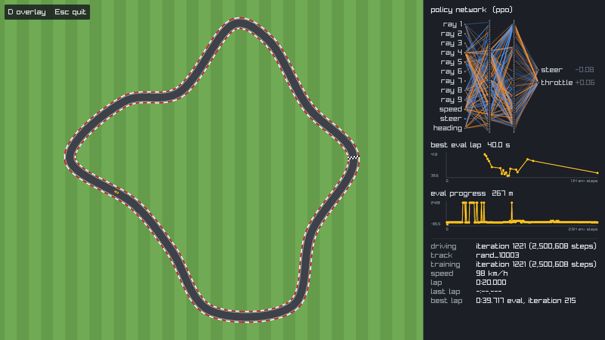

# 09 · Generalization: random tracks, held-out tracks, and what transfers

Every policy in lessons 04-08 trained on one track and was tested on the same one. A driver that
laps twisty might have learned to drive, or might have learned twisty. This lesson trains PPO on
a fresh random track every rollout ([`configs/ppo_random.toml`](../../configs/ppo_random.toml)),
tests it on ten random tracks it never trained on and on twisty, and gives lesson 07's PPO, trained
on twisty alone, the same test. The results were not the ones the setup was built to show:

- **The random-track PPO laps held-out tracks, on every seed.** The final checkpoints drove both
  laps on 6, 8 and 7 of the 10 held-out tracks. That is the spec's bar, met.
- **The twisty-only PPO did as well or better on the same tracks.** At the same 2.5M-step budget
  its checkpoints drove both laps on 9, 10 and 7 of them (its 4.5M-step finals on 10, 10 and 7).
  On the held-out set, as a group, the twisty-only drivers showed no overfitting to twisty. One
  seed did over-specialize, and experiment 2 finds a direction bias. The held-out tracks are
  easier than twisty in the one way that matters most for this car: none has a hairpin.
- **The random-track PPO lost twisty.** One seed lapped twisty early in its run, at 39.72 s,
  faster than any twisty-trained PPO in lesson 07, and stopped lapping it before the halfway point.
  At the end, all three crash at the first hairpin.
- **Both fail a mirror test.** Every track in the project turns mostly left. Mirror the tracks and
  10 of the 12 checkpoints tested lap fewer of them, the random-track ones most of all.
- **Why the random-track runs did not do better:** with `track_every = 1` each track is driven for
  one 8.53 s rollout from a standing start, about the first fifth of a lap. Experiment 1 changes
  that one number, and with a tenth of the tracks driven whole, PPO lapped twisty and the held-out
  set more often on both seeds tried, in less than half the budget.

Files: [`racer/trackgen.py`](../../racer/trackgen.py), [`racer/algos/ppo.py`](../../racer/algos/ppo.py),
[`configs/ppo_random.toml`](../../configs/ppo_random.toml), [`racer/sim.py`](../../racer/sim.py),
[`tests/test_trackgen.py`](../../tests/test_trackgen.py), [`tests/test_ppo.py`](../../tests/test_ppo.py),
and the measurement scripts [`heldout_eval.py`](scripts/heldout_eval.py),
[`heldout_history.py`](scripts/heldout_history.py), [`rollout_reach.py`](scripts/rollout_reach.py),
[`corner_speed.py`](scripts/corner_speed.py).

## Memorizing, generalizing, and what this policy can see

In supervised learning, generalization has a standard test: hold out data the model never trained
on and compare its error there with its error on the training data. The difference is the
*generalization gap*. A model that memorized its training set has a large one.

RL has the same idea with one twist: the agent produces its own training data by acting, so "the
training set" is really a distribution over situations, set by the environment and by the policy
itself. Train on one track and that distribution is the situations one track produces. Train on
random tracks and it is the situations the track generator produces. Holding out tracks means
holding out samples from the same generator. That tests *in-distribution* generalization: new
tracks, same kind of tracks. A track unlike anything the generator makes, like twisty with its
hairpin, is *out of distribution*, and a much harder test.

What can this policy memorize? Look at what it sees
([`sim.py#L247-L261`](../../racer/sim.py#L247-L261), lesson 03): nine ray distances out to 60 m,
its speed, its steering angle, and the angle between its heading and the road's. There is no
position and no progress along the lap. The network cannot know *where* on twisty it is, only what
the next 60 m of road look like from the driver's seat. So "memorizing twisty" cannot mean
memorizing a sequence of corners. It can only mean a reaction map, from what the rays show to what
to do, that is right for the situations twisty produces and wrong for others. A policy with
position in its input could memorize; this one can only over-specialize. Keep that in mind when
reading the results: it is the most likely reason the twisty-only driver transfers as well as it
does.

One rule of test-set hygiene matters below. If you pick the checkpoint to report by its held-out
score, the held-out set becomes part of training (a validation set), and its score is no longer
an honest test. So every checkpoint in this lesson is chosen without looking at the held-out
tracks: either the **final** one, or the **best** one by the twisty evaluation that training logs
(most laps, then fastest lap, then most meters; for a run that lapped twisty, its fastest-lap
checkpoint). The same rule applies to both groups of runs. The flip side: twisty picks the "best"
checkpoint, so that checkpoint's own twisty figures, such as seed 0's 39.72 s below (the best of
245 evaluations), are optimistic for both groups, like lesson 07's per-run fastest laps.

## Random tracks and the held-out set

[`random_track`](../../racer/trackgen.py#L113-L138) places 12 control points at sorted, jittered
angles around a circle, each at a random radius of 80-160 m, and fits the same closed spline as
the hand-drawn tracks (lesson 01). Sorted angles make the loop star-shaped, so it winds once round
the center and never crosses itself at the control points. The spline between them can still
bulge or pinch, so every candidate goes through
[`track_is_valid`](../../racer/trackgen.py#L97-L110) (no wall crossings, no corner tighter than
width/2 + 3 m radius, no two distant stretches of road within one road width + 4 m) and is redrawn
if it fails.

One seed gives one track ([`track_for_seed`](../../racer/trackgen.py#L141-L143)). Seeds
10,000-10,009 are the held-out set ([`heldout_tracks`](../../racer/trackgen.py#L146-L149)), and
[`training_seed`](../../racer/trackgen.py#L152-L157) redraws any training seed that lands in that
range, so a run can never train on a held-out track.
[`heldout_eval.py`](scripts/heldout_eval.py) measures them:

```sh
uv run python docs/lessons/scripts/heldout_eval.py
```

| track | length | tightest corner radius | sharpest turn within 60 m | turning to the right |
|---|---|---|---|---|
| heldout_10000 | 761.1 m | 11.8 m | 102° | 17% |
| heldout_10001 | 804.5 m | 15.6 m | 96° | 18% |
| heldout_10002 | 828.7 m | 11.4 m | 112° | 17% |
| heldout_10003 | 868.4 m | 12.5 m | 104° | 23% |
| heldout_10004 | 888.3 m | 14.1 m | 98° | 26% |
| heldout_10005 | 737.9 m | 18.2 m | 87° | 13% |
| heldout_10006 | 814.1 m | 9.9 m | 109° | 27% |
| heldout_10007 | 860.9 m | 14.6 m | 99° | 21% |
| heldout_10008 | 861.1 m | 18.0 m | 88° | 12% |
| heldout_10009 | 798.0 m | 9.7 m | 114° | 22% |
| **twisty** | 1,126.4 m | 12.0 m | **175°** | 27% |
| oval | 713.6 m | 38.9 m | 74° | 2% |
| first 200 training tracks of a seed-0 run | 721.0-1,005.4 m | 9.0-28.6 m | 65-124° | 7-32% |

The columns measure different things:

- **Length.** The held-out tracks are 737.9-888.3 m, two thirds of twisty.
- **Tightest corner radius** is the local measure `track_is_valid` uses (a circle through three
  centerline points 6 m apart). On this measure the held-out tracks are *not* gentler than twisty:
  four have a tighter point than twisty's 12.0 m, and the grip limit `v = √(12 · r)` says
  10.8-14.8 m/s through them against 12.0 m/s for twisty's tightest point.
- **Sharpest turn** is the largest change of road heading within any 60 m of centerline, and this
  is where twisty is different. Its hairpin turns the car round, 175° in 60 m. No held-out track
  turns more than 114° in 60 m, and none of the first 200 training tracks more than 124°. The
  star shape is the likely reason: angles around the center only increase, so the road tends to
  kink rather than double back. A random-track run is unlikely ever to drive a hairpin.
- **Turning to the right** is the share of all the road's turning that bends right. Every track
  here runs counter-clockwise (random tracks by construction, twisty and oval as drawn), so most
  turning is to the left: 12-27% to the right on the held-out set, 27% on twisty. Experiment 2
  uses this.

So "laps on the held-out tracks" and "laps on twisty" are different tests. The held-out tracks
are shorter and have no hairpin, but they do have short corners as tight as twisty's tightest. A
driver that laps them has shown it can handle sharp kinks; it has not shown it can handle a
hairpin.

## Training on a new track every rollout

Random mode is a few lines of [`train_ppo`](../../racer/algos/ppo.py), with everything else
unchanged from lesson 07:

- [ppo.py#L201-L207](../../racer/algos/ppo.py#L201-L207): `track` (twisty) stays the
  *evaluation* track, so the `eval_*` columns mean the same as in a fixed-track run. The run gets
  its own track RNG, seeded with the run's seed, and the sim starts on a random training track.
- [ppo.py#L225-L236](../../racer/algos/ppo.py#L225-L236): every `track_every` rollouts,
  `set_track` and a full `reset()` move all 16 cars to a new track. The switch happens between
  rollouts: the previous rollout has already taken its bootstrap value from the old track, and
  the next starts from fresh observations, so no advantage estimate spans two tracks. The partial
  episodes it cuts are dropped.
- [ppo.py#L330-L335](../../racer/algos/ppo.py#L330-L335): each evaluation also drives one
  deterministic episode on each held-out track and logs the mean laps as `eval_heldout_laps_mean`.
  Each episode can score 0, 1 or 2 laps, so the mean runs 0-2, and 2.00 means every held-out track
  was driven both laps.

That reset has a consequence that is easy to miss. A `reset()` puts every car back on the start
line, standing still ([`sim.py#L147-L153`](../../racer/sim.py#L147-L153); `random_start` is off).
With `track_every = 1` a track is driven for exactly one rollout: 128 decisions × 4/60 s =
**8.53 s**. [`rollout_reach.py`](scripts/rollout_reach.py) drives the final policies on each run's
first 20 training tracks for that window:

```sh
uv run python docs/lessons/scripts/rollout_reach.py runs/ppo-20261123-235521-s0 runs/ppo-20261123-235522-s1 runs/ppo-20261123-235524-s2
```

```
runs/ppo-20261123-235521-s0 (iteration 1221): window 128 decisions = 8.53 s per track; furthest point reached on 20 training tracks: median 177 m (123 .. 215), median 21% of a lap
runs/ppo-20261123-235522-s1 (iteration 1221): window 128 decisions = 8.53 s per track; furthest point reached on 20 training tracks: median 167 m (136 .. 189), median 20% of a lap
runs/ppo-20261123-235524-s2 (iteration 1221): window 128 decisions = 8.53 s per track; furthest point reached on 20 training tracks: median 173 m (0 .. 212), median 21% of a lap
```

(The 0 m is real: on one of seed 2's training tracks the deterministic driver never leaves the
start line. We did not measure whether the noisy training cars, which sample actions around that
mean, get moving there.) So the training data is the first ~170 m of
each track, from a standing start, again and again. The car never drives the other four fifths of
any training track, never completes a lap during training, and only rarely ends an episode: the
`train_return_mean` column is empty on 927, 941 and 968 of the three runs' 1,221 iterations,
because no car crashed or finished in those rollouts. The evaluation, meanwhile, drives full 90 s
episodes. Experiment 1 asks what this costs.

## Results: random-track PPO, three seeds

Three main runs with `configs/ppo_random.toml` unchanged (the lesson 07 PPO settings, a new
training track every rollout, 2.5M env steps, an evaluation every 10,240 steps), seeds 0, 1, 2,
started together on the dev machine on 2026-11-23 and sharing it with up to three experiment runs.
They took 1,367, 1,733 and 1,617 s, 1.6-2.1 times `configs/budgets.md`'s ~830 s for a run alone.

```sh
uv run racer train ppo --config configs/ppo_random.toml --seed 0          # and --seed 1, 2
uv run python docs/lessons/scripts/heldout_history.py runs/ppo-20261123-235521-s0 runs/ppo-20261123-235522-s1 runs/ppo-20261123-235524-s2
uv run python docs/lessons/scripts/heldout_eval.py runs/ppo-20261123-235521-s0 runs/ppo-20261123-235521-s0@best ...   # and s1, s2
```

| seed | run directory | held-out mean ≥ 1.0 first | held-out 2.00 first | evaluations at 2.00 (of 245) | twisty: evaluations that lapped |
|---|---|---|---|---|---|
| 0 | `runs/ppo-20261123-235521-s0` | 163,840 steps | 430,080 steps | 10 | 18, the last at iteration 530 |
| 1 | `runs/ppo-20261123-235522-s1` | 143,360 steps | 143,360 steps | 47 | 0 |
| 2 | `runs/ppo-20261123-235524-s2` | 184,320 steps | never | 0 | 0 |

and the checkpoints, driven by `heldout_eval.py` (whose held-out means equal the
`eval_heldout_laps_mean` each run logged at those iterations, a check that the script measures the
same thing):

| seed | checkpoint | held-out mean laps | held-out tracks driven both laps | twisty |
|---|---|---|---|---|
| 0 | final (iteration 1221) | 1.20 | 6 / 10 | crash at 266.7 m |
| 0 | best (iteration 215) | 1.80 | 9 / 10 | **2 laps, best 39.72 s** |
| 1 | final | 1.60 | 8 / 10 | crash at 294.0 m |
| 1 | best (iteration 145) | 2.00 | 10 / 10 | crash at 313.5 m |
| 2 | final | 1.40 | 7 / 10 | crash at 286.1 m |
| 2 | best (iteration 300) | 1.80 | 9 / 10 | crash at 296.1 m |

(Seeds 1 and 2 never lapped twisty, so their "best" checkpoint is the evaluation that got
furthest round it.)

**The spec's bar, checked.** Random-track PPO must complete laps on held-out tracks. Every seed
does, final checkpoint included: 6, 8 and 7 of the 10 tracks driven both laps. So the bar passes.
The partial failure is reported alongside it: no final checkpoint laps twisty, and only seed 1's
held-out score kept rising through the run (seed 2 plateaued from the second quarter on, and seed 0
barely moved).

**It is noisy, and it does not settle.** The held-out mean jumps between evaluations: seed 0 went
from 1.60 at iteration 150 to 0.00 at iteration 155 and back to 1.80 at iteration 160. Per quarter
of each run (`heldout_history.py`), the median held-out mean was:

| seed | Q1 | Q2 | Q3 | Q4 |
|---|---|---|---|---|
| 0 | 1.00 | 1.00 | 1.00 | 1.20 |
| 1 | 0.90 | 1.20 | 1.60 | 1.80 |
| 2 | 1.00 | 1.40 | 1.40 | 1.40 |

Seed 1 kept improving all run. Seed 2 rose in the second quarter, then stayed at 1.40. Seed 0
barely moved (1.00 for three quarters, 1.20 in the last), and all its perfect evaluations came in
the first half. These are single deterministic
episodes per track, so one track changing its mind moves the mean by 0.1 or 0.2. Read the trend,
not individual points.

### Where the random-track drivers crash

Per held-out track, final checkpoints (2 = both laps; otherwise where the car crashed):

| track | tightest corner | random s0 | random s1 | random s2 | twisty-only s0 | twisty-only s1 | twisty-only s2 |
|---|---|---|---|---|---|---|---|
| heldout_10000 | 11.8 m | 2 | 2 | 2 | 2 | 2 | 2 |
| heldout_10001 | 15.6 m | 2 | 2 | 2 | 2 | 2 | 2 |
| heldout_10002 | 11.4 m | 593.2 m | 621.5 m | 612.4 m | 2 | 2 | 2 |
| heldout_10003 | 12.5 m | 2 | 2 | 2 | 2 | 2 | 2 |
| heldout_10004 | 14.1 m | 2 | 2 | 2 | 2 | 2 | 538.7 m |
| heldout_10005 | 18.2 m | 2 | 2 | 2 | 2 | 2 | 2 |
| heldout_10006 | 9.9 m | 700.1 m | 2 | 701.1 m | 2 | 2 | 267.8 m |
| heldout_10007 | 14.6 m | 675.9 m | 2 | 2 | 2 | 2 | 196.4 m |
| heldout_10008 | 18.0 m | 2 | 2 | 2 | 2 | 2 | 2 |
| heldout_10009 | 9.7 m | 214.8 m | 248.3 m | 586.2 m | 2 | 2 | 2 |
| twisty | 12.0 m | 266.7 m | 294.0 m | 286.1 m | 1 lap | 1 lap | 1 lap |

(Random = `runs/ppo-20261123-235521-s0`, `-235522-s1`, `-235524-s2`; twisty-only = lesson 07's
`runs/ppo-20261123-220355-s0`, `-220356-s1`, `-220358-s2`, whose 1-lap twisty finals are lesson
07's slowdown: still driving when the 90 s limit ends the episode.)

The random-track drivers fail on the tracks with the tightest corners: 10002, 10006 and 10009, the
three tracks with a point tighter than 11.5 m, account for 8 of their 9 crashes. The crashes are at
those corners. 10002's tightest point is 603 m from the start, and the three crashes are at
593-622 m. 10009 has corners of 11.5 m at 224 m and 9.7 m at 580 m, and its crashes are at 215,
248 and 586 m. The two crashes on 10006, at 700-701 m, come at a 13.6 m corner at 698 m that leads
into its 9.9 m one. [`corner_speed.py`](scripts/corner_speed.py) shows what went wrong on 10002:

```sh
uv run python docs/lessons/scripts/corner_speed.py 10002 runs/ppo-20261123-235521-s0 ...
```

Within 20 m of the apex, the three crashing finals never got below 14.7-19.5 m/s before they
crashed. Every driver that got through slowed to 6.4-13.7 m/s there, against a grip-limit speed of
11.7 m/s. That covers all six twisty-only checkpoints and the three random-track "best" ones. The
random-track finals brake too late for tight corners. On twisty they crash at 266.7-294.0 m, at the
hairpin where the drivers lesson 08 compared braked to 8.7-12.0 m/s.

That fits the 8.53 s window. A car that starts from rest and drives 170 m meets the first corners
of each track at modest speed. Arriving at a tight corner *fast*, which is what teaches braking
(lesson 02), happens rarely in that window and not at all at the end of a long straight. Twisty
puts its hairpin at the end of its opening straight, where lesson 07's fastest drivers reached
about 34 m/s.

### Twisty: one seed lapped it, briefly and fast

Seed 0 first lapped twisty at iteration 135 (276,480 steps). Its fastest lap, 39.72 s at iteration
215, is faster than every lap our fixed-track PPO or SB3 set in lesson 07 (their fastest were
41.53-42.93 s), and close to A2C's 39.03 s. Seventeen of its 18 lapping evaluations came by
iteration 305. The last came at iteration 530 (1,085,440 steps), and none of the 139 evaluations
after it lapped. Seeds 1 and 2 never lapped twisty. The best seed 1 did was 313.5 m and seed 2
296.1 m, both at the hairpin.

So a driver that, as far as we measured, never trained on a hairpin could, for a while, drive
twisty faster than drivers trained on it. Its hairpin skill came from somewhere else, perhaps from
tight kinks like those on 10002 and 10009, and it was not stable. Probably nothing in the training
data rewards it directly: none of the training tracks we measured (the first 200 of a seed-0 run)
turns more than 124° in 60 m.

## The contrast: PPO trained on twisty only

Lesson 07's three PPO runs (`configs/ppo.toml`, twisty only, 4.5M steps), driven on the same ten
held-out tracks. Their budget was 4.5M steps against 2.5M for the random-track runs, so the table
also has their checkpoint at iteration 1220 (2,498,560 steps), the same budget:

```sh
uv run python docs/lessons/scripts/heldout_eval.py runs/ppo-20261123-220355-s0 runs/ppo-20261123-220355-s0@best runs/ppo-20261123-220355-s0@1220 ...   # and s1, s2
```

| seed | final (4.5M): held-out mean, tracks both laps | at 2.5M (iteration 1220) | best (iteration): held-out | twisty (from lesson 07) |
|---|---|---|---|---|
| 0 | 2.00, 10 / 10 | 1.80, 9 / 10 | 2.00, 10 / 10 (110) | best 42.13 s, final 1 lap |
| 1 | 2.00, 10 / 10 | 2.00, 10 / 10 | 2.00, 10 / 10 (270) | best 42.43 s, final 1 lap |
| 2 | 1.40, 7 / 10 | 1.40, 7 / 10 | 1.80, 9 / 10 (150) | best 41.53 s, final 1 lap |

(The twisty laps this script drives reproduce lesson 07's logs: 42.13, 42.43 and 41.53 s for the
best checkpoints; 51.53, 52.65 and 46.13 s for the finals.)

At equal budget the twisty-only checkpoints drove both laps on 9, 10 and 7 held-out tracks, against
6, 8 and 7 for the random-track finals. Training on one track did not make PPO worse on new tracks
here. Three reasons fit what was measured:

- **The policy cannot memorize a place,** only a reaction to what the rays see (above). Twisty's
  situations, a long straight into a hairpin, a chicane, long curves, seem to cover the situations
  the held-out tracks produce: the held-out tracks' sharpest turns (87-114° in 60 m) are milder than
  twisty's hairpin, and their tightest points (9.7-18.2 m) sit around twisty's 12.0 m.
- **Twisty-only training drives the whole track.** Its cars keep driving between rollouts and
  respawn only when an episode ends, so they cover every corner at racing speed, laps included.
  The random-track runs cover the first ~170 m of each track from rest.
- **Twisty-only seed 2 is the exception,** and it shows over-specialization can happen: its final
  crashed on 10004, 10006 and 10007 (at 538.7, 267.8 and 196.4 m), tracks the other two seeds
  lapped. With one policy per seed, we cannot say why that seed and not the others.

## What transfers, and what does not

- **Reaction maps transfer within the kind of track they learned.** Both kinds of driver lap most
  held-out tracks. At the same 2.5M-step budget, the twisty-only checkpoints drove both laps in 26
  of 30 track-runs and the random-track finals in 21 of 30. The twisty-only 4.5M-step finals drove
  27 of 30.
- **Held-out success does not certify twisty.** The random-track finals lap 6-8 held-out tracks
  each and crash at twisty's hairpin, a corner shape none of the measured training tracks has.
  Held-out tracks from the same generator test the generator's range, not the world's.
- **A rare skill is fragile.** Seed 0's 39.72 s twisty lap came early and went: its last lapping
  evaluation was at iteration 530 of 1,221. Nothing in the training distribution kept it.
- **What the training data covers matters more than how many tracks it comes from.** 2,500,608
  steps over 1,221 tracks gave no more held-out skill than the same steps on one track driven
  whole (6, 8 and 7 tracks driven both laps against 9, 10 and 7). Experiment 1 tests the coverage
  explanation directly.
- **Direction is part of what was learned.** Every track turns mostly left. Experiment 2 mirrors
  them, and 10 of 12 checkpoints lap fewer of them.

## What to look for in the viewer

`racer watch` drives the run's checkpoint on the run's eval track unless `--track` names
another. To watch a random-track driver on a held-out track, write that track to a file (inside
`runs/`, which git ignores) and pass it. Its ghosts were recorded on twisty, so turn them off:

```sh
uv run racer gen-track --seed 10003 --out runs/tracks/heldout_10003.json
uv run racer watch runs/ppo-20261123-235521-s0 --track runs/tracks/heldout_10003.json --ghosts 0
```



(Screenshot: the same `watch` command with `--screenshot docs/img/generalization.png
--frames 1200`, so 20.000 s into the lap.) The status block says what is on screen: driving
iteration 1221 (2,500,608 steps), track `rand_10003` (the name `gen-track` gives seed 10,003's
track, the same road as `heldout_10003`), speed 98 km/h, lap 0:20.000, no last lap yet. The track
is one of the generator's blobs. The start line, the checkered strip, is at the far right, and the
loop runs counter-clockwise like every track here. The car, small and yellow, is on the lower-left
side of the loop. This final policy drives this track both laps with a best lap of 32.70 s
(`heldout_eval.py`). The side panel plots `metrics.csv`, which holds the *twisty* evaluations:
**eval progress** sits near 300 m for most of the run, the hairpin, with a cluster of two-lap
spikes early on and one more at about 1.1M steps (seed 0's 18 lapping evaluations, the last at
iteration 530), and the final evaluation's 267 m at the label. The **best eval lap** panel's axis
ends at 1.1M steps, that last lapping evaluation. The status line **best lap 0:39.717 eval,
iteration 215** is the fastest twisty lap from the results above. The held-out evaluations are not
plotted; `heldout_history.py` summarizes them.

## Experiments

Each experiment ships with a prediction to make before you look. Experiment 1 trains; experiment
2 only evaluates checkpoints that already exist.

### 1. A new track every rollout, or every 10: `track_every` 1 vs 10

**Change.** `track_every = 10`: each track is kept for 10 rollouts (1,280 decisions, 85.33 s)
before the switch. The cars auto-respawn after a crash or the end of an episode, so they drive
whole laps of each track. The cost is ten times fewer tracks: 49 in 1M steps instead of 489.
Budget **1,000,000 env steps** (`--set env_steps_budget=1000000`), seeds 0 and 1.

**Predict.** More tracks or more of each track? With `track_every = 10` the policy sees far fewer
road shapes. Do you expect it to overfit those 49 tracks and do worse on the held-out set, or does
driving whole laps at speed teach more than meeting more starting stretches? What about twisty's
hairpin, which (as far as we measured) neither setting trains on?

**Run.**

```sh
uv run racer train ppo --config configs/ppo_random.toml --set env_steps_budget=1000000 --set track_every=10 --seed 0   # and --seed 1
uv run racer train ppo --config configs/ppo_random.toml --set env_steps_budget=1000000 --seed 0                        # track_every = 1
uv run python docs/lessons/scripts/heldout_history.py runs/<run>
uv run python docs/lessons/scripts/heldout_eval.py runs/<run>
uv run python docs/lessons/scripts/rollout_reach.py runs/<run>
```

<details><summary>What we got</summary>

Four arms, 2026-11-23 and 24, sharing the machine with the three main runs. The 1M-step runs took
499 s (`track_every = 1`) and 743 and 736 s (`track_every = 10`). Expect more than 5 minutes on
your own machine too. Every evaluation also drives the 10 held-out tracks, so 1M steps at
`configs/budgets.md`'s 3.0k steps/s is about 333 s even on an idle machine. And `track_every = 10`
took about 1.5 times as long as `track_every = 1` under the same sharing, most likely because its
better policies drive full two-lap evaluation episodes instead of crashing early (not measured
separately). For `track_every = 1`, seed 0 was run on its own
(`runs/ppo-20261123-235707-s0`); its `metrics.csv` turned out identical, row for row except wall
time, to the first 488 rows of the main seed 0 run (row 489 is the 1M run's end-of-budget evaluation,
which the main run does not have), because PPO does not depend on its budget until
it stops. So seed 1's `track_every = 1` arm is the main seed 1 run up to 1,001,472 steps
(`heldout_history.py --until 1001472`, 97 evaluations; its last checkpoint inside the budget is
iteration 485) instead of a duplicate run.

| `track_every` | seed | run directory | tracks driven | held-out 2.00 first | evaluations at 2.00 | twisty: evaluations that lapped | fastest twisty lap | final: held-out mean (both laps) | final: twisty |
|---|---|---|---|---|---|---|---|---|---|
| 1 | 0 | `runs/ppo-20261123-235707-s0` | 489 | 430,080 steps | 9 of 98 | 17 of 98 | 39.72 s | 1.80 (9 / 10) | crash at 295.2 m |
| 10 | 0 | `runs/ppo-20261123-235709-s0` | 49 | 174,080 steps | 32 of 98 | 38 of 98 | 39.82 s | **2.00 (10 / 10)** | **2 laps, 40.45 s** |
| 1 | 1 | `runs/ppo-20261123-235522-s1` (to 1M) | 489 | 143,360 steps | 5 of 97 | 0 of 97 | – | 1.40 (7 / 10), iteration 485 | crash at 296.0 m |
| 10 | 1 | `runs/ppo-20261124-000011-s1` | 49 | 143,360 steps | 37 of 98 | 45 of 98 | **39.42 s** | 1.80 (9 / 10) | **2 laps, 41.22 s** |

- **Fewer tracks, driven whole, won on both seeds on most measures.** The exceptions are seed 0's
  fastest twisty lap (39.72 s for `track_every = 1`, 39.82 s for 10) and seed 1's first perfect
  held-out evaluation (143,360 steps in both arms, a tie). Held-out evaluations
  at a perfect 2.00: 32 and 37 against 9 and 5. Twisty evaluations that lapped: 38 and 45 against
  17 and 0. Both `track_every = 10` finals lap twisty; neither `track_every = 1` final does. Seed
  1's `track_every = 1` arm never lapped twisty in 1M steps, or in its full 2.5M.
- **The coverage changed, as intended.** `rollout_reach.py` on the finals: 8.53 s per track and a
  median 185 m (21% of a lap) for `track_every = 1`, seed 0; 85.33 s and 1,707 m (seed 0) and
  1,674 m (seed 1), more than a full lap, for `track_every = 10`.
- **Twisty laps without training on a hairpin** (as far as we measured). The `track_every = 10`
  seeds first lapped twisty at 174,080 and 143,360 steps, with fastest laps of 39.82 and 39.42 s, faster than every
  fixed-track PPO and SB3 lap in lesson 07 (41.53-42.93 s), in under a quarter of their budget. Their
  quarter medians of the twisty lap fell from 43.15 / 42.07 s to 40.33 / 40.42 s
  (`heldout_history.py`), but the drop came early: from Q3 to Q4 they went 40.43 -> 40.33 s and
  40.13 -> 40.42 s, so lap times had levelled off. Seed 0 was still getting more reliable (two-lap
  twisty evaluations: 7 in Q3, 19 in Q4); seed 1 less clearly (11, then 13).
- **`track_every = 1`, seed 0, collapsed late:** its held-out mean was 0.0-0.4 for every evaluation
  from iteration 370 to 455, then climbed back to 1.80 by iteration 485. The longer main run logged
  the same rows; after them it reached 2.00 once more, at iteration 535, and never again.
- **The held-out track 10009 (9.7 m corner) stopped seed 1's `track_every = 10` final**, at
  578.8 m, the same corner that stops the main runs. Driving whole laps helps; it does not make
  the tightest kinks easy.

Two seeds and 1M steps: this says `track_every = 10` is better *here, early*. It does not say how
it ends after 2.5M steps, or that 10 is the best value. Neither was measured. A third option the
project has but did not test is `random_start = true`, spawning cars at random points so that even
short windows cover whole tracks. It would also move the evaluation's start, so evaluations would
no longer be comparable with every other run.

</details>

### 2. Mirror the tracks

**Change.** Nothing is trained. [`heldout_eval.py --mirror`](scripts/heldout_eval.py) rebuilds
every held-out track and twisty from its control points with `y → -y`. Each left bend becomes the
same bend to the right, the loop runs clockwise, and the right-hand share of the turning goes
from 12-27% to 73-88%. Length, radii and sharpest turns are unchanged, and the mirrored tracks pass
`track_is_valid`.

**Predict.** The observation is symmetric: the nine rays fan out evenly from -90° to +90°
([`sim.py#L87`](../../racer/sim.py#L87)), and steering and heading error are signed. A driver that
learned "corners" should not care which way they turn. Both groups trained only on mostly-left
tracks. Which group do you expect to suffer more? The twisty-only driver, which saw one track, or
the random-track driver, which saw 1,221?

**Run.**

```sh
uv run python docs/lessons/scripts/heldout_eval.py --mirror runs/ppo-20261123-235521-s0 runs/ppo-20261123-235521-s0@best ...   # all twelve checkpoints
```

<details><summary>What we got</summary>

Held-out mean laps (0-2), normal / mirrored:

| group | seed | final checkpoint | best checkpoint | mirrored twisty, final / best |
|---|---|---|---|---|
| random-track | 0 | 1.20 / **0.40** | 1.80 / **0.70** | crash 279.2 m / crash 277.4 m |
| random-track | 1 | 1.60 / **1.40** | 2.00 / **1.40** | 0 laps (time limit at 283.9 m) / crash 286.0 m |
| random-track | 2 | 1.40 / **0.20** | 1.80 / **0.40** | crash 280.0 m / crash 286.7 m |
| twisty-only | 0 | 2.00 / **1.80** | 2.00 / **1.00** | 1 lap (51.68 s) / crash 292.8 m |
| twisty-only | 1 | 2.00 / **2.00** | 2.00 / **2.00** | 1 lap (55.38 s) / **2 laps, 42.27 s** |
| twisty-only | 2 | 1.40 / **0.50** | 1.80 / **0.00** | crash 383.8 m / crash 284.4 m |

- **Mirroring hurt 10 of the 12 checkpoints,** and the two it did not hurt are twisty-only seed 1.
  The mean over the 12 dropped from 1.75 to 0.98. Neither kind of driver learned a symmetric skill
  from mostly-left tracks.
- **The random-track drivers suffered more, though at equal budget only a little more.** The
  table compares 2.5M-step random-track runs with 4.5M-step twisty-only ones. Over all six
  checkpoints per group, random-track went from 1.63 to 0.75 and twisty-only from 1.87 to 1.22. At
  the same 2.5M budget (twisty-only iteration 1220, mirrored: 1.20, 2.00 and 0.00, against 1.80,
  2.00 and 1.40 unmirrored), the twisty-only mean went from 1.73 to 1.07 and the random-track finals'
  from 1.40 to 0.67. That keeps 62% against 48%. No random-track checkpoint laps mirrored
  twisty. Seeing 1,221 tracks did not help when every one of them ran counter-clockwise. Diversity
  only covers what the generator varies, and this generator never varies the direction.
- **Twisty-only seed 1 is mirror-proof:** 2.00 on the mirrored held-out set with both checkpoints,
  and its best checkpoint drove mirrored twisty in 42.27 s, against 42.43 s the right way round.
  The same algorithm, settings and track gave one seed a symmetric driver and two seeds lopsided
  ones. We cannot tell from the outside which you will get.
- The obvious fix, not built here, is to mirror training tracks at random, a cheap form of data
  augmentation.

</details>

## Tests worth reading

| test | what it pins |
|---|---|
| [`test_heldout_disjoint_from_training_seeds`](../../tests/test_trackgen.py#L33-L38) | 5,000 training seeds drawn as a run draws them never hit seeds 10,000-10,009: no run trains on a held-out track |
| [`test_training_seed_redraws_inside_heldout_range`](../../tests/test_trackgen.py#L41-L48) | a draw that lands in the held-out range is thrown away and redrawn |
| [`test_heldout_tracks_are_fixed`](../../tests/test_trackgen.py#L51-L53) | the held-out set is the same tracks every time, so every run is tested on the same ten |
| [`test_random_tracks_valid`](../../tests/test_trackgen.py#L15-L22) | 50 generated tracks pass an independent wall-crossing check and stay 400-1,400 m long |
| [`test_set_track_applies_on_reset`](../../tests/test_sim.py#L220-L228) | a new track takes effect only at `reset()`, and the car spawns at its start line: the standing start of every training track |
| [`test_ppo_random_tracks_smoke`](../../tests/test_ppo.py#L65-L82) | with `track_every = 2`, 6 iterations switch tracks exactly twice, and evaluations log `eval_heldout_laps_mean` |
| [`test_gen_track_round_trip`](../../tests/test_trackgen.py#L96-L102) | `racer gen-track` writes the same track `track_for_seed` builds, which is what lets the viewer show a held-out track |

Next: 10 · Results (coming): every method side by side, by env steps and by wall-clock time.
