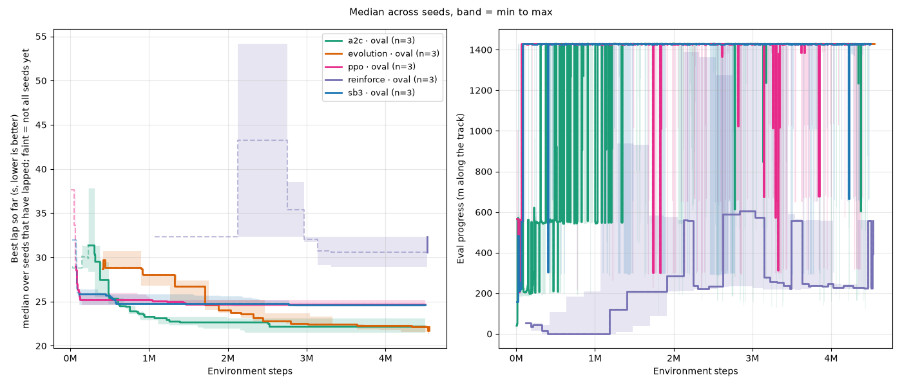
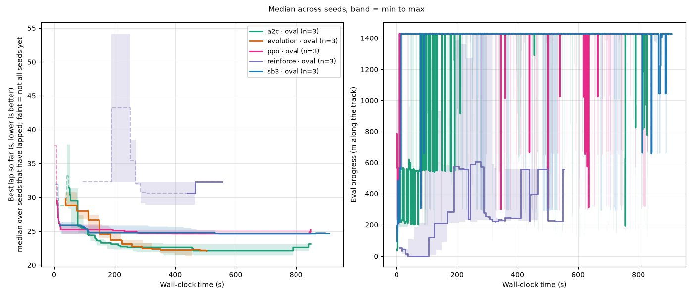
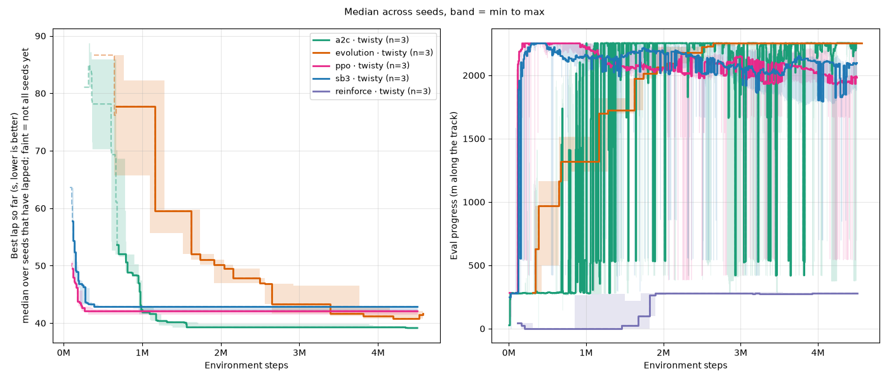
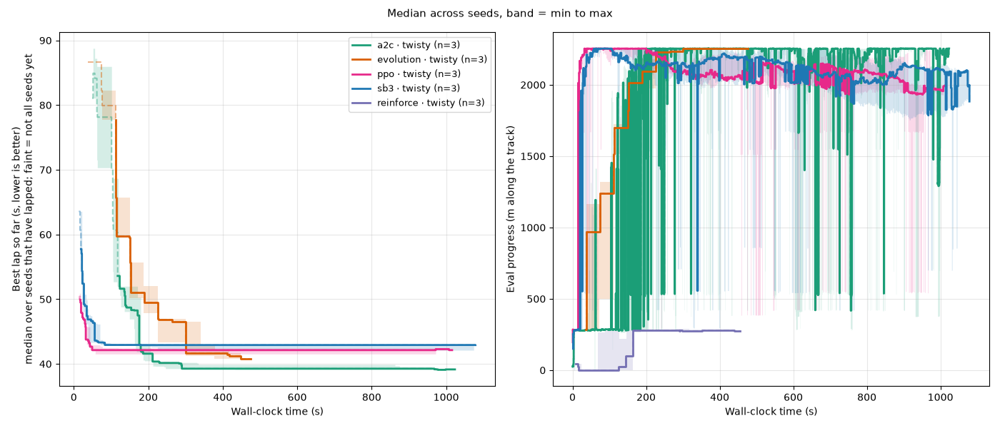

# 10 · Results: every method side by side

Lessons 04-09 built and measured the learning methods one at a time. This one puts them next to each other on
the same budget: three seeds per method on twisty and on the oval, 4.5M env steps each, the
default reward. It checks every success bar the project set itself before the first line of
code, shows the comparison plots against env steps and against wall-clock time, and explains why
the two plots rank the methods differently. Then it says what each method is good for and lists
what is worth trying next, none of it tested yet.

Every number here comes from a run directory named next to it, or from an earlier lesson's
section, linked. The per-run numbers come from
[`docs/lessons/scripts/final_table.py`](scripts/final_table.py), new in this lesson.

## The success bars, checked

The spec's "Success looks like" section, bar by bar
([design spec](../superpowers/specs/2026-11-23-rl-racer-design.md#success-looks-like)):

| bar | outcome | evidence |
|---|---|---|
| The owner can drive the car on both tracks. | **For the owner to confirm** | `uv run racer drive --track oval` and `--track twisty` ([lesson 02](02-car-physics.md#what-to-look-for-in-the-viewer), [`drive.py`](../../racer/drive.py)). Claude can render drive mode ([`docs/img/drive.png`](../img/drive.png) is a `--screenshot` render) but cannot press the keys. |
| Every method completes clean laps on `oval.json`. | **Partial: four of five methods; REINFORCE is a spec deviation** | Evolution, A2C, our PPO and SB3 lap the oval on 3 of 3 seeds, final evaluations included ([oval results](#the-oval)). REINFORCE: its trained *stochastic* policy laps on every seed (at least one lap in 21-23 of 32 sampled episodes, both laps in 14-15), but its deterministic mean, which every evaluation drives, crashes in all three final evaluations, and seed 1's mean never lapped in any of its 28 evaluations ([lesson 05](05-reinforce.md#results-three-seeds-on-each-track)). The bar is judged on its intent (REINFORCE learned to drive the oval) and reported here as a deviation, not a pass. |
| On `twisty.json`, evolution, A2C and PPO complete clean laps; REINFORCE may fail, reported honestly. | **Pass** | All three lap twisty on 3 of 3 seeds ([twisty table](#twisty-the-main-comparison)). Final evaluations: evolution 3 of 3 drive both laps; A2C 2 of 3 (seed 2's final crashed at 856 m after hundreds of lapping evaluations); our PPO 3 of 3 complete one clean lap and are still driving when the 90 s limit ends the episode (the late slowdown of [lesson 07](07-ppo.md#but-it-gets-slower)). REINFORCE never lapped twisty on any seed ([lesson 05](05-reinforce.md#results-three-seeds-on-each-track)), which is why lesson 06 adds a critic. |
| Our PPO laps twisty in at least 2 of 3 seeds, best lap within 10% of SB3's under the same budget. | **Pass** | 3 of 3 seeds; best lap 41.53 s against SB3's 42.12 s, 1.4% faster ([lesson 07](07-ppo.md#results-our-ppo-against-sb3-three-seeds-each)). |
| Generalization: PPO trained on random tracks completes laps on held-out tracks (partial failure acceptable, reported). | **Pass, with a reported partial failure** | Final checkpoints drove both laps on 6, 8 and 7 of the 10 held-out tracks. PPO trained on twisty alone did as well or better on the same tracks (9, 10 and 7 at the same budget), and no random-track final laps twisty ([lesson 09](09-generalization.md#results-random-track-ppo-three-seeds)). |
| Lap times visibly improve in the viewer and in the comparison plot. | **Pass for the plot; the viewer for the owner to confirm** | In the plots below the median best lap falls from 77.72 s at 1M steps to 40.78 s at 4.5M for evolution, and from 78.14 s at 500k steps (two seeds lapping) to 39.15 s for A2C. The viewer draws ghost cars of earlier best laps and a best-lap curve ([lesson 04](04-neural-nets-and-evolution.md#watching-it-learn) shows them in a screenshot). One caveat both views share: "best lap so far" only goes down, and PPO's *current* driver gets slower late in its runs ([lesson 07](07-ppo.md#but-it-gets-slower)). |
| The owner can point at any behaviour in the viewer and find the code that causes it. | **For the owner to confirm** | What exists for it: the `D` overlay (walls, centerline, rays), the live network panel ([lesson 00](00-overview.md#what-to-look-for-in-the-viewer)), a viewer section in each of lessons 00-09 ("What to look for in the viewer", "Watching it learn" in lesson 04) that links the lines behind each behaviour, and a link check that runs with the test suite, [`tests/test_doc_links.py`](../../tests/test_doc_links.py): every relative link in the README and the docs resolves (files exist, line ranges are inside the file, heading anchors exist). It cannot tell whether a line range still shows what its link text describes; those were checked by hand after the last code changes. Whether that is enough to find *any* behaviour is the owner's call. |

And the rules for runs ([spec](../superpowers/specs/2026-11-23-rl-racer-design.md#runs-budgets-and-reproducibility-claudes-calls)):

| rule | outcome | evidence |
|---|---|---|
| Every method gets the same env-step budget per track, fixed before the main runs. | **Pass** | 4,500,000 on both tracks for all five ([`configs/budgets.md`](../../configs/budgets.md)); runs stop at the first check past it (4,500,480-4,568,870 steps). |
| Plots against env steps and wall-clock time, and a discussion of why the ranking differs. | **Pass** | [Two plots, two rankings](#two-plots-two-rankings). |
| Main results use 3 seeds and report ranges. | **Pass** | Every table below. |
| A main training run takes at most about 15 minutes. | **Partial** | Evolution and REINFORCE took 408-556 s. A2C, PPO and SB3 took 971-1,079 s (16-18 min) on twisty and 790-911 s on the oval, with about five other training runs sharing the machine (the "other runs" columns below); `budgets.md` estimated ~850-900 s for PPO and SB3 alone. The fast-lap and random-track runs of lessons 08 and 09 took longer still under heavier sharing (up to 1,931 s). |
| A lesson experiment takes at most about 5 minutes. | **Partial: exceeded in lessons 05, 08 and 09, and said so there** | Wall time is the last `wall_time_s` in each run's `metrics.csv`. Within it, or about it: lesson 04's experiments took 124-286 s, lesson 05's `gamma` runs 171-177 s, lesson 06's 253-364 s, lesson 07's 260-347 s, and this lesson's [Experiment 1](#1-evaluate-less-often) 240 and 125 s. Over it: lesson 05's [batch-size and learning-rate experiment](05-reinforce.md#2-batch-size-and-learning-rate) uses the full 4.5M budget (401-436 s; the lesson says "about 7 min per run"), lesson 08's [experiments](08-fastest-lap.md#experiments) took 206-534 s six at a time with other runs ("a few went over the 5-minute target"), and lesson 09's [experiment 1](09-generalization.md#1-a-new-track-every-rollout-or-every-10-track_every-1-vs-10) took 499-743 s for 1M steps, because every evaluation also drives the 10 held-out tracks ("Expect more than 5 minutes"). |

## Twisty: the main comparison

Fifteen runs, all with the defaults in `configs/<method>.toml`, seeds 0, 1, 2, 2026-11-23. They
are the main runs of lessons 04-07, compared here for the first time on one plot:

```sh
uv run racer compare runs/evolution-20261123-200006-s0 runs/evolution-20261123-200008-s1 runs/evolution-20261123-200010-s2 \
    runs/reinforce-20261123-204932-s0 runs/reinforce-20261123-204933-s1 runs/reinforce-20261123-204935-s2 \
    runs/a2c-20261123-205730-s0 runs/a2c-20261123-205731-s1 runs/a2c-20261123-205732-s2 \
    runs/ppo-20261123-220355-s0 runs/ppo-20261123-220356-s1 runs/ppo-20261123-220358-s2 \
    runs/sb3-20261123-220359-s0 runs/sb3-20261123-220400-s1 runs/sb3-20261123-220401-s2 --out results/ --name final
uv run python docs/lessons/scripts/final_table.py runs/evolution-20261123-200006-s0 ...   # the same 15
```

(Name the runs: `runs/ppo-*` would also pick up the fast-lap, random-track and experiment PPO
runs. `compare` would keep them apart, since it groups by method, track, env config and the
method's own settings with the seed left out, but the plot would then hold 20 PPO groups.)

`racer compare`'s table (appended to [`results/summary.md`](../../results/summary.md)):

| group | seeds | success | best lap s, median (range) | env steps to first lap | wall s to first lap |
|---|---|---|---|---|---|
| a2c · twisty | 3 | 3/3 | 39.15 (39.03–39.27) | 317,440 | 51.7 |
| evolution · twisty | 3 | 3/3 | 40.78 (40.77–41.67) | 649,193 | 75.4 |
| ppo · twisty | 3 | 3/3 | 42.13 (41.53–42.43) | 102,400 | 15.3 |
| reinforce · twisty | 3 | 0/3 | – | – | – |
| sb3 · twisty | 3 | 3/3 | 42.92 (42.12–42.93) | 102,400 | 16.7 |

"Success" is a seed with at least one lapping evaluation at any point; "best lap" is the fastest
lap any evaluation drove (lesson 08 explains [which best lap](08-fastest-lap.md#results-the-fast-lap-reward-against-the-default-three-seeds-each)).
Neither says how the run *ended*, so `final_table.py` adds that:

| method | first lapping evaluation, env steps | evaluations that lapped | final evaluation | wall time | steps/s | of which evaluating | other runs at the same time |
|---|---|---|---|---|---|---|---|
| evolution | 383,855-669,230 | 32 of 35 | 3 of 3: 2 laps (40.77, 41.67, 40.78 s) | 408-476 s | 9.5-11.1k | 7-8 s (2%) | 1.7-2.0 |
| REINFORCE | never | 0 of 133 | 3 of 3: crash at 277-278 m | 437-455 s | 9.9-10.3k | 2-54 s (0-12%) | 4.9-5.0 |
| A2C | 261,120-680,960 | 1,765 of 2,637 | 2 laps on seeds 0, 1 (41.75, 41.50 s); seed 2 crash at 856 m | 977-1,024 s | 4.4-4.6k | 602-650 s (62-63%) | 4.9-5.0 |
| our PPO | 92,160-112,640 | 1,232 of 1,320 | 3 of 3: 1 lap in 90 s, no crash (51.53, 52.65, 46.13 s) | 971-1,016 s | 4.4-4.6k | 380-425 s (39-42%) | 4.9-5.0 |
| SB3 PPO | 81,920-112,640 | 1,228 of 1,320 | 3 of 3: 1 lap in 90 s, no crash (54.30, 49.27, 48.83 s) | 1,072-1,079 s | 4.2k | not measurable | 4.8 |

The last two columns matter for the wall-clock plot and are explained [below](#two-plots-two-rankings).

What the table says, method by method (the lessons have the why):

- **A2C set the fastest laps** (39.03-39.27 s), and did not settle: its final evaluations went 2
  of 3, and between 10% and 30% of its evaluations after a run's first lap failed ([lesson 06](06-a2c.md#results-three-seeds-on-each-track)).
- **Evolution was slow to start and solid at the end.** It needed the most steps to a first lap,
  but every final evaluation drove both laps, and its best lap *is* its final lap on all three
  seeds. Elitism copies the best genomes unchanged into every generation, so a driver that laps
  is not lost to a bad update; no evaluation after a seed's first lap failed to lap ([lesson 04](04-neural-nets-and-evolution.md#results-three-seeds-on-twisty)).
- **PPO and SB3 were the most sample-efficient by far** (first laps after 81,920-112,640 steps,
  three to six times fewer than A2C and evolution) and, once lapping, the steadiest of the gradient
  methods: 1,232 and 1,228 of 1,320 evaluations lapped. Both then slow down late in the run as their exploration
  noise collapses ([lesson 07](07-ppo.md#but-it-gets-slower)), so every final evaluation drives
  one lap where their best checkpoints drove 41.5-42.9 s laps.
- **REINFORCE never got past the first hairpin** on any seed ([lesson 05](05-reinforce.md#results-three-seeds-on-each-track)).

## The oval

Fifteen runs on `oval.json` at the same 4.5M-step budget (`--set track=oval`). REINFORCE's and
A2C's are lesson 05's and 06's oval main runs. Evolution, PPO and SB3 had no oval main runs until
this lesson; they were run for it on 2026-11-24 the way their twisty runs were, PPO and SB3 six at
once, then the three evolution seeds together:

```sh
uv run racer train ppo --seed 0 --set track=oval        # and --seed 1, 2; the same for sb3, then evolution
uv run racer compare runs/evolution-20261124-010807-s0 runs/evolution-20261124-010808-s1 runs/evolution-20261124-010810-s2 \
    runs/reinforce-20261123-204929-s0 runs/reinforce-20261123-204930-s1 runs/reinforce-20261123-204931-s2 \
    runs/a2c-20261123-205726-s0 runs/a2c-20261123-205727-s1 runs/a2c-20261123-205728-s2 \
    runs/ppo-20261124-005242-s0 runs/ppo-20261124-005244-s1 runs/ppo-20261124-005245-s2 \
    runs/sb3-20261124-005247-s0 runs/sb3-20261124-005248-s1 runs/sb3-20261124-005250-s2 --out results/ --name final_oval
uv run python docs/lessons/scripts/final_table.py runs/evolution-20261124-010807-s0 ...   # the same 15
uv run python docs/lessons/scripts/eval_history.py runs/evolution-20261124-010807-s0 ... --short
```

| group | seeds | success | best lap s, median (range) | env steps to first lap | wall s to first lap |
|---|---|---|---|---|---|
| a2c · oval | 3 | 3/3 | 22.15 (21.52–23.13) | 148,480 | 41.4 |
| evolution · oval | 3 | 3/3 | 22.13 (21.35–22.32) | 416,542 | 37.0 |
| ppo · oval | 3 | 3/3 | 24.67 (24.50–25.23) | 51,200 | 7.3 |
| reinforce · oval | 3 | 2/3 | 30.61 (28.90–32.32) | 1,598,192 | 141.9 |
| sb3 · oval | 3 | 3/3 | 24.65 (24.48–24.77) | 71,680 | 11.9 |

| method | first lapping evaluation, env steps | evaluations that lapped | after the first lap, evaluations that did not | final evaluation | wall time | of which evaluating | other runs at the same time |
|---|---|---|---|---|---|---|---|
| evolution | 407,810-444,023 (the first evaluation, generation 5) | 45 of 45 | 0 | 3 of 3: 2 laps (21.35, 22.13, 22.32 s) | 432-503 s | 0-11 s (0-2%) | 1.9-2.0 |
| REINFORCE | 1,071,712 and 2,124,672; seed 1 never | 10 of 84 | 33 of 43 (seeds 0 and 2) | 3 of 3: crash at 225-558 m | 438-556 s | 3-30 s (1-5%) | 4.8-5.0 |
| A2C | 25,600-230,400 | 2,109 of 2,637 | 452 of 2,561 | 3 of 3: 2 laps (28.82, 27.92, 30.35 s) | 790-849 s | 418-474 s (53-56%) | 5.0-5.1 |
| our PPO | 10,240-61,440 | 1,205 of 1,320 | 106 of 1,311 | 3 of 3: 2 laps (27.57, 24.97, 26.68 s) | 844-849 s | 252-261 s (30-31%) | 5.0 |
| SB3 PPO | 20,480-112,640 | 1,202 of 1,320 | 101 of 1,303 | 3 of 3: 2 laps (28.90, 24.97, 25.02 s) | 865-911 s | not measurable | 4.7-4.9 |

(REINFORCE's row is the deterministic mean, which is what `compare` and every evaluation drive;
its sampled policy laps on every seed, [lesson 05](05-reinforce.md#results-three-seeds-on-each-track).
Its seed 0 wall time is inflated by processes started by mistake, as lesson 05 discloses.)





(At the right edge of each plot a median line can jump: a seed that has finished stops
contributing, and the median is then of the seeds still running. REINFORCE's best-lap line also
jumps up at about 2.1M steps for the same kind of reason: seed 2 lapped for the first time, slowly,
and joined the median.)

The oval tells the same story as twisty, with smaller gaps:

- **Every method but REINFORCE ends with clean laps on every seed**: all twelve final
  evaluations of evolution, A2C, PPO and SB3 drive both laps. That is the spec's oval bar for four
  methods.
- **PPO and SB3 lap first by steps again** (medians 51,200 and 71,680 steps), then A2C (148,480),
  then evolution, which lapped at its very first evaluation on every seed (generation 5), and
  REINFORCE's mean on two seeds after 1-2M steps.
- **A2C and evolution set the fastest laps, tied** (medians 22.15 and 22.13 s), about 2.5 s ahead
  of both PPOs (24.65-24.67 s). Lesson 02's constant-speed controller needed 30.28 s.
- **Evolution again never lost a lap once it had one** (0 of 45 evaluations); A2C again lost the
  most (452 of 2,561 after the first lap, 18%), PPO and SB3 sit between (106 and 101, about 8%).
- **Wall clock:** evolution finished in 432-503 s, A2C, PPO and SB3 in 790-911 s. The same
  evaluation effect is there, smaller for PPO than on twisty (30-31% of its wall time against
  39-42%), because a two-lap oval evaluation is under a minute of driving (46-60 s, from the final
  evaluations' returns) where the late twisty ones ran into the 90 s limit.

## Two plots, two rankings





`final_table.py --at` reads the same running-best curves at fixed budgets (median over the seeds
that had lapped, and how many had):

```
uv run python docs/lessons/scripts/final_table.py --at runs/evolution-20261123-200006-s0 ...   # the same 15

best lap so far, median over seeds that had lapped (lapped/seeds), at env steps:
group                          250,000         500,000       1,000,000       2,000,000       3,000,000       4,500,000
a2c · twisty                   - (0/3)     78.14 (2/3)     42.32 (3/3)     39.27 (3/3)     39.27 (3/3)     39.15 (3/3)
evolution · twisty             - (0/3)     86.63 (1/3)     77.72 (3/3)     50.22 (3/3)     43.33 (3/3)     40.78 (3/3)
ppo · twisty               42.67 (3/3)     42.13 (3/3)     42.13 (3/3)     42.13 (3/3)     42.13 (3/3)     42.13 (3/3)
reinforce · twisty             - (0/3)         - (0/3)         - (0/3)         - (0/3)         - (0/3)         - (0/3)
sb3 · twisty               46.33 (3/3)     42.93 (3/3)     42.92 (3/3)     42.92 (3/3)     42.92 (3/3)     42.92 (3/3)

best lap so far, median over seeds that had lapped (lapped/seeds), at s:
group                               30              60             120             300             450             900
a2c · twisty                   - (0/3)     84.14 (2/3)     53.60 (3/3)     39.27 (3/3)     39.27 (3/3)     39.27 (3/3)
evolution · twisty             - (0/3)     86.63 (1/3)     59.73 (3/3)     46.52 (3/3)    40.78 (3/3)*    40.78 (3/3)*
ppo · twisty               46.20 (3/3)     42.13 (3/3)     42.13 (3/3)     42.13 (3/3)     42.13 (3/3)     42.13 (3/3)
reinforce · twisty             - (0/3)         - (0/3)         - (0/3)         - (0/3)        - (0/3)*        - (0/3)*
sb3 · twisty               48.95 (3/3)     43.58 (3/3)     42.93 (3/3)     42.92 (3/3)     42.92 (3/3)     42.92 (3/3)
```

(`*`: at least one seed had already finished its 4.5M steps and holds its final best lap.)

**By env steps**, PPO and SB3 lead the whole first million: they have 42-46 s laps by 250,000
steps, when nobody else has lapped. A2C passes them at about 1M steps and stays ahead.
Evolution is last of the lappers until late: its median best lap beats PPO's 42.13 s only at
3,388,831 steps, three quarters of the way through the budget. Final order: A2C, evolution, PPO,
SB3, with REINFORCE nowhere.

**By wall-clock time**, the start looks the same (PPO and SB3 first, at 13-19 s), but evolution
moves up. It beats PPO's 42.13 s median at 301 s, and finishes all 4.5M steps in 408-476 s, when
the PPO runs had done about 2.0M steps of theirs (2,007,040-2,017,280 at 450 s). Give every
method 450 seconds instead of 4.5M steps and evolution's 40.78 s beats PPO's 42.13 s; give every
method 1M steps and PPO's 42.13 s beats evolution's 77.72 s.

Why the same runs rank differently, from the largest effect to the smallest:

1. **Evaluation is on the wall clock, and the methods evaluate at very different rates.** Each
   trainer stamps `wall_time_s` on a row *before* that row's evaluation and checkpoint, so their
   cost shows up as extra time on the next row ([`final_table.py`](scripts/final_table.py)'s
   docstring has the method). An evaluation is one car driving a whole episode alone, up to
   1,350 decisions, about one second here (in the A2C runs the median row after an evaluation took
   0.93-0.95 s, a plain row 0.040 s). A2C evaluates every 10 updates of 512 decisions,
   879 times per run, and those evaluations were **62-63% of its wall time**. PPO and SB3
   evaluate every 10,240 decisions, 440 times: **39-42%** for our PPO (SB3 logs only at
   evaluations, so its share cannot be read this way; same cadence, so presumably similar).
   Evolution evaluates every 5 generations, 11-13 times: 2%. Take the evaluations out and the
   training speeds differ far less (point 2 has the numbers). So a large part of A2C's and
   PPO's wall-clock curve is the cost of *measuring* them, a cadence set in each config for the
   plots' sake, not part of learning. Experiment 1 changes only that cadence.
2. **What one env step costs differs, but less than you might guess.** Without evaluations,
   training ran at 12.0-12.1k steps/s for A2C, 10.2-11.2k for REINFORCE, 9.7-11.3k for evolution
   and 7.6k for PPO (`final_table.py` on the twisty runs). Only PPO stands out: 10 epochs of 8
   minibatches of 256 is 80 Adam steps per 2,048 decisions, 20 times as many per decision as A2C's
   one step per 512. Reusing each sample ten times saves samples, not time, and in this project
   samples are cheap. Evolution's step has no gradient at all and is still not cheaper than A2C's,
   partly because its generations keep simulating cars that crashed long ago: `BatchSim.step`
   moves, projects and crash-checks every car and only then keeps the old state of the frozen
   ones ([sim.py lines 192-218](../../racer/sim.py#L192-L218)), and casts every car's rays
   ([lines 229-230](../../racer/sim.py#L229-L230)). A frozen car costs compute but no env steps, so it
   lowers steps per second (lesson 04's [speed note](04-neural-nets-and-evolution.md#results-three-seeds-on-twisty));
   we did not profile further. So against PPO, evolution's lead on the clock is part training cost
   and part evaluation; against A2C it is all evaluation: without its 879 evaluations, A2C's
   4.5M steps would have taken about 375 s, less than evolution's 408-476 s.
3. **The machine was shared differently.** The evolution runs had about 2 other training runs
   alongside on average; REINFORCE, A2C, PPO and SB3 about 5 (`final_table.py`, which counts only
   runs still under `runs/`; lessons 05 and 06 disclose extra processes started by mistake for a
   few minutes, so their real load was higher). On 16 hardware threads with 2 torch threads per
   run, it is a smaller effect than 1 and 2, but it pushes in the same direction: it flatters
   evolution's wall clock. Experiment 1 gives one measure of it: A2C's training parts ran at 13.1k
   steps/s with the default settings when only the two experiment runs shared the machine, and
   at 12.0-12.1k in the main runs with about five others alongside, about 8% slower.
4. **SB3 runs its own Python per step** (buffer, callbacks, logger, info dicts), 5-11% slower
   than ours for the same steps ([lesson 07](07-ppo.md#results-our-ppo-against-sb3-three-seeds-each)).

None of these touch the steps plot: an env step is an env step however long it takes and
whatever else the machine is doing. That is why the lessons quote steps first. Which axis to
trust depends on what is scarce. When experience is expensive (a real robot, a slow simulator),
the steps plot is the one that matters, and PPO's 100,000 steps to a first lap is the result. When
the simulator is cheap, as here, wall clock is what you pay, and a sample-hungry method can win on
it if its steps are cheap enough. But check what the clock is measuring: here, most of what put
evolution ahead was that it evaluated 11-13 times per run where A2C evaluated 879 times and PPO
440.

## What each method is good for

Here, on this task, with these budgets:

- **Neuroevolution**: the simplest learner (no gradients, no critic, no probability
  distributions) and the most dependable *final* driver: on both tracks every final evaluation
  lapped, at its best lap time, and once it lapped it never lost the lap in an evaluation. Its
  weaknesses are sample hunger (384k-669k steps to a first lap on twisty) and traps: a reward that ranks cars badly can stall it for a whole run, as at the
  hairpin under the fast-lap reward ([lesson 08](08-fastest-lap.md#evolution-stuck-at-the-first-hairpin-on-every-seed)).
  Good for: problems where you only have a score at the end, and a first baseline.
- **REINFORCE**: the policy gradient with nothing added, which is what it is for. It shows the
  theorem working (the noisy driver laps the oval) and every reason the later methods exist:
  noisy gradients, few updates, and a mean policy that nothing trains ([lesson 05](05-reinforce.md#results-three-seeds-on-each-track)).
  Good for: understanding, not for driving.
- **A2C**: the fastest twisty laps in the project (39.03 s), and tied with evolution on the oval,
  from a critic and bootstrapped returns, with far cheaper training steps than PPO's. It never
  settles: 10-30% of evaluations after the first lap fail, and you cannot trust whichever
  checkpoint the run ends on. Good for: quick runs where you keep the best checkpoint, not the last.
- **PPO (ours)**: the most sample-efficient and, once lapping, the steadiest of the gradient
  methods; it matched SB3, which is what made it trustworthy. Its known problem here is the late slowdown as `log_std`
  collapses. Good for: the default choice, provided you keep the best checkpoint or fix the
  slowdown (below).
- **SB3 PPO**: the answer key. Same results as ours within seed noise, a little slower per step.
  Good for: checking a from-scratch implementation, and for real work where you would not write
  PPO yourself.

## Where to go next

None of these were tried in this project; they are ideas, with the lesson that suggests each.

- **Stop PPO slowing down late** ([lesson 07](07-ppo.md#but-it-gets-slower)): an entropy bonus or a
  floor on `log_std`, a learning rate that decays to zero, or SB3's `target_kl`. The time-cost
  changes lesson 08 tried did not help; these change the optimizer, where lesson 07 traced the
  slowdown.
- **Random tracks, driven longer** ([lesson 09](09-generalization.md#1-a-new-track-every-rollout-or-every-10-track_every-1-vs-10)):
  `track_every = 10` did better than `track_every = 1` on most measures, on both seeds tried, at
  1M steps. Not measured: a full 2.5M-step run, three seeds, other values, or
  `random_start = true`.
- **A curriculum for evolution under the fast-lap reward** ([lesson 08](08-fastest-lap.md#tuning-the-time-cost-a-second-attempt)):
  learn to lap under `env.toml`, then raise the time cost.
- **Mirrored tracks** ([lesson 09](09-generalization.md#2-mirror-the-tracks)): every track turns
  mostly left, and mirroring hurt 10 of 12 checkpoints; training on both directions is the
  obvious next test.
- **SAC** (soft actor-critic): an off-policy method that keeps a replay buffer of old experience
  and maximizes reward plus entropy. The replay buffer attacks sample cost from another side than
  PPO's epochs, and the entropy term is meant to keep the policy from collapsing to nearly
  deterministic, which is what PPO's std did here.
- **Drift physics**: the car is grippy by design ([lesson 02](02-car-physics.md)); tyre slip would
  make braking and corner entry harder, and the observation (which has no slip angle today) might
  no longer be enough.
- **The Detailed look**: gravel, trees, grandstand, tyre marks; a rendering project, not a learning one.
- **A track editor**: tracks are JSON control points or `racer gen-track` today ([lesson 01](01-track-and-geometry.md)).

The last three were out of scope by design (spec non-goals), not left unfinished.

## Experiments

### 1. Evaluate less often

**Change.** A2C evaluates every 10 updates (`eval_every = 10` in
[`configs/a2c.toml`](../../configs/a2c.toml)). Set it to 100 and train 1.5M steps.

**Predict.** Will the learning, step for step, change? How much shorter will the run be? (The
twisty main runs spent 62-63% of their wall time evaluating.)

**Run.**

```sh
uv run racer train a2c --set env_steps_budget=1500000
uv run racer train a2c --set env_steps_budget=1500000 --set eval_every=100
uv run python docs/lessons/scripts/final_table.py runs/a2c-<first run> runs/a2c-<second run>
```

<details><summary>What we got</summary>

Runs `runs/a2c-20261124-011656-s0` (`eval_every = 10`) and `runs/a2c-20261124-011657-s0`
(`eval_every = 100`), seed 0, twisty, started together on an otherwise idle machine, 2026-11-24:

| `eval_every` | run directory | evaluations | wall time | evaluating (`final_table.py`) | training alone | first lapping evaluation | fastest lap seen | final evaluation |
|---|---|---|---|---|---|---|---|---|
| 10 | `runs/a2c-20261124-011656-s0` | 293 | 240 s | 126 s (53%) | 13.1k steps/s | 261,120 steps | 40.15 s | 2 laps, 40.98 s |
| 100 | `runs/a2c-20261124-011657-s0` | 30 | 125 s | 12 s (9%) | 13.2k steps/s | 358,400 steps | 40.98 s | 2 laps, 40.98 s |

- **The learning did not change at all.** Every training column of `metrics.csv` (`env_steps`,
  `train_return_mean`, `log_std_mean`, `value_loss`, ...) is identical in all 2,930 rows, and so are
  the 30 evaluations both runs made (iterations 100, 200, ..., 2930). Evaluations drive a separate
  one-car simulator with the deterministic mean, so they draw none of the trainer's random
  numbers (the identical rows confirm it) and cannot change what it does.
  (Lesson 06's `runs/a2c-20261123-213731-s0`, the same settings run a day earlier with other runs
  alongside, matches both row for row too, apart from wall time.)
- **The run took half as long**: 125 s against 240 s. The script's row-timing estimate predicts
  the saving: 126 s of evaluating in the dense run minus the 12 s the sparse run still spent
  evaluating is 114 s, and the measured saving is 115 s, which is a check on that estimate; the
  training parts agree (13.1k and 13.2k steps/s).
- **What the cheaper run paid in measurement.** With an evaluation every 51,200 steps instead of
  every 5,120, the first lap shows up at 358,400 steps instead of 261,120, and the run's fastest
  lap, 40.15 s, happened at an iteration the sparse run never evaluated, so it reports 40.98 s.
  A sparse curve is a coarser picture of the same learning, not different learning.

So the wall-clock plot of this lesson partly measures each config's evaluation cadence, and the
steps plot does not. If you ever compare methods by wall clock, give them the same evaluation
cost, or subtract it.

</details>

### 2. Rank at your own budget

**Change.** Pick a budget in steps and one in seconds, other than the ones above.

**Predict.** Who leads after 1.5M steps? After 200 s?

**Run.** Edit `STEP_POINTS` and `TIME_POINTS` at the top of
[`final_table.py`](scripts/final_table.py), then:

```sh
uv run python docs/lessons/scripts/final_table.py --at runs/evolution-20261123-200006-s0 ...   # the 15 twisty runs above
```

<details><summary>What we got</summary>

Same 15 runs, `STEP_POINTS = [1_500_000]` and `TIME_POINTS = [200]`:

```
best lap so far, median over seeds that had lapped (lapped/seeds), at env steps:
group                        1,500,000
a2c · twisty               40.15 (3/3)
evolution · twisty         59.48 (3/3)
ppo · twisty               42.13 (3/3)
reinforce · twisty             - (0/3)
sb3 · twisty               42.92 (3/3)

best lap so far, median over seeds that had lapped (lapped/seeds), at s:
group                              200
a2c · twisty               41.58 (3/3)
evolution · twisty         49.53 (3/3)
ppo · twisty               42.13 (3/3)
reinforce · twisty             - (0/3)
sb3 · twisty               42.92 (3/3)
```

At both budgets the order is A2C, PPO, SB3, evolution. Evolution needs either most of the step
budget or about 300 s of clock before it passes PPO, so short budgets of either kind favour the
gradient methods. The two axes disagree most around 300-450 s, where evolution has already
finished and the gradient methods are less than half way through their steps.

</details>

## Tests worth reading

The comparison is only as good as the code that groups and summarizes runs:

| test | what it pins |
|---|---|
| [`test_summarize_groups_and_success`](../../tests/test_compare.py#L40-L50) | runs group by method and track, and a seed succeeds if any evaluation lapped |
| [`test_best_lap_so_far_is_running_min_over_eval_rows_only`](../../tests/test_compare.py#L53-L58) | "best lap so far" never gets worse and reads only evaluation rows |
| [`test_groups_split_by_track_and_env_hash`](../../tests/test_compare.py#L61-L72) | a different reward or track lands in a different group, never in the same median |
| [`test_groups_split_by_train_config_but_not_by_seed`](../../tests/test_compare.py#L75-L86) | seeds of one setup share a group; a different method setting (here `mutation_std`) gets its own |
| [`test_aggregate_steps_values_and_never_extrapolates`](../../tests/test_compare.py#L97-L108) | a seed holds its last value between evaluations and contributes nothing after its run ended |
| [`test_aggregate_best_lap_ignores_seeds_without_a_lap_yet`](../../tests/test_compare.py#L111-L118) | early in a run the median describes only the seeds that have lapped, and the plot says so |
| [`test_sb3_config_matches_ppo_toml`](../../tests/test_sb3.py#L40-L57) | every setting our PPO and SB3 share is the same number, evaluation cadence included |

That is the end of the lessons. [00 · Overview](00-overview.md) has the map if you want to go
round again.
